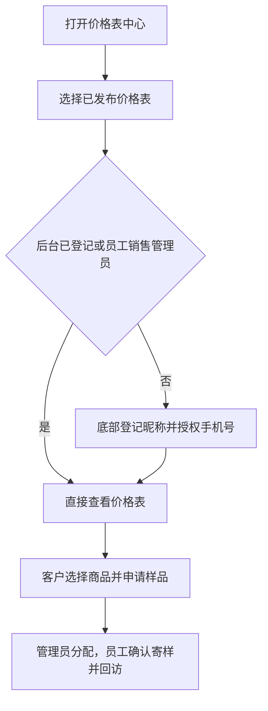

# 小程序价格表中心与登记用户

适用：PR-688、PR-689、PR-691、PR-692。客户入口：小程序首页“价格表”或底部“价格表”。固定路径：`pages/bean-list-center/bean-list-center`。管理员入口：系统设置 → 页面入口管理；登记用户在客户门户配置中查看。

## 流程图

## 客户如何查看

1. 打开价格表中心。无需登录即可浏览目录，搜索名称或版本；返回目录会恢复搜索和浏览位置。
2. 点击价格表。首次查看“登记用户可见”的普通价格表时，目录上直接从底部弹出登记面板；不用进入系统登录页。点昵称输入框选择微信建议的昵称，或自行填写，然后点“授权手机号并查看”。此处填写的是昵称，不是系统用户名。
3. 在微信弹出的手机号确认框中同意授权，验证成功后直接打开刚才选择的价格表，无需再点一次。微信确认框必须由本人确认；手工填写号码不能完成登记。拒绝授权后可以重试，或点“暂不查看”、右上角关闭、面板外空白处返回目录，搜索和浏览位置保留。直接链接进入时同样弹出面板，关闭回到价格表中心。
4. 再次打开、登录失效、清除本机缓存或同一微信换设备时，都先通过后台微信身份恢复登记资料。仅后台确认昵称或已验证手机号缺失时才弹出登记；网络错误显示重试，不当作未登记。停用账号仍禁止访问。
5. 在“我的 → 我的登记资料”修改昵称；更换手机号必须点击“重新授权手机号”。取消或验证失败保留原号码。

“我的订单”显示完整订单列表，最新订单排在前面，每页 20 条，可翻页查看历史；商品下单沿用现有流程。普通登记身份不代表客户业务权限：未匹配有效客户时，请使用已有客户账号登录或联系工作人员。一个小程序账号有多个有效客户且没有当前客户时，访问订单等客户业务先选择客户，再返回原功能；只查看普通登记价格表不需要选择客户。

## 在价格表中搜索和筛选

打开一张价格表后，使用顶部搜索框按部分名称、编号、风味、行业字段、规格、价格或说明搜索。英文不区分大小写；多个词用空格分开，需要同时匹配同一商品及其所属表头、分类文字。例如“浅烘 227g”可筛出浅烘且有 227g 价格规格的商品。此处只搜索当前表；目录搜索仍用于选择价格表。

点“筛选”从底部打开面板。行业字段和值来自该表当前发布版本，每项可以多选；同一项任意值匹配即可，不同项同时满足。商品标签可选“上新”“推荐”“无标签”；两种推荐样式统一筛选，商品仍显示原标签。点“显示结果”应用，关闭面板不应用未确认选择。“重置筛选”清除面板里的筛选；主页面“清空条件”同时清除搜索和筛选。

结果显示匹配数量，沿用原商品顺序；无结果时可一键清空。返回同一表会恢复查询条件；更换版本后移除不再存在的字段值。账号或客户切换后不复用另一身份的条件。行业字段按发布时模板顺序展示，标签紧跟商品名称右侧，长文字自然换行。

行业字段为发布快照：管理员在商品档案里改字段不会改变旧版本。已有结构化行业字段的发布版本无需重新发布价格表；历史只有文字行的版本仍可展示和全文搜索，但行业筛选需要选择包含结构化字段的发布版本。字段若为空、没有在发布时开启价格表展示，或目标版本不包含该字段，不会出现在面板里。升级小程序后，旧缓存会重新获取；入口停用、价格表撤回或权限失效时不会继续显示旧缓存。

## 配置价格表目录

需要系统设置维护权限。

1. 在“系统设置 → 页面入口管理”手工创建或编辑四个价格表入口：咖啡豆标准、咖啡豆一件代发、咖啡生豆、挂耳。
2. 分别选择实际价格表及指定发布版本，核对内容。系统不通过名称猜测用途。
3. 对官方公共价格表选择“登记用户可见”，勾选“展示在价格表中心”，设置目录排序（0–99999，数字小的靠前）。客户专属表不能使用登记范围或进入公共目录。
4. 保存草稿 → 手机预览 → 发布。只有已发布、已启用的配置出现在目录；保存草稿不会改变已发布卡片和内容。
5. 需要更换版本时手工选择版本并重新发布入口，固定路径不变。新增商品类型、复制表、发布新版都不会自动增加卡片或切换版本。

公开入口维持公开访问；历史“认证客户可见”入口不批量降级。停用或删除入口、撤回价格表后，目录移除卡片，直接路径和图片接口也拒绝访问，不自动替换内容。网页打开登记范围时显示到小程序查看的指引，网页密码登录不能绕过该范围。

## 登记用户管理

在“客户门户配置 → 登记用户”展开列表，按昵称或已验证手机号查询，查看登记时间和最近访问时间。读取需要客户读取权限，停用需要客户维护权限。停用前确认目标账号；停用后其会话立即失效，再次登记也不会自动恢复，不影响历史订单或客户档案。若需恢复，由管理员按账号治理流程处理。

登记资料单独保存，旧接口自行填写的手机号不作为验证凭证。只有验证号码唯一匹配有效 ERP 客户账号时，才复用已有有效客户绑定；无匹配或有歧义时仅获得登记身份。订单、专属价格和其他个人业务每次重新检查客户权限。

## 公众号导航及上线

在“系统设置 → 公众号管理 → 公众号菜单”点击“生成小程序导航草稿”，可得到：价格表、我的订单、下单三个一级菜单。先预览差异，正式后端与含价格表中心的小程序审核发布完成后，再明确发布菜单。生成草稿不会修改微信现有菜单。

旧“最近一次/最近三次”消息动作仅提示进入小程序，不再回复订单信息。个人中心不再提供获取、复制和发送绑定码的操作；历史关联保留兼容，不影响新流程。登记不依赖公众号 OpenID、UnionID 或网页授权。

## 常见问题与验收

- 目录为空：核对入口为价格表、已勾选目录、已发布且启用，目标版本未撤回。只保存草稿不生效。
- 手机号授权失败：面板会原地显示原因，重新点击授权；核对小程序自身手机号接口权限、隐私声明、服务端 AppID/密钥及当前环境配置。模拟凭证不能替代真机授权。
- 已登记但没有订单：这是正常的权限隔离。核对客户账号及有效客户绑定；不能通过姓名或自行填写手机号直接查订单。
- 多客户未选择：选择后继续；不能通过修改客户 ID 越权。
- 页面不可用：联系管理员核对启停、删除、目标版本和权限，不会自动显示另一张价格表。
- 测试环境包仅连接开发环境。Van 需在手机验证首次授权、取消授权、再次进入、手机号修改、四张表与客户订单；构建成功不代表微信审核发布。

接口实现使用小程序 `wx.login` 和手机号授权动态凭证，在服务端验证；昵称由用户选择/填写。参考：[腾讯小程序登录接入说明](https://cloud.tencent.com/document/product/1441/68677)。

## 员工访问与样品申请（PR-692）

销售或管理员使用员工账号登录后，首页显示“价格表中心”，可直接查看中心配置的官方已发布价格表，不需填写客户登记资料；其他员工角色不能借用此入口越权查看。客户专属价格仍按原客户权限执行。名称已统一，旧页面路径、分享链接和入口配置继续兼容。

客户在一张表中多选商品后申请样品，填写收件人、电话、地址和可选留言。提交成功后等待工作人员联系，在“我的样品申请”查看进度。收件电话修改不覆盖已验证手机号。在“客户门户配置 → 登记用户”可查看昵称、验证手机号、登记时间、最近访问和启停状态，点击“样品申请”查看该用户的申请记录。管理员分配、员工确认规格数量费用、正式下单与回访步骤见[样品申请与回访手册](OP_MANUAL_SAMPLES.md)。
