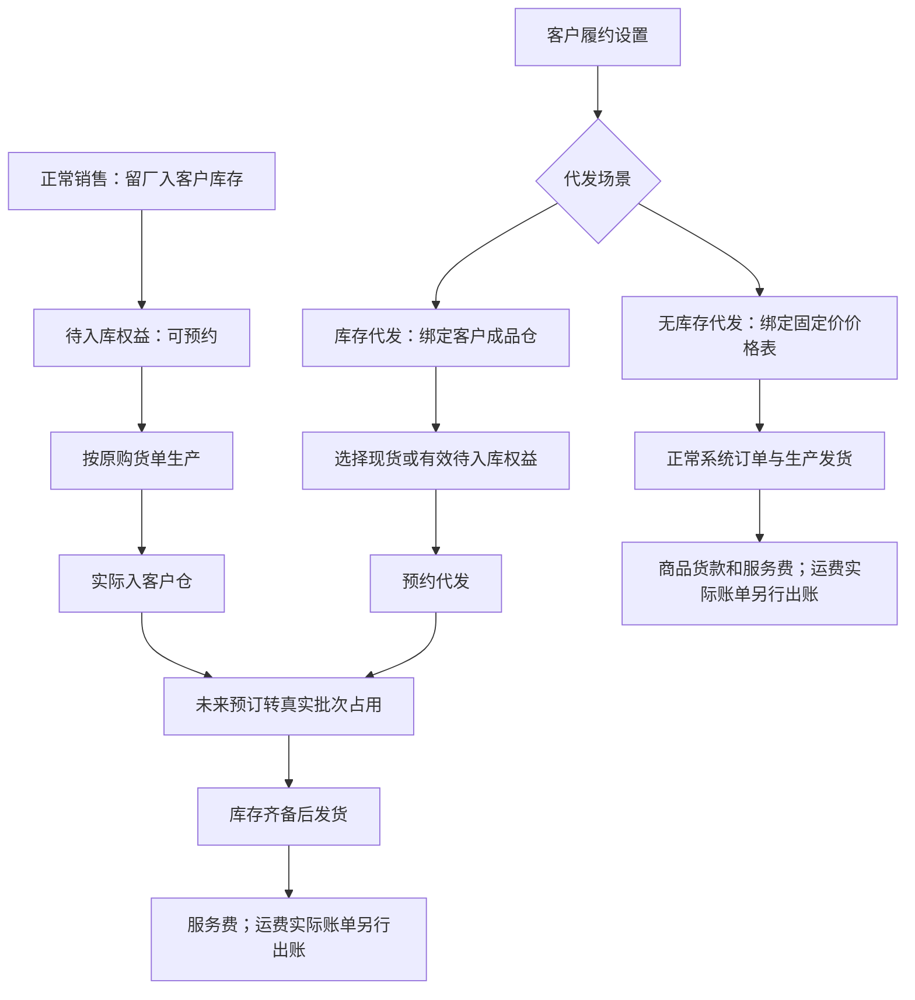

# 客户购货寄存与代发操作手册

适用角色：销售、客户履约运营、仓库、生产和财务；客户通过已授权的 ERP 客户工作台或小程序提交自己的代发。

## 流程图

## 配置与权限

1. 在客户履约设置分别启用“库存代发”和“无库存代发”。任一场景开启时，商品下单自动开启且不能单独关闭；全部代发场景关闭后恢复普通商品下单能力配置。两者都开通时，每张单必须明确选一种；保存设置后不受能力模板重新应用覆盖。
2. 库存代发选择当前客户的有效成品仓。点击旁边“打开仓库”，在右侧抽屉管理“虚拟仓库”下的子仓；默认筛选当前客户，可切换全部客户。新增默认归属当前客户、类型为成品仓，保存后自动选入本次代发配置草稿。其他客户或未绑定客户的仓库不能作为当前客户的代发仓。
3. 在“商品 → 商品价格表”，为无库存场景指定当前类别的“一件代发价格表”。公共表或当前客户专属表均可，必须已发布且未删除。绑定的是具体版本，发布新版后需明确改绑。
4. 每个可代发规格使用一个固定单价，无起订量或数量档位。普通商品下单继续使用其独立绑定和原有阶梯。提示多个价格时，请调整代发固定价，系统不会任选某档。
5. 每种场景分别维护代发服务费：每单固定费用、每个包装件费用，或两者相加。明确配置零费用才表示免费；未配置不是免费。
6. 在“设置 → 业务设置 → 物流设置”维护运费模板，再在已开启的代发场景区域内选择模板、附加费和包邮；与仓库及服务费一起点击“保存履约设置”。两种代发整体保存，任一校验错误或版本冲突全部不保存，页面输入保留。关闭场景隐藏配置并保留旧值。普通发货运费政策单独在物流设置维护，不是代发前提。运费仅预估，不计本次应付；实际Excel账单确认后单独出账，见[运费手册](OP_MANUAL_FREIGHT.md)。

### 虚拟仓库抽屉

- “虚拟仓库”只组织客户子仓，父级不承载库存；子仓继续使用原库存账。已有客户仓归入后，编码、库存和历史单据保持原样。
- 在抽屉按名称或客户查找仓库并翻页。新增填写名称、类型、说明和绑定客户；仓库编码由系统生成。编辑可修改名称、说明和客户归属，已有业务历史时不能更换客户。
- 删除为停用并保留历史；仓库有库存、预留、待入库权益或未完结业务时不能删除，按提示先处理原业务。保存失败保留表单，版本冲突时核对最新仓库再重试。
- 仓库操作即时保存并记录操作日志；代发运费、服务费和开关仍由外层“保存履约设置”提交。关闭抽屉不会清空外层草稿；删除已选草稿仓后需重新选择。

设置和调整接口只供有对应权限的内部员工使用。客户只能提交当前客户的商品、数量、收件信息和场景，不能通过请求改价、改货主或选择其他客户仓库。

## 地址簿与录单

ERP 履约录单和小程序代发共用当前客户的收件地址簿，可搜索、新增、编辑、删除、设默认及粘贴解析。选“仅本单使用”只保存本单收件快照；“保存并使用”才维护地址簿，不创建系统用户或客户档案。录单往返地址维护保留已选商品、数量和备注。

内部员工从“订单列表”打开库存代发或无库存代发订单，可在完整订单表单中修改收件信息、商品规格、数量、日期及备注，并核对服务费与运费后点击“保存订单”。库存代发从该客户全部有效现货及待入库权益选择，计算本单可用时包含原有占用；减少释放、增加重新占用，缺口先补购。商品款仍在原购货单，不重复收费。原订单号和代发申请保留，无需取消重下。

地址或商品数量变化时，使用原单模板版本与计费设置重新预估；未改时保持原快照。服务费、预估运费、实际出账和待收费用分别显示。实际账单确认后运费另行出账，历史实收和已结算费用不能直接覆盖。保存失败保留输入，已发货、作废、生产状态、费用锁定或并发版本变化按提示处理。详见[订单销售手册](OP_MANUAL_ORDER_SALES.md)。

## 先购货留厂，再分批代发

1. 销售正常下单，交付方式选择“留厂入客户库存”，核对目标仓、商品和真实 BOM 规格。例如曜石2.0、454g规格、24包。
2. 订单按正常流程生效后，客户立即看到24包待入库权益。它可用于代发预约，实际可发库存仍为0。
3. 原购货单正常安排24包生产，可分批完工入库。原单状态显示待入客户仓、部分入客户仓、已入客户仓，不需要再对该原单发物流。
4. 客户选择库存代发，填写收件地址并预约12包。系统先占真实现货，再预约原购货单尚未入库的产出；商品货款不再收一次。
5. 生产实际入库后，未来预订转换成对应批次占用。只有所有发货行都有真实合格库存才可发货，不能用虚拟数量直接扣库或填发货。
6. 余下12包继续按同一来源生产、入库、代发。代发出库不会把原购货单重新变成生产缺口。

留厂数量按所选 BOM 规格的库存单位记录，例如454g袋装按袋计数。按箱订货时，先换算成包装件数，或选用库存单位为箱的对应规格；系统会拒绝把箱数直接当袋数记录。

超过可用现货与有效待入库权益时保留草稿，先为缺口补购，再返回代发；已有购货但未入库只等待原订单生产，不重复购买或重复补产。

## 无库存代发与费用

无库存代发从已绑定固定价表选商品规格，数量可从1开始，服务端核价后自动生成正常系统订单。商品货款按数量乘固定单价计算，服务费与运费单独列示。

运费计费重量为规格手填物流重量乘商品数量，再加模板外包装附加重。提交时保存价格、设置修订和费用快照；之后修改模板不回算历史。员工按实际调整时必须填写原因并记录操作日志，客户账单按原始来源只计一次。库存代发只计本次服务费和运费；原购货款仍在原销售单中。

## 取消、异常与结果校验

- 未发货代发取消释放现货占用及未来预订，并按原来源撤销费用；原购货单与生产需求继续有效。
- 来源销售已有代发预订、生产或入库时，先处理关联单据，再改客户、规格、仓库、交付方式或缩减数量。批量作废也执行依赖检查。
- 检查订单与库存详情中的原购货来源、待入库量、已预约量和实际批次。生产暂停或减产时处理供应缺口，不能手工把虚拟量改成实物。
- 地址维护、设置、下单、预订、入库转换、取消及费用调整均应在操作日志可追溯。
- 本次开发交付不自动改历史订单，不改生产客户配置，不包含正式小程序审核或发布。

### 网页版客户代发入口（PR-703 / DEV-799）

内部员工在门户客户配置中点击“打开客户履约工作台”，自动进入该客户的履约运营台；左上角可返回配置来源。客户账号从“一件代发”进入库存/无库存代发表单，选择或维护共用地址簿，先核对库存与服务费、运费，再提交。客户账号只能操作本人绑定的客户，无法通过链接或请求切换其他客户。

内部运营台可为已启用门户和履约能力的有效客户操作，无须先替客户建立ERP登录账号。客户本人登录入口继续验证账号绑定；内部运营总览仅内部员工可用。

内部运营台订单清单同时展示留厂购货来源单和后续代发单，无需建立客户登录账号。原单商品货款、代发单运费和独立服务费应合并核对；生成月结汇总服务费，不新增一遍应收。

同一BOM规格工单分批入库时，按累计完工数量计算累计物料用量，本批仅扣累计用量增量；最后一批不会再次独立向上取整而超出整单冻结物料。真实库存不足仍会阻止入库。

## PR-705 运费预估与实际出账（2026-10-20）

库存代发仍不重复收取商品款。运费改为预估展示、实际账单另行出账；每票附加费和包邮在客户运费政策维护，服务费独立计费。库存补购仍为购货留厂，不收运费。完整入口、步骤、结果核对及异常处理见[运费模板与实际运费出账手册](OP_MANUAL_FREIGHT.md)。

## 商品重量及缺重处理（PR-706）

无库存代发只显示商品、费用与收件信息，不显示“履约来源预览”、现货或在制缺口提示。库存代发继续显示库存权益、缺口及补购指引。

每个商品规格必须由员工在商品 BOM/规格模板中手填物流重量，例如 `1盒 = 0.1kg`。运费使用各商品物流重量乘本次数量的合计，再加运费模板外包装附加重；小数克数合计后向上取整。自动用料重量只供参考，不替代物流重量。

缺少物流重量时，非包邮代发不能自动核价，会指出具体商品；请复制新版规格模板/BOM，填好所有规格的物流重量并发布后再重新预览。系统不会从商品名、价格表净含量或本层用料猜填。旧发布版本不批量作废，历史订单、费用和重量快照不回算。包邮场景保留原有“快递成本待核”处理。

库存与价格表的结果核对：见[客户门户手册：代发客户商品下单与库存范围](OP_MANUAL_CUSTOMER_PORTAL.md)。当前价格表核对已绑定的具体发布版本，接口失败不等于未绑定；我的库存只展示本客户启用的虚拟子仓及对应分类，空仓仍显示仓名。

## 多商品、多包装补库存

在“一件代发 → 商品下单”中可用“新增商品”同时订购多行，包括同一商品的不同包装。每行分别选择已发布的BOM规格并填写数量；例如同一商品454g袋装和227g袋装是两个独立规格，按各自单价与库存单位核算。整单只提交一次，购货留厂不要求收件地址。

提交成功后在“我的订单”核对三类信息：各行商品/规格/数量、整单货款、目标客户仓。每行生成对应待入库权益，不把待入库数量当成可发实物库存。失败时保留草稿，先核对订单是否已经成功，再重试；重复提交同一成功请求不会重复购货。
