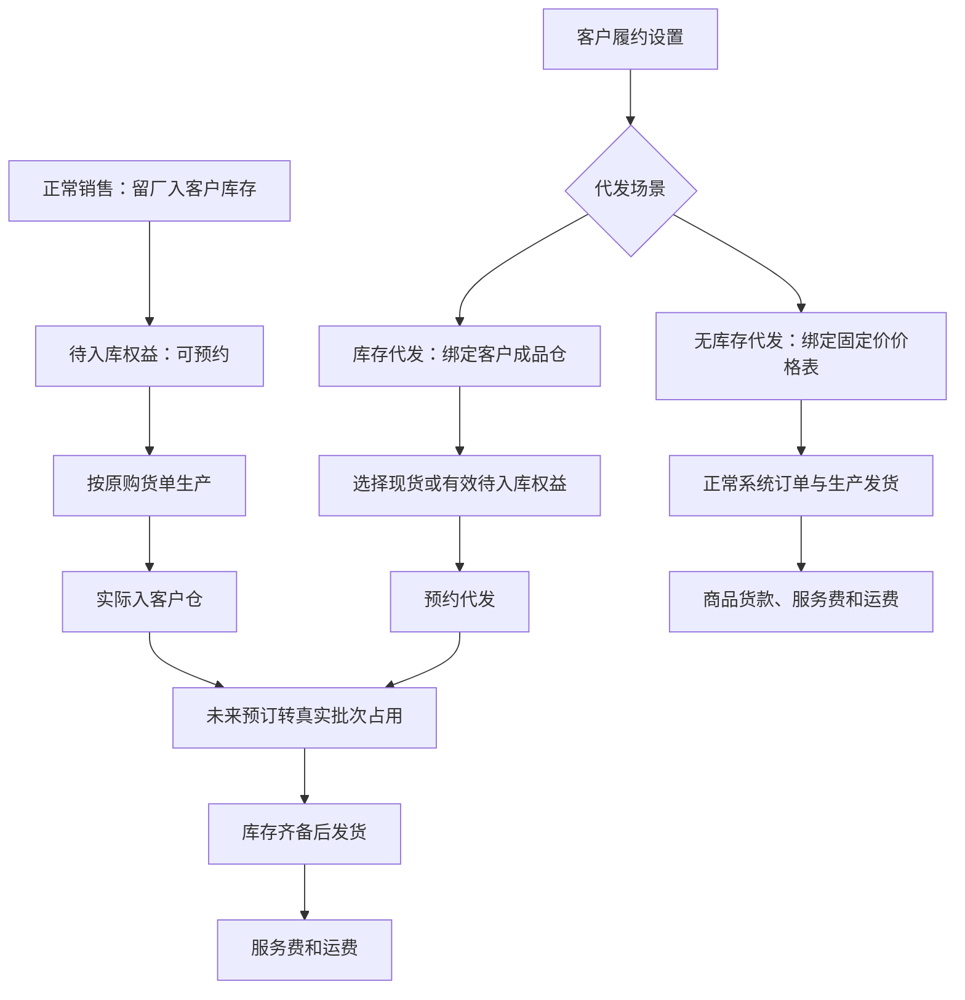

# 客户购货寄存与代发操作手册

适用角色：销售、客户履约运营、仓库、生产和财务；客户通过已授权的 ERP 客户工作台或小程序提交自己的代发。

## 流程图

## 配置与权限

1. 在客户履约设置分别启用“库存代发”和“无库存代发”。两者都开通时，每张单必须明确选一种；保存设置后不受能力模板重新应用覆盖。
2. 库存代发选择当前客户的有效成品仓。已有客户仓可复用；没有时先按仓库管理流程开通。其他客户的仓库不能绑定。
3. 在“商品 → 商品价格表”，为无库存场景指定当前类别的“一件代发价格表”。公共表或当前客户专属表均可，必须已发布且未删除。绑定的是具体版本，发布新版后需明确改绑。
4. 每个可代发规格使用一个固定单价，无起订量或数量档位。普通商品下单继续使用其独立绑定和原有阶梯。提示多个价格时，请调整代发固定价，系统不会任选某档。
5. 每种场景分别维护代发服务费：每单固定费用、每个包装件费用，或两者相加。明确配置零费用才表示免费；未配置不是免费。
6. 在“物流设置”维护运费模板，配置省市区、首重、首重费用、续重和续重费用，以及包装附加重量，再绑定到客户场景。地区从具体到一般匹配，续重向上取整；无匹配费率、无有效重量或模板失效会阻止自动核价。

设置和调整接口只供有对应权限的内部员工使用。客户只能提交当前客户的商品、数量、收件信息和场景，不能通过请求改价、改货主或选择其他客户仓库。

## 地址簿与录单

ERP 履约录单和小程序代发共用当前客户的收件地址簿，可搜索、新增、编辑、删除、设默认及粘贴解析。选“仅本单使用”只保存本单收件快照；“保存并使用”才维护地址簿，不创建系统用户或客户档案。录单往返地址维护保留已选商品、数量和备注。

## 先购货留厂，再分批代发

1. 销售正常下单，交付方式选择“留厂入客户库存”，核对目标仓、商品和真实 BOM 规格。例如曜石2.0、454g规格、24包。
2. 订单按正常流程生效后，客户立即看到24包待入库权益。它可用于代发预约，实际可发库存仍为0。
3. 原购货单正常安排24包生产，可分批完工入库。原单状态显示待入客户仓、部分入客户仓、已入客户仓，不需要再对该原单发物流。
4. 客户选择库存代发，填写收件地址并预约12包。系统先占真实现货，再预约原购货单尚未入库的产出；商品货款不再收一次。
5. 生产实际入库后，未来预订转换成对应批次占用。只有所有发货行都有真实合格库存才可发货，不能用虚拟数量直接扣库或填发货。
6. 余下12包继续按同一来源生产、入库、代发。代发出库不会把原购货单重新变成生产缺口。

留厂数量按所选 BOM 规格的库存单位记录，例如454g袋装按袋计数。按箱订货时，先换算成包装件数，或选用库存单位为箱的对应规格；系统会拒绝把箱数直接当袋数记录。

超过可用现货与有效待入库权益时保留草稿，先为缺口补购，再返回代发；已有购货但未入库只等待原订单生产，不重复购买或重复补产。

## 无库存代发与费用

无库存代发从已绑定固定价表选商品规格，数量可从1开始，服务端核价后自动生成正常系统订单。商品货款按数量乘固定单价计算，服务费与运费单独列示。

运费计费重量为规格净重乘商品数量，再加模板包装附加重。提交时保存价格、设置修订和费用快照；之后修改模板不回算历史。员工按实际调整时必须填写原因并记录操作日志，客户账单按原始来源只计一次。库存代发只计本次服务费和运费；原购货款仍在原销售单中。

## 取消、异常与结果校验

- 未发货代发取消释放现货占用及未来预订，并按原来源撤销费用；原购货单与生产需求继续有效。
- 来源销售已有代发预订、生产或入库时，先处理关联单据，再改客户、规格、仓库、交付方式或缩减数量。批量作废也执行依赖检查。
- 检查订单与库存详情中的原购货来源、待入库量、已预约量和实际批次。生产暂停或减产时处理供应缺口，不能手工把虚拟量改成实物。
- 地址维护、设置、下单、预订、入库转换、取消及费用调整均应在操作日志可追溯。
- 本次开发交付不自动改历史订单，不改生产客户配置，不包含正式小程序审核或发布。

### 网页版客户代发入口（PR-703 / DEV-799）

内部员工在门户客户配置中点击“打开客户履约工作台”，自动进入该客户的履约运营台；左上角可返回配置来源。客户账号从“一件代发”进入库存/无库存代发表单，选择或维护共用地址簿，先核对库存与服务费、运费，再提交。客户账号只能操作本人绑定的客户，无法通过链接或请求切换其他客户。
