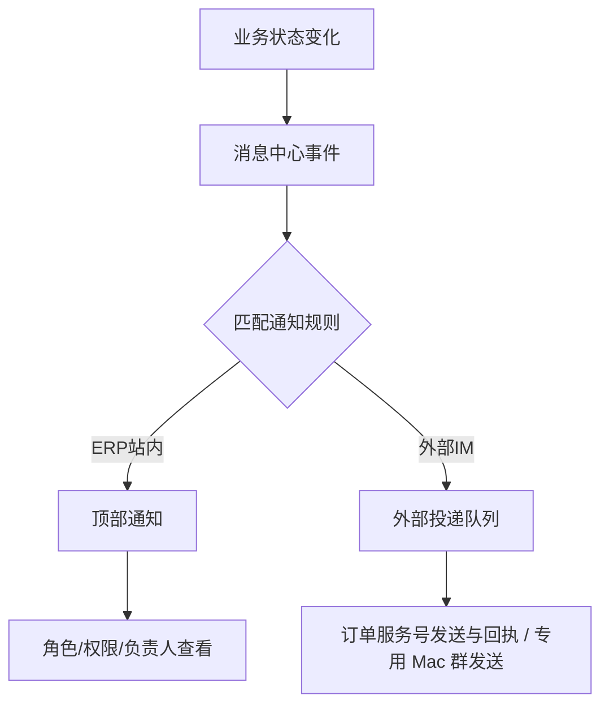

# 通知配置操作手册

## 流程图

## 功能定位

- 通知配置用于把订单下单、生产完成、已发货等业务事件推送给指定接收人。
- 消息中心不是微信专用；ERP 站内通知沿用原有规则。订单微信通知使用上方独立配置区，具备服务号发送、回执及专用 Mac 群投递协议；是否可用须以渠道配置和真实实测结果为准。
- 下方旧版外部 IM 规则仍只提供队列，不会因新增订单微信通知而自动激活。两种微信渠道默认停用。

## 入口和权限

- 入口：设置 / 通知配置。
- 权限：需要系统设置维护权限。
- ERP 顶部通知仍按用户自己的订单读取、角色、权限、负责人或客户绑定关系显示。

## 配置规则

1. 填写规则编码，例如 `order_shipped_customer_im`。
2. 填写事件类型，例如 `order.created`、`order.production_finished`、`order.shipped`。
3. 选择通知通道：ERP站内、外部IM、微信服务号或企业微信。
4. 选择接收人类型：
   - 角色用户：`target_key` 填 `sales`、`production` 等角色编码。
   - 权限用户：`target_key` 填 `orders.read` 等权限编码。
   - 指定员工：填写员工 ID。
   - 订单负责人：用于订单来源事件，推送给订单负责人。
   - 订单客户：用于订单来源事件，后续外部 IM 适配器按客户身份绑定发送。
5. 如需限制状态或业务来源，在 Payload 条件中填写 JSON，例如 `{"new_status":"已发货"}`。
6. 外部通道填写模板键和适配器键，后续接入具体 IM 时使用。

## 默认规则

- 新订单会通知具备订单读取权限的 ERP 用户。
- 新订单会通知生产角色，作为烘焙师接单提醒。
- 订单生产完成会通知销售角色。
- 订单已发货会通知销售角色。
- 已发货客户外部 IM 规则默认停用，等 IM 适配器和客户身份绑定完成后启用。

## 顶部提示展示

- PR-336-MOBILE-NOTICE-STACK：手机端顶部 ERP 站内通知最多展示 3 条，采用层叠卡片排列；同一类型的多条新订单通知可以逐条点击进入订单列表，也可以逐条关闭。
- PR-343-ORDER-NOTICE-DEDUP-PAYMENT-HINT：同一订单创建事件按消息事件去重展示；即使当前用户同时命中订单读取权限、生产角色等多条投递规则，顶部也只显示一条新订单通知，避免重复通知。
- PR-429-PRODUCT-ARCHIVE-LIST-NOTICE-CLEANUP：点击顶部通知右侧关闭后，前端会同时请求服务端标记已读，并在当前浏览器记录已关闭通知 ID；即使短时间轮询又返回同一条未读通知，也不会在当前浏览器重新弹出。
- PR-432-NOTIFICATION-CENTER-SCROLL-CLEAR：顶部通知区域一次展示 3 条，左侧计数显示当前窗口位置；通知超过 3 条时，用上下箭头查看前后通知。点击“清空”会清空当前已拉取通知、记录已清空通知 ID，并同步标记服务端已读，刷新或轮询后不再回弹。
- 录单或修改订单里的红色保存错误会与顶部绿色/信息通知分开显示；当顶部存在新订单通知时，红色错误自动下移，不会盖住新订单通知。

## 常见问题

- ERP 顶部看不到通知：检查规则是否启用、接收人角色/权限是否分配、用户是否已登录对应员工账号。
- 外部 IM 没有真实发送：第一期只落外部投递队列和 adapter 框架，需后续接入具体 IM 服务。
- 想新增某个状态变化通知：新增或复用业务事件类型，配置目标角色或接收人即可，不需要在业务页面写死微信逻辑。

## 样品工单通知（PR-692）

样品新申请通知管理员；分配／改派及回访到期通知当前负责人。ERP 顶部点击样品通知直接打开对应工单，可从左上角返回来源操作。员工小程序“通知”显示未读数量，可阅读、标记已读并跳转工单，与 ERP 共用同一站内消息记录。

首次分配开始七天计时，确认寄样或保存有效回访重算；查看、已读、改派及发货不重算。到期每七天提醒一次，成交或放弃立即停止。提醒每小时检查并防止重复投递；服务恢复只补发当前到期提醒。本流程不发微信订阅消息。详见[样品申请与回访手册](OP_MANUAL_SAMPLES.md)。

## 订单微信通知（PR-750）

### 范围与接收人

设置 → 通知配置 → 订单微信通知；仅系统设置维护人员可配置、测试、重试和配对设备。六个节点为下单成功、付款成功、开始生产、生产完成、发货进度、订单取消。付款不包括赠样自动结清；部分发货和全部发货会分别提示。相同状态保存不重复发送，同一次保存的多个状态变化合为一条，事务撤销不发通知。

客户只接收自己的订单；员工须有订单查看权限，且是订单负责人或相关生产岗位，并满足小程序订单的可见范围。不能通过关注服务号获得原本没有的权限。生产群接收六类已选节点，仅包含订单号、客户名称、商品、交期、负责人及时间，不包含金额、电话或地址。订单未设置交期时不编造交期。

### 服务号准备与开启

通知配置中可分别选择生产群和服务号的节点。带固定状态的模板仅填写已在微信后台审核通过的状态，每行一项；审核中或未审核通过的状态不可填写为已通过。接单、每笔到账、每次发货和正式出账启用前，须选择有权查看对应测试单据的接收账号、填写测试单据内部编号，取得微信成功回执，并人工确认消息内容与详情跳转。虚拟消息仅跳到通知偏好页时，不算详情验证。部分发货需在对应枚举审核通过后单独测试；未验证状态不会自动补发，原因显示在未发送业务事件中。

1. 服务号具备相应消息接口能力，服务器已配置服务号凭据、加密回调和关联小程序。回调必须到达实际发送环境；开发、生产共用服务号时，切勿直接改生产回调做测试。
2. 在微信公众平台添加符合业务用途的订单模板；“订阅模板消息”的 `content` 字段不能作为本功能的持续订单模板。
3. 点击“读取服务号模板”，为六类节点选择模板，并将各字段对应到订单号、状态、通知时间等。先保存设置，保持自动发送关闭。
4. 客户或员工登录小程序 → 我的 → 订单通知 → 生成关注二维码。识别并关注后返回，点击“已关注，确认接收通知”。二维码有效期 5 分钟，其他账号不能代为确认。页面显示账号编号，供管理员选择测试接收人。
5. 接收人按需要选择节点并保存偏好。取消关注会停止通知；重新关注后须再次确认，不会自动恢复旧授权。
6. 管理员在“逐项发送测试”选择明确的账号编号，每次选一个节点。虚拟通知标注测试，不创建真实订单；测试链接打开通知偏好页。实际订单通知打开对应订单，登录后仍保留目标并重新检查客户权限，已取消订单明确标注。
7. 六类消息实际收到、内容正确、真实订单跳转正确后再开启服务号自动发送。启用前的历史事件不补发。

“微信已受理，待回执”仅代表接口接受请求；“已送达”代表收到微信成功回执，不表示用户已阅读。失效凭据或限流会有限重试，明确配置错误需修正；网络中断等无法确认是否发出的情况进入“结果不明”，不会自动重发。

### 原有个人微信群与专用 Mac

个人微信群通过专用 Mac 客户端读取任务并操作当前选定群。必须使用可可靠读取群名、群标识、输入框、发送按钮及发送成功记录的微信版本和已验证控件配置。没有适配配置时会停止；不会用猜测坐标、模拟盲输或绕过微信安全提示完成发送。

1. 填写专用设备名和唯一且准确的群名称，生成一次性配对凭据。凭据只显示一次，存入专用 Mac 钥匙串；遗失时撤销旧设备重新配对。
2. Mac 登录微信、保持解锁，并打开目标群。发送端检查当前版本、群名和控件，任一不符会暂停。不能使用有重名且无法确认身份的群。
3. 在设置页依次发送六类虚拟通知；每条都须在目标群读回完整发送成功记录，才计算为通过。人工“已核对已发送”不会计入设备自动验收。
4. 六类全部通过后，在线设备才可启用生产群自动发送。微信或控件配置变化会使原验证失效，需要重新实测。
5. 发送期间断线、微信退出或结果不明时，队列暂停。按通知号核对群记录，再选择“已核对已发送”或“已核对未发送，补发”。不能因为未看到系统成功提示就直接补发。

当前现场微信曾提示重新登录，且未提供可用的聊天控件读取能力；此版本的自动群发送尚未通过，不能作为已上线能力。实现与适配说明见仓库 `tools/wechat-notifier/README.md`。

### 记录、停止与数据影响

配置、通知授权、测试、重试、人工确认、设备配对与撤销均记录在操作日志中。通知发送失败不会撤销订单，但订单事务的消息记录与订单一起提交。停用通道后旧待发任务停止；重新启用只发送之后的新变化。服务号取消关注、绑定变化或账号失效会在发送前再次拦截。撤销设备立即使配对凭据失效。

排查顺序：账号关注与授权 → 模板字段 → 发送记录 → 微信回执 → 接收端消息及跳转。测试记录与真实订单通知明确区分，不以模拟接口测试代替真实微信验收。
