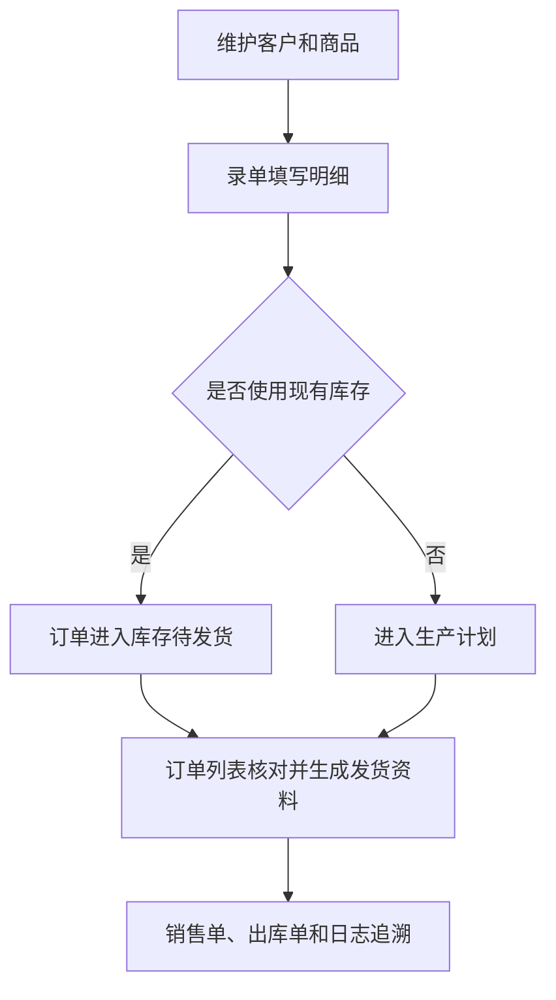

## 留厂库存订单的状态与编辑（2026-10-23）

适用内部订单维护人员。从“客户履约 → 订单”或“订单列表”点击留厂订单，核对商品、目标客户仓及生产进度。留厂库存是原购货单，“库存代发”是后续需要寄送给收件人的代发单，两者分别处理。

- 留厂订单显示“留厂库存 · 无需发货”。未入库时显示实际生产进度，缺少生产状态显示“待生产”；生产完成后显示“待入客户仓”；部分、全部入库分别显示“部分入客户仓”“已入客户仓”。
- 留厂详情及编辑隐藏收件地址、地址解析、配送方式、发货状态、快递单号和寄件人区域，不提供出库单操作。保留商品、生产与入库进度、目标客户仓，以及“付款信息”中的付款状态、预付款和收款方式。
- 无需补收件地址即可按原规则保存；目标仓必须属于当前客户且启用。切换回普通发货时寄递字段重新显示，原有收件资料和单号保留。关闭后重开恢复已保存的交付方式。
- 保存留厂订单不会把已入库进度退回待入库，也不会产生运费；既有代发预订、生产或入库造成的编辑限制继续生效。出现关联单据限制时按提示处理，不能通过重新保存重建库存权益。
- 留厂订单不计入待发货、缺收件信息及代发队列；待确认、待收款按实际情况统计。保存成功后可在操作日志核对修改记录。本次显示修正无需手工修改历史发货状态。

# 操作手册：订单与销售资料

## 订单列表批量修改付款与发货状态

适用具备订单修改权限的内部人员。入口：订单 → 订单列表。只能操作当前账号有权处理的订单。

1. 在当前页勾选需要处理的正常订单，使用列表原有的行复选框或表头全选。切换筛选或翻页后重新选择；已失效订单不可选。
2. 点击“批量修改状态”，选择付款状态、发货状态或两者；不需要修改的状态保持“不修改”。核对每张订单现有状态和收款资料。
3. 目标付款状态需要收款方式、预付款、实收货款、实收运费或收款凭证时，按每张订单实际情况补充资料。各订单的金额和凭证分别填写，不会自动套用同一份资料；不要以应收金额代替实际收款。
4. 提交后查看每张订单的结果。成功和未发生变化的订单已处理；失败项会显示原因。补齐资料后点击“重试未成功订单”。若提示订单已被修改或提交结果未确认，点击“重新读取失败订单”，核对最新资料后再重试。
5. 已发货所需物流资料仍按原规则核对；缺少物流公司、物流产品或其他发货资料时，在订单详情补齐后再操作。留厂库存不修改发货状态；履约订单发货状态由实际履约进度更新，需通过对应发货流程处理。

作废、未确认履约订单及免费样品沿用原有业务限制。付款或发货状态变更会记录操作日志并影响需要重新生成的单据；操作后可重新打开订单和单据核对。批量修改不会自动完成实际出库或发货。

### 同一客户订单合并付款

1. 订单列表勾选同一客户的订单，点击“批量修改状态”，选择“合并付款”。核对每单应收、已有收款、待收和汇总；已付款订单不会重复收款。作废、未确认订单和异常金额按页面提示先处理。
2. 输入本次实际收款，选择收款方式，可上传本次收款凭证。实际收款不能低于待收合计；超出部分记为本次收款的“待分配”，不会自动抵扣其他订单。需要同时修改发货状态时可选择；不修改则保持原状态。
3. 点击“确认合并付款”。整批付款及所选发货状态一起校验、一起保存，任一订单不符合要求则整批不保存。成功后本次结清的订单显示已付款，原备注保留并追加“合并付款”；已有订单凭证保留，本次凭证关联这笔合并收款。
4. 在订单详情展开“合并收款记录”，核对收款时间、方式、本次实际收款、待分配金额和该订单的分配。操作日志可查收款与订单变更。若订单已变化，重新读取并核对后提交；若网络导致结果未确认，按提示重试原次操作，系统使用原订单、金额和发货设置，避免重复入账。

合并付款处理的是所选订单的应收，不会自动将履约费用账单标记为已付款。未付款的免费样品或零金额订单需单独处理。

## 订单行付款与发货颜色（PR-739）

- 订单未付款时整行保持红色，即使订单已发货也不改变；“已发货”状态文字本身显示绿色。
- 只有订单已发货且已全额付款时，整行才显示绿色。未发货已付款、部分付款、部分发货和作废订单不会因为其中一个状态单独变成绿色。
- 这是订单列表的状态提示，不会修改订单付款、发货或库存数据。判断具体应收和已收金额时，打开销售单或订单详情核对。

## 录单以所选已发布价格表为准（PR-707）

适用角色：网页及员工小程序录单人员。入口：订单销售 → 录单 → 选择客户 → 选择价格表。

1. 每个商品分类默认带入当前可用版本的默认表；可以手动切换对应公共表或客户表，包括零售价格表。客户类型和订单类型不再自动切换价格表或过滤商品。零售客户需要零售价时，由录单人手动选对应表。
2. 商品、规格、数量档位和报价必须存在于当前所选已发布表中。分类名称来自实际发布分类，新增商品类型也会展示；商品档案或 BOM 中有、但该表未发布的规格不能录入。
3. 切换客户或价格表、重新进入录单或打开商品选择器时重新读取当前目录。新版保留同一命名表时会跟随同名表刷新，并提示核对已有明细；保存前必须重新确认规格和价格。表已被移除或撤回时，重新打开录单并手动选择有效表，不能直接提交旧价。
4. 目录读取失败时先重试；页面不会使用其他客户、其他表或全部商品填补。编辑/复制历史订单仍保留原内容供核对，失效规格必须重选。已存冻结换算和原样品行沿用原规格、冻结价格及来源；新增、替换或复制出的普通明细仍须通过当前价格表校验。

结果校验：网页与员工小程序对同一客户、同一组所选发布表展示相同商品与规格。零售客户也可以选择商用表，且不会只剩生豆。查看订单报价来源可核对冻结的表名、版本和价格。目录读取本身不修改业务数据；正式保存订单和发布价格表继续在操作日志留痕。

## 复制订单详情文字（PR-701、PR-734）

- 适用角色：有当前订单查看权限的员工或客户；客户只能复制当前绑定客户的订单。
- 入口：网页订单列表及详情、客户工作台/我的订单，以及小程序员工订单与普通客户订单的列表和现有详情。客户小程序“发货中心”不在本次范围。
- 操作：先保存订单修改，再点“复制订单详情”；看到“订单详情已复制”后，到生产群粘贴文字并自行发送。原“复制订单”仍用于新建相似订单。
- 内容：订单号、客户名称、订单日期、付款状态、付款方式、全部商品名称/规格/数量及单位、收件人/电话/完整地址。每次读取最新保存版本，不复制未保存编辑、价格、金额或备注。商品行格式为“2. 曲奇｜227g袋装｜1 袋”，省略“规格”“数量”标签。历史商品规格优先保留下单快照；收件信息与订单详情一致：优先使用订单保存值，普通订单的空字段使用客户档案联系人（为空时取客户名称）、电话和地址；代发、商品下单、加工发货订单只使用已保存收件信息。仍缺失时显示“未填写”；可查看的作废单带“【已作废订单】”。
- 校验：核对粘贴文字中的订单号、客户名称、付款状态、付款方式、商品数量和收件地址。复制不会新建、修改订单，也不会自动发送消息。
- 异常：读取失败请重试；网页复制受浏览器限制时，在弹出的文字框中选中并手动复制；小程序复制失败后重试。切换客户、退出登录或离开页面后，未完成请求的结果会丢弃。

## 订单列表类型与极简详情（PR-700）

- 入口：订单 → 订单列表，或客户工作台中的订单列表。沿用现有订单查看权限；只能展开自己有权查看的订单。
- “类型”同时显示订单类型、真实样品关联标记及本单全部商品分类。分类按商品管理的当前配置汇总，规格商品可继承主商品分类；同名分类只出现一次。历史无分类商品回退已保存的熟豆、生豆、挂耳或速溶类型，无法识别显示“未分类”。备注中写“样品”不会生成样品标记。
- 点击订单行普通文字或空白处，或订单号旁的三角按钮，在本行下方展开极简详情；再次点击收起。每次只展开一张，打开另一张自动收起前一张。三角按钮支持键盘 Tab 聚焦及 Enter/空格操作。
- 点击订单号仍打开完整详情及编辑；销售单、出库单、发票、审计、复制、失效及复选框保留原操作，不触发展开。选中文字复制时也不会误展开。
- 明细展示订单保存的商品名称、规格、数量与单位、单价、小计；商品备注在对应商品下显示。底部展示运费、最终应收总价及订单备注，有优惠或委外费用时补充说明。快递费备注不再次计入应收，零金额明确显示 ¥0.00。
- 极简详情只读。需要调整商品、收件或付款、发货状态时，点击订单号进入完整详情。商品分类修改会影响列表分类显示，不重新计算历史订单价格和规格。
- 第一次展开时加载数据；失败可点击“重试”，无权限时应联系管理员核对权限。刷新、翻页、筛选或保存订单后会收起并重新读取，避免展示旧详情。展开期间暂停列表定时刷新，保留正在阅读的明细。

## 已有订单顶部操作与免费样品（PR-698）

1. 从订单列表打开已有订单，先在顶部“收件信息”核对收件人、电话、公司和地址；必要时直接修改，或粘贴后解析。普通订单也可以修改本单收件信息。
2. 在其下方“付款与交付”处理付款状态、实际收款金额、收款方式及凭证，选择配送方式、交付状态、物流公司、物流产品并填写单号。相关字段随状态显示；在详情最底部点击“保存订单”保存当前订单全部修改。新建录单页维持原布局。
3. 收件资料保存为本单快照；仅修改备注或付款状态不会清空资料或改变订单来源。修改客户档案不会自动覆盖历史订单。若发货提示资料缺失，回到顶部补齐提示的字段后保存。
4. 服务端核实样品关联且商品、运费、其他费用和总额均为零时，自动显示“无需收款”，已收、待收均为零，无需收款方式和凭证，也不产生收款流水。普通订单不能自行选用这个标记。
5. 商品免费但运费收费时，货款金额填 0，运费按实际到账填写，按原规则选择收款方式、上传凭证。整单免费改成收费，先保存费用；系统恢复未收款后，再登记实际收款。已有真实收款不能用改回免费来清除。
6. 销售单和图片也显示“无需收款”，不展示收款二维码。生产、出库、发货和权限限制继续生效；订单已进入不能编辑的状态时，按页面提示走原履约流程，不通过重新保存绕过。

### 库存代发与无库存代发完整编辑（PR-714）

1. 内部订单维护人员从“订单列表”点击订单号。加载完成后核对订单信息、收件人、电话、公司、地址、原商品规格数量和费用。加载失败点击重试，也可以关闭；不会显示一张默认空白新单。
2. 可粘贴解析收件信息或从本客户地址簿选择；商品支持新增、删除、换规格及修改数量，备注与订单日期可一起修改。客户和代发类型沿用原单。
3. 库存代发从该客户全部有效现货和已购待入库权益选择。页面显示本单占用和本单可用；已有占用计入本单可用，不会重复扣减。超过权益时先补购，保留本次草稿；待入库权益必须实际入库后才能发货。商品货款仍在原购货单结算，本次不重复计价。
4. 无库存代发沿用本客户授权价格表；原商品不因仅改地址重新计价。更换商品规格及数量时核对新货款。历史明细已有单独优惠或折扣时，仅改地址会保留原金额；改变该行数量前需先通过财务核对，避免重新计算覆盖历史优惠。
5. 上方“订单状态与费用明细”集中显示商品货款、代发服务费、模板预估运费、实际出账及待收情况；下方代发费用区仅维护地区、服务费调整及重新核算，不重复展示明细。点击“重新核算代发费用”后，上方明细同步显示本次核算结果。打开订单显示已保存的费用快照，改变地址、商品或数量后按原单模板版本、计费设置和冻结的物流单件重量重算。预估运费待实际账单核对后另收，不能把“当前运费应收为0”理解为包邮。人工费用调整需填写原因，已结算记录走原财务调整流程。
6. 核对完成后，在详情最底部点击唯一的“保存订单”，系统一次保存地址、商品、库存预占和费用并记录操作日志，单号与原购货关联保留。保存失败保留输入，库存不足、版本冲突等按具体提示处理；关闭不会保存草稿。
7. 快递信息中的寄件人默认显示“跟随本次寄件人”及当前批次寄件人名称。可选择本单寄件人；列表刷新和详情重开保留当前选择。此选择用于快递下单/导出，本身不随“保存订单”写入订单资料。
8. 已发货、已扣库、作废、进入不可编辑生产阶段或相关费用已锁定时显示限制原因，不通过重新保存覆盖历史收款或出库。减少商品只释放本单尚未履约的占用，不修改原购货数量及既有入库历史。

普通销售录单仍仅允许当前所选价格表中的商品规格。同一 BOM 规格更新制造版本后，已发布的客户报价仍可按该规格使用；这不会开放价格表外规格或其他客户价格。

## 客户商品下单与收件地址快照（PR-664）

- 客户小程序和 ERP 客户工作台中的“现货下单/现货录单”统一显示为“商品下单”。客户从 ERP 在商品价格表页指定的具体发布版本选商品和规格，不能自行选择价格表、客户或修改成交价；员工普通录单继续保留原选表能力。
- 商品下单可一次录入多行商品，填写或从客户地址簿选择收件信息，核对服务端报价后生成一张正常 ERP 订单。库存不足继续走订单现有生产与发货流程，同一提交标识不会重复生成订单。
- 订单保存实际发布记录、成交价格和本次收件信息快照。价格表重新指定、地址簿修改或删除后，历史订单不回算、不改收件信息。客户临时修改收件信息只用于本次订单，只有点击“保存当前信息到地址簿”才写入地址簿。
- 客户地址簿在客户档案的“收件地址”维护，支持搜索、解析、新增、编辑、删除和默认地址。同一客户多个账号共用；下游收件人不会新增为 ERP 客户。

## 录单按真实价格表分类选商品（PR-660）

- 进入 `订单 → 录单`，先确认商品明细标题区当前选中的已发布价格表。打开商品输入框后，顶部分类按这些价格表的真实商品分组顺序显示。例如当前生产数据应为“全部、烘焙咖啡豆、咖啡生豆、咖啡挂耳、速溶咖啡、好玩的产品”。只显示当前价格表中存在可售商品的分类。
- 分类与名称、拼音或首字母搜索同时生效。选择“咖啡挂耳”后，只显示当前所选咖啡挂耳价格表发布快照中的商品；选择“好玩的产品”后，可找到该分类发布的咖啡果皮茶等商品。商品行标签也显示同一真实价格表分类。
- 分类归属以当前所选已发布价格表及其发布 ID 为准。即使旧商品档案仍记录 `roasted` 等历史商品形态，只要商品发布在“咖啡挂耳”，录单就归入“咖啡挂耳”，不会再显示为“熟豆”。切换价格表版本后，分类和候选商品一起重新计算。
- 如果价格表分类资料临时加载失败，页面才回退到旧商品形态筛选，避免商品选择完全不可用。遇到分类缺失，先刷新并检查当前价格表是否已发布、是否选中正确版本、该分类是否有带正价的可售规格；不要通过修改旧商品形态来修补录单分类。
- 选择商品后继续选择该价格表中的具体规格，数量命中发布档位后带入单价。保存订单仍由服务器校验客户范围、价格表发布状态、发布 ID、规格和价格来源。

## 履约订单保存与确认（PR-647）

1. 在客户履约工作台录单或内部代录，保存即获得订单编号，客户侧和 ERP 订单列表显示“待确认”。没有独立申请单或申请编号；保存不会自动接单。
2. 点击订单号进入详情，选择“修改订单”，可按已有权限修改订单日期、商品、规格、数量、价格及收件信息。客户侧价格始终取所选有效价格表。保存保留原订单号，并重新进入“待确认”。
3. 当前客户负责人或管理员在 ERP 详情点击“确认订单”，成功后显示“已接单”。确认时重新核对当前商品、BOM 规格和价格表有效性；错误会保留待确认内容，不自动换价。
4. 拒绝必须填写原因。新订单显示“已拒绝”，可修改后再次保存；已接单订单的修改被拒绝，恢复上次接单内容及“已接单”，确认记录保留每次版本、日期、明细、金额和原因。
5. 待确认期间不能排产、占用库存或发货。修改前应解除库存占用并取消未开工计划/工单；开始生产或进入后续履约后不能修改。旧快捷编辑入口会提示从订单详情修改，不能跳过确认。
6. 详情分别展示确认、生产、发货状态。页面可见时每 15 秒更新，返回页面或操作成功后立即更新；自动刷新不覆盖正在编辑的表单。

新订单待确认时不计入应收；已接单订单修改待确认期间，账务和销售资料沿用上次接单内容，确认后统一更新，历史文件保留。普通 ERP 新建、商城及小程序新单保留原规则；已经进入此确认流程的订单，其他入口也不能绕过。

## 按命名价格表下单（PR-635）

- 每种商品类型先选择价格表，选项显示“表名 · 版本号”。系统沿用客户专属、公共回退和版本可用范围，默认带入有效版本指定的默认表；同版本可选其他命名表。
- 一张订单中，同一商品类型只使用一张表，不同商品类型分别选择。商品、规格和自动报价来自所选表；同一商品在不同表中可以有不同价格。
- 切表后仍存在的规格保留数量并重新匹配该表价格；不在新表中的规格需要重选，修正前不能提交。草稿按商品类型保留选表信息。
- 保存时服务器重新校验客户归属、发布状态和商品价格来源。遇到“价格表已更新”或“商品价格来源与所选价格表不一致”，刷新可选表并重选规格。
- 历史订单显示当时冻结的表名、版本、规格和成交价格。复制订单及新建订单要按本次选择检查商品和规格；命名价格表按当前所选表重新匹配报价。历史单表订单仍保留既有兼容读取。

> PR-600 当前口径：新建商品和已完成 cutover 的商品，录单只选择当前默认已发布 BOM 提供的规格；保存父商品 + BOM 规格与当时的版本快照，数量直接按规格库存单位计算。旧子 SKU、`spec_g` 和销售规格换算只保留给 legacy 商品与历史订单。

- PR-570-ORDER-ENTRY-PRICE-SPECS-ORDER-DETAIL：新建、复制和切换价格表时只显示当前已选已发布价格表中的可售规格；历史订单保留冻结规格；已有订单详情继续正常打开。
- PR-572-MINIAPP-ORDER-DETAIL-DOCUMENT-SHARE：员工小程序订单可进入完整详情，并把销售单、发货单分别以 PDF 或图片通过微信分享。
- PR-573-MINIAPP-ORDER-CATALOG-EDIT：员工小程序新建和编辑订单只使用所选客户当前默认已发布价格表中的商品规格；尚未进入生产计划、工单、执行和发货的订单可在小程序修改。

## 员工录单自动匹配与手动选档（PR-671）

- ERP 普通员工录单默认按商品、规格、当前价格表和数量自动匹配价格，行内显示命中的档位、范围和单价。
- 需要跨数量门槛使用某档时，在商品明细下方的“手动选择价格档”中点击目标档。候选只来自当前已发布价格表、当前商品与当前规格，并显示档位名称、数量范围和单价；不依赖固定的 A/B/C/D 命名。选档后数量变化仍使用该档单价，金额随数量重算。
- 点击“恢复自动价格”后重新按当前数量匹配。直接在单价框修改属于“手动输入单价”，与“手动选档”区分；手动输入后也可恢复自动匹配。
- 切换客户、商品、规格或价格表时，原手选档会清除并按新范围自动匹配。草稿和订单编辑回显计价方式；订单详情保留成交价来源。复制订单按当前有效价格表重新校验，已经失效的档位必须重新选择。
- 客户门户自行下单不显示手选档，也不能提交手选档请求；仍由服务端按数量自动计价。员工手选金额由服务端从已发布快照校验，不能通过伪造客户端金额、商品或规格越权。

## 适用范围
录单、订单列表、客户档案、销售单和出库单等销售前后台操作。

## PR-508 端到端链路验收口径
- PR-509-E2E-RAW-MATERIAL-ORDER-PRODUCTION-FLOW：下单验收必须使用可生产商品规格和已发布价格表快照。PR-600 商品保存父商品 + BOM 规格，legacy 商品保存旧 SKU/规格；两者都必须保留价格版本和可进入生产计划的明确身份，库存不足时不能因历史模板或价格单位解析失败而丢失。
- 订单保存、修改和影响生产需求的用户操作都要能追溯到操作日志或订单业务日志；PR-508 浏览器验收要从订单回看生产来源和报价来源。

## 入口
- 订单：录单、订单列表
- 档案：客户档案
- 设置：物流设置

## 流程图

## 标准操作
1. 先维护客户档案，确认客户名称、联系方式、客户类型、默认来源、默认订单类型、客户负责人、结算信息和业务配置可用；客户档案列表点击客户名称打开右侧抽屉，不再通过单独“编辑”列进入。
2. 维护商品档案，确认商品资料、商品分组、销售规格模板、客户引用、价格表快照和 BOM/成本追溯资料准确；库存单位来自销售规格模板。
3. 进入录单页面，先选择当前使用的已发布价格表，再选择父商品、价格表中的具体规格、数量、单据日期、订单日期、发货和付款信息；来源、客户类型和订单类型只从客户资料读取并只读展示。规格只来自该价格表已发布的具体 SKU，不再手工选择全局克数。当收款状态选择“已付款/已收款/已支付”时必须同步选择收款方式；当收款状态需要收款凭证时，还要分别填写货款金额、运费金额并上传凭证。当发货状态选择“已发货”时必须选择物流公司和物流产品。如单个商品有贴标、磨粉、特殊包装等说明，在该商品明细行填写“条目备注”；如该行需要优惠，可选择减免数额、单价优惠、折扣或免费。
4. 核对商品名和规格分列展示、所选价格表版本与规格一致；价格表中没有的规格不能用于新订单。
5. 订单负责人不在录单时手工指定；系统会按客户档案中必填的客户负责人自动写入订单负责人快照，负责人只能是员工维护里的启用内部员工。
6. 保存订单后进入订单列表确认记录存在，核对金额、状态、负责人、备注和发货信息。
7. 在订单列表搜索框可输入订单号、客户名、负责人名称或快递单号，快速定位某个售前售后负责人负责的订单。
8. 需要对外销售资料时，在订单列表打开销售单或出库单抽屉，直接核对销售单预览并生成 PDF 或图片版本；报价来源和生产来源统一到订单详情查看。同一客户多张订单需要合并收款或合并出库资料时，在订单列表用统一选择框勾选后生成组合销售单或组合出库单。

## 录单要点
- PR-439-PRODUCT-PRICE-MASTER-REMODEL / PR-500-UNIT-MODEL-CONSOLIDATION / PR-504-PARENT-PRODUCT-CHILD-SKU-UOM / PR-505-SALES-SPEC-TEMPLATE-DERIVED-SKU：录单单位、价格和子 SKU 只读取已发布商品价格表快照，不再从客户商品或旧模板兜底决定报价单位/录单单位。商品价格表发布时把当时的 `sku_id/sku_snapshot`、子 SKU 销售单位和销售规格模板库存单位固化到快照；价格表快照是什么子 SKU 和单位，订单行就是什么子 SKU 和单位。商品有效库存单位只用于库存、生产、BOM 产出和成本口径，不直接决定订单行销售单位。
- PR-440-PRODUCT-GROUP-PRICE-REMODEL / PR-620-ORDER-ENTRY-PRODUCT-CUSTOMER-REFERENCE / PR-629：客户料号和客户商品名来自商品档案“复制到客户”建立的引用。`客户引用` 不定义价格、单位、BOM、分组或物料来源，只把商品投影到对应客户录单目录；最终价仍只来自该客户已发布价格表快照。若同一客户和商品仍有旧客户商品别名，录单保持旧客户商品别名优先并只显示一条商品。新订单不再保存商品级供料方式，生产所需库存来源在生产计划逐组件选择并冻结。
- PR-440-PRODUCT-GROUP-PRICE-REMODEL：商品价格表是 Price List / Item Price 平铺价格行，订单保存时冻结价格表版本、最终价、价格单位、库存换算、分组快照、阶梯价模板来源和 Pricing Rule 版本。订单成交价不因后续 BOM、工单、原料批次或 Pricing Rule 修改自动变化。
- PR-342-ORDER-BACKFILL-DATES：录单页的“订单补录”区域有两个日期。`单据日期` 用于 ERP 制单、订单编号和内部出入库/销售单据口径；`订单日期` 用于客户真实下单或业务发生日期。普通录单也可以改两个日期；如果只是补录一张历史订单，把订单日期改成真实日期即可，单据日期可按今天或实际制单日保存。
- 新订单默认 `单据日期` 和 `订单日期` 都是当天；旧接口没有传单据日期时，系统自动用订单日期作为单据日期。订单号按单据日期生成，例如单据日期是 2026-05-23 时订单号前缀为 `SO-20260523-`。
- PR-348-ORDER-BACKFILL-CONTINUOUS-MODE：连续补录多张订单时，打开“订单补录”里的“连续补录”开关。点“保存并继续补录”后，页面会保留客户、单据日期、订单日期、收款方式、发货/物流设置、运费、取整和三类豆单版本，清空商品明细、快递单号、收款金额、收款凭证、订单备注、优惠和外协费用，继续录下一张；点“保存并查看订单”则按普通保存进入订单结果页。
- 如果只补录一张历史订单，不需要打开连续补录；直接修改 `订单日期`，必要时调整 `单据日期`，然后点“保存订单”。
- 客户输入框支持客户名、拼音和首字母搜索，选择后订单信息中只读展示客户类型、来源和订单类型；这三个字段只在客户资料维护，录单/编辑订单不再手工修改。
- 商品明细标题区点击“选择价格表”打开价格表选择抽屉，可按熟豆、生豆、挂耳分别选择已发布价格表版本。标题区会把当前使用的三个价格表按行展示，方便核对完整版本号和发布时间。客户有某类型专属价格表时可选不同已发布版本，默认最新；客户没有专属价格表时该类型使用公共价格表，也可以选择公共历史发布版本，默认最新公共价格表。
- PR-379-CHANNEL-PORTAL-WORKBENCH-SWITCH：录单价格表/豆单选择优先按商品自定义产品类型分组。选择商品后系统按该商品的 `product_type_category_id/product_type_name` 自动匹配同分类客户专属最新价格表；没有客户专属版本时回退公共同分类最新版本。旧 `commercial/green/drip` 只作为兼容 fallback，不能作为新增产品类型的硬编码枚举。
- PR-351-ORDER-ENTRY-PUBLIC-BEANLIST-NO-CUSTOMER：刚打开新建录单页、尚未选择客户时，商品明细标题区会先显示公共已发布价格表版本；如公共熟豆价格表已发布多个版本，可直接点“选择价格表”切换公共版本。选择客户后，系统会按客户专属价格表优先、无专属则公共价格表的规则重新同步。
- PR-350-BEAN-LIST-PUBLISH-MANUAL-WITHDRAW：录单只能选择状态为已发布的豆单；产品豆单中已手动撤回的版本不会出现在“选择豆单”抽屉，也不能作为新订单保存的豆单版本。发布新版豆单不会自动撤回旧版，所以仍处于已发布状态的旧版可以作为历史发布版本继续选择。
- PR-353-ORDER-ENTRY-HISTORICAL-BEANLIST-PRODUCT-TIERS：切换到仍处于已发布状态的历史熟豆/生豆豆单后，商品下拉会按该历史版本的发布快照展示商品和梯度；如果历史版本里有熟豆商品，不能因为最新版本覆盖而只显示生豆或其他类型商品。
- PR-352-INSTANT-COFFEE-PRODUCT-KIND：SKU设置中维护为“速溶咖啡”的商品，录单商品下拉会显示“速溶咖啡”标识；选择后按普通重量规格和商用价格梯度录单，不需要选择挂耳袋/盒单位，也不会要求生豆绑定。
- PR-362-PRODUCT-CONFIG-TEMPLATE：如果客户产品子类型绑定了客户自己的“商品配置”，录单仍只读取已发布产品价格表快照；商品配置影响的是生成和发布快照前的草稿内容。保存订单后，商品行记录实际命中的发布 ID、版本号、单价和单位快照，后续修改商品配置不会静默改历史订单价格。
- PR-505 后，录单商品接口会带出产品类型、产品子 SKU、销售规格模板库存单位、子 SKU 销售单位和价格表快照。前端选择商品时会把已发布价格表快照中的子 SKU 和价格单位带到数量栏；例如 `227g袋装` 是子 SKU，销售单位是 `袋`，`227g` 来自销售规格模板明细和 BOM，不写成 `袋/227g` 销售单位。系统用价格表快照保存订单销售单位和库存口径，用于小计、库存、生产需求和销售单单位展示。
- PR-345-ORDER-CUSTOMER-PROFILE-BEANLIST-DRAWER：客户资料中的客户类型、来源和订单类型为必填项。新增客户、编辑客户或保存订单时缺少任一项都会失败；先在客户资料补齐后再录单。订单保存时后端以客户资料为准写入来源和订单类型，不能用前端隐藏字段绕过。
- PR-324-FENNA-ORDER-ENTRY-CUSTOMER-BEAN-LIST-SCOPE：客户已有自己的熟豆/商用豆单时，录单商品下拉只展示该客户商用豆单发布快照中包含且带价格档的商品；公共商用商品和未发布到客户豆单的客户 SKU 不再可选。熟豆自动价读取发布快照中的 `commercial_wholesale_tiers`，例如芬纳咖啡两个定制产品应直接带出豆单磅价。
- PR-331-ORDER-ENTRY-PUBLIC-SKU-SCOPE：商品下拉还会读取 SKU 设置中的 `use_public_sku`。客户关闭“是否使用公共SKU”时，录单和修改订单不显示公共 SKU、其他客户 SKU 或其他客户豆单中的生豆 SKU；如果芬纳咖啡看到了岩师傅的 `孟连水洗A`、`红酒日晒-2026`，先检查芬纳是否误开启公共 SKU，关闭后重新进入录单。
- PR-340-ORDER-ENTRY-PRODUCT-DROPDOWN-LAYER：多条商品明细同时存在时，商品下拉会浮在规格输入、后续商品行和价格梯度按钮上方；如果商品下拉被后续商品行遮挡，先刷新页面确认前端版本，再重新打开该商品输入框。
- PR-546 / PR-660：商品下拉顶部按当前所选已发布价格表显示真实商品分类，不再固定为“熟豆 / 挂耳 / 生豆 / 速溶咖啡”。分类和名称、拼音或首字母搜索同时生效；商品标签使用同一发布分类。点击商品下拉外部的规格、数量或页面空白处会自动收起；切换到另一行商品输入框时旧行下拉也会关闭。
- 保存订单会记录本单使用的价格表发布 ID 和版本号；商品行显示 `报价来源：价格表 {版本}`，用于后续追溯当时的报价和展示口径。ERP 录单只使用“工厂供货”用途的已发布价格表，客户转售分享价格表不会出现在版本选项或订单自动价中。同一客户/公共范围多次部分发布时，每个派生 SKU 分别使用最近一次包含自己的快照；新版已包含该 SKU 但价格为空时不会回退旧价。PR-551 起，`报价来源`、`生产来源` 两块只在订单详情只读展示，销售单页面不再重复展示或刷新追溯；报价来源来自价格表快照，生产来源来自工单/BOM/工序卡快照，生产来源变化只影响成本、毛利和追溯，不自动改已成交价格。
- 商品明细直接在商品输入框搜索父商品，商品名称不追加规格；随后从“规格”选择当前已选已发布价格表中有价的具体 SKU。这里的“价格表中的规格”就是该发布版本已有正价行的可售规格；价格表没有的商品档案规格不会出现在新订单候选中，按规格名或 SKU 编码搜索时也不会用未定价规格命中父商品，新发布价格也不跨同父规格按重量换算取价。选择一个商品后，系统会在明细列表底部自动补一个空明细行；已有空明细时不会因修改商品反复新增空行，仍可在列表下方点击“新增明细”手工加行。
- PR-325-ORDER-ENTRY-MATCHED-TIER-HIGHLIGHT：自动价命中后，价格提示按钮按行内 `tier_id` 实际命中的豆单梯度高亮；即使当前规格是 1000g 或 2.5kg、单价单位显示元/kg，只要价格来自 454g 磅价梯度折算，页面仍高亮对应的 454g 档位。
- 生豆商品录单时会保留 `green_bean` 形态；生豆订单价格和页面展示的梯度价只能来自所选生豆豆单版本的已发布价格档。缺少生豆豆单价格时保存会失败，不能用绑定熟豆阶梯价、同名熟豆 SKU 梯度或商品直连梯度兜底。
- 挂耳商品不使用熟豆重量规格控件；选择“袋”时规格显示为 `10g/袋`，选择“盒”时规格显示为 `10袋/盒`（以产品设置为准）。存在已发布盒装档时，盒单必须按盒数严格匹配，数量越界不会退回袋价；只有该 SKU 完全没有盒装档时，才按每盒袋数折算并匹配袋装档。
- 挂耳订单明细会保存产品类型、销售单位、每盒袋数、每袋熟豆克重、匹配数量、价格来源和库存换算快照；后续编辑订单、订单列表、销售单和生产计划都以该快照为准，不受之后商品档案单位换算、价格模板或 BOM 修改静默影响。
- 批发单价单位优先跟随命中的豆单阶梯展示单位：KG 阶梯显示元/kg，磅价阶梯显示元/磅；只有阶梯没有明确展示单位时才按当前规格推断。1000g × 30 袋如果匹配到 48 元/磅档，页面显示 106 元/kg，小计 3180。
- 曲奇拼配等按 KG 设梯度的产品，梯度区间按该行总 kg 匹配，不按包装件数匹配；例如 2.5kg × 10 袋按 25kg 落档。
- 商品的 KG 梯度在价格提示中显示为 `kg` 区间；生豆豆单的销售单价跟随发布快照中的模板单位显示，KG 生豆模板显示为元/KG，例如 `1-59kg 51.75/kg`、`60kg+ 62/kg`。
- PR-339-ORDER-ENTRY-KG-TIER-UNIT-VERSION-WARNING：如果 KG 阶梯商品改为 80g、100g 等小包装，只要该行总重量落入已发布 KG 档位，录单/编辑页仍显示元/kg，并按总 kg 计算小计；小计下方显示 `梯度 82/kg` 这类实际单价，不再显示梯度 ID。低于起订量、高于有限最高量或落在档位空隙时不猜测最低档或末档，页面显示“当前数量无已发布价格，不能保存”；调整数量、补齐价格档或按授权输入大于 0 的手动价后才能保存。
- 临时改价时按当前单价单位直接编辑单价，需要恢复自动价时点击单价旁的恢复按钮。
- 每条商品明细支持行级优惠：减免数额直接扣整行固定金额，单价优惠按当前单价单位逐单位扣减（零售按件数、挂耳按袋/盒数量、454g 等批发按总磅数、1000g/2.5kg 等按总 kg），折扣按输入比例计算（90=9折），免费会把该行应收小计置为 0。保存后行级优惠会汇总到订单优惠字段，订单列表和履约客户订单范围都能看到优惠金额和应收金额。
- 每条商品明细都有“条目备注”，用于记录只属于该商品的说明；保存后编辑订单会回显，并会带入销售单和出库单对应商品行。订单级“备注”仍用于整单说明，不要混用。
- 录单页面的订单合计会把物流费用一起计入，并在合计下方以小字展示货款金额和物流金额，便于保存前核对收款拆分。
- 录单和编辑订单的商品行会显示当前选中价格表版本；能从价格表选到商品时不应显示“未记录”。切换熟豆、生豆或挂耳价格表版本后，已有商品行会按当前选择的价格表发布 ID 重新取价并刷新版本号。如果该行使用的价格表不是当前客户、当前商品类型的最新发布版本，价格表版本会标红并显示感叹号，鼠标悬停或手机点击感叹号可看到“非最新价格表”提示。新订单保存后会记录价格表发布 ID 和价格表版本号，历史订单详情中只在旧数据确实缺失时才可能显示未记录。
- 收款方式是订单财务口径字段。订单状态为已付款、已收款或已支付时，录单/编辑保存会强制要求选择收款方式；状态改回未付款时系统不要求收款方式，并按未付款处理。
- 收款凭证是实收核对字段。订单状态为已收款时，接口会强制要求货款金额大于 0、运费金额已填写且已上传收款凭证；录单页对已付款、已收款和已支付状态都会显示货款金额、运费金额和凭证上传区，便于提前留档。
- 收款凭证上传后会默认收起，显示凭证摘要和更换入口；点击凭证摘要可打开大图预览，图片凭证直接看图，其他文件用预览框查看。
- 发货物流是发货核对字段。订单状态为已发货时，录单/编辑保存会强制要求选择物流公司和物流产品；物流公司和产品在 `设置 → 业务设置 → 物流设置` 维护，系统默认初始化顺丰、顺丰小件和顺丰大件。
- PR-346-ORDER-SALES-NOTES-VOUCHER-SKU-SORT / PR-550-SALES-SPEC-ORDER-OUTPUT-FIX：销售单商品行备注只来自该行“条目备注”，并在商品表最后一列完整换行展示；不会再把商品行备注汇总为结算区的“订单明细备注”。结算区只把真实快递费备注和销售单备注作为独立备注行展示，某类为空时不占行。销售单预览、PDF 和图片保持同一备注口径。
- PR-334-ORDER-ENTRY-GLOBAL-ERROR-TOAST：录单或编辑订单保存失败时，错误提示会在当前视口内全局弹出；即使页面停在底部点击“保存订单”，也能看到缺少收款凭证、物流信息、收款方式或商品明细等错误，处理后可点击提示右侧关闭。
- PR-335-ORDER-ENTRY-MOBILE-LAYOUT：手机上录单或编辑订单时，发货物流、收款凭证和商品明细会改为单列排布；收款凭证上传控件会显示“选择文件”和文件名，避免原生文件框裁切。遇到保存错误时，全局错误提示会贴合手机安全区完整展示。
- PR-336-MOBILE-NOTICE-STACK：手机上如果顶部有新订单通知，录单保存错误会自动下移到通知堆叠区下方；红色错误和绿色/信息通知分开显示，不会互相盖住。
- PR-337-ORDER-ENTRY-CUSTOMER-EDIT-VALIDATION：录单选择客户后，可在“新增客户”右侧点击“编辑客户”打开客户资料抽屉，维护客户名、公司信息、联系信息、客户类型、默认来源、默认订单类型和负责人并保存。保存订单时如果客户、收款方式、物流、收款凭证或商品明细缺失，系统会弹窗提示并滚动定位到对应字段标红；把该字段改正确后标红自动取消。
- PR-569-MINIAPP-CUSTOMER-DRAFTS-MULTI-ITEM：员工小程序也支持新增和维护客户，但销售只能保存本人负责客户，新增客户负责人固定为当前销售且不能自行改派；管理员可维护全部客户并调整负责人。录单选中客户后可原地维护，权限校验由后端按角色、客户 ID 和当前负责人执行，不能只依赖页面按钮。
- PR-343-ORDER-NOTICE-DEDUP-PAYMENT-HINT：录单或编辑订单需要填写收款凭证时，货款金额栏会弹出“实时价格提示 货款 金额”作为货款提示，运费金额栏会弹出“实时价格提示 运费 金额”作为运费提示；点击提示会把当前商品合计或物流费用填入对应金额，之后仍可按实际收款修改。
- PR-344-ORDER-ENTRY-CUSTOMER-COMMON-PRODUCT-SORT：选择客户后，如果该客户有历史订单，商品下拉会优先展示常用商品。常用商品按该客户历史有效订单次数、明细次数和最近下单时间排序；没有历史订单时仍按原商品顺序展示。
- PR-341-ORDER-ENTRY-STALE-BEANLIST-AUTOLINE：商品行使用旧版价格表时会标红感叹号提示“非最新价格表”；商品明细按钮放在列表下方，选择商品后自动补一个空明细且全列表最多保留一个空明细。
- PR-342-ORDER-ENTRY-PUBLIC-BEANLIST-VERSION-SELECT：客户没有专属豆单时，对应熟豆、生豆或挂耳豆单下拉仍可选择公共豆单最新和历史发布版本；改选公共历史版本后，商品候选、梯度按钮、单价、小计和保存的豆单版本都按该公共版本快照计算。
- PR-349-ORDER-ENTRY-BEANLIST-SUMMARY-WARNING：商品明细标题区按行显示当前熟豆、生豆、挂耳豆单，避免长版本信息被省略；选择历史豆单后，行级价格和右侧豆单版本会同步到该版本，并用红色感叹号提示非最新版本。
- 客户负责人是订单归属口径字段，必须先在客户档案维护。录单页只展示当前客户负责人；客户资料没有负责人时订单保存会失败，需要回到客户档案补齐。
- PR-544 起新订单不再提供全局“常用规格”或自定义克数；规格候选以当前已选已发布价格表的具体 SKU 为准。历史订单仍按保存时的规格快照显示。
- PR-573 后员工小程序也执行同一价格表目录边界：选择客户后重新读取该客户当前默认已发布的熟豆、生豆、挂耳等适用价格表，只显示其中有价的商品和具体规格。商品档案启用、历史价格表或归档价格表中存在，不代表当前可售；例如“红岩”未进入当前默认发布时，小程序搜索不到，也不能手工提交其 ID。
- PR-613 后员工小程序在回到录单页和每次打开商品选择器前再次读取最新已发布工厂供货价格表，接口不允许缓存旧目录。阶梯模板规格选中后先等待数量；数量只有在同步匹配到大于零的对应档位价格时才与单价一起更新，匹配失败时恢复原数量和原单价。
- PR-614 后 ERP 与员工小程序共同以当前启用的商品分组识别价格表类型：旧分类中残留的“默认价格表”不再与当前表合并。已切换到 BOM 规格权威的商品按主商品读取发布价，再按 BOM 规格与变体精确显示；价格表只发布 454g 时，227g/1Kg 不会借用 454g 价格，也不会因缺少旧子 SKU 映射导致整个商品为空。
- 件数阶梯按接口返回的起止数量匹配，并以所选 BOM 规格库存单位展示范围和单价。例如 `454g袋装 × 50袋` 命中 `48袋+` 档，显示 `47元/袋`；页面不会再把件数阶梯显示成 `0g 全部数量`。修改数量后应同步刷新档位、单价与小计。
- 保存前如果成品库存批次或历史成品库存余额足够，系统会列出建议批次或 `LEGACY-FP-商品ID-规格`；选择使用后订单进入库存待发货，选择不使用则按库存不足进入生产计划。
- 录单页面只保存订单，通常不处理快递；如编辑历史订单需要补录快递单号，可在快递单号框输入一个或多个单号，多个单号用换行、逗号或分号分隔。
- 从侧边栏进入“录单”固定为新建订单；编辑历史订单应从订单列表打开订单详情抽屉或明确带订单 `edit_id` 的编辑入口进入，避免把新单误保存到旧订单上。
- PR-316-FORM-DRAFT-CACHE：ERP 网页录单、BOM配方维护、SKU设置 的新建表单使用会话内内存草稿；跳转到其他功能再回来时保留未提交表单，刷新浏览器后草稿清空。PR-569 的员工小程序录单草稿不同：每名登录员工只有一份服务器草稿，重新登录仍可恢复，销售和管理员都只能读取自己的草稿，正式订单创建成功后由服务端清理。
- 订单生产完成、无需生产或库存待发货后，到订单列表勾选订单生成顺丰发货 Excel。
- 录单页可抽屉式新增客户，粘贴收件信息后点击“地址解析”可自动识别姓名、联系电话和地址；必须选择负责人后才能保存，保存后自动选中新客户。
- 客户档案抽屉也支持“地址解析”；解析后自动回填联系人、联系电话和地址，客户名默认取联系人，后续可继续手工修改。负责人下拉只包含启用的内部员工，不包含外部客户账号。
- PR-579 后 ERP 与员工小程序共用同一个 `POST /api/customer-recipient/parse` 和同一服务端解析规则。小程序“客户维护”和录单内客户编辑解析成功后只回填联系人、电话和地址，结果仍可手工修改；解析失败不改当前表单，不在小程序复制正则。
- 地址解析本身只读，不保存粘贴原文、不创建或修改客户，也不产生客户变更操作日志。ERP 或小程序最终点击保存时，才沿用原客户权限、负责人规则和操作日志。
- 客户档案页可点击客户名称打开详情抽屉；抽屉内维护客户字段、统计和附件，底部不再嵌套二级客户列表。

## 员工小程序客户维护、多商品和服务器草稿

- 入口：员工小程序 → 简易 ERP → 客户维护，或录单选择客户后点击维护客户。销售新增客户时系统自动把本人设为负责人；销售只维护本人负责客户，管理员可维护全部客户和负责人。
- 新增或编辑时可粘贴一整段收货信息并点击“地址解析”；两处入口都使用共享客户编辑器和 ERP 同一解析接口。回填后核对联系人、电话和地址，可继续修改再保存。
- 从“客户维护”独立入口新增/编辑后留在客户列表；从录单页维护选中客户则返回当前订单，并更新客户、默认来源和默认订单类型。本单收货资料未手改时同步客户最新资料，已手改时页面会询问同步或保留本单。订单收件信息是本单快照；客户档案后续变化不回改历史订单。
- 小程序新建订单可新增、编辑和删除多条商品明细。唯一的“新增商品”按钮放在最后一条商品明细下方、商品估算合计之前，不需要回到商品区顶部；每行分别核对商品、具体规格、数量、销售单位和单价，切换客户后全部行重新校验客户商品范围。
- 新建订单选定或切换客户时，小程序重新加载该客户当前默认已发布价格表；加载完成前不沿用上一客户的商品候选。恢复服务器草稿时也按草稿客户和当前发布重新校验，历史/归档/非默认价格表商品不能由草稿带回当前候选。
- 每名登录员工只有一份服务器录单草稿，重复保存覆盖本人草稿并保留全部订单字段、全部商品明细和顺序；管理员也不能读取其他员工草稿。
- 保存草稿不生成订单号或正式订单，不进入生产、库存、发货和财务。单次正式提交只生成一张订单，提交处理中按钮禁用；订单创建成功后服务端清理本人草稿。
- 订单责任人继续取客户档案负责人，而不是本次录单员工。客户新增/修改、负责人变化和草稿保存/清理可在操作日志追溯。

## 员工小程序订单详情与微信分享

- 入口：员工小程序 → 简易 ERP → 查看订单 → 点击订单卡片。列表保留订单号、客户、日期、金额和状态概要，点击后进入独立详情页。
- 详情页展示网页订单详情中的订单日期、单据日期、客户和收件资料、物流、收款/发货/生产/开票状态、费用合计、商品规格/数量/单价/行总价/条目备注、价格表版本、报价来源、生产来源、责任人、创建人和订单备注；小程序不提供失效或生产操作；商品等整单编辑受生产前门禁限制，付款与发货状态使用顶部独立入口。
- 销售只能打开本人负责的订单，管理员可以打开全部订单；服务端会在读取详情、生成单据和下载文件前分别校验员工身份、权限与订单归属。越权订单统一按不存在处理，客户账号不能调用员工订单接口。
- 详情页先显示订单及付款、发货状态，紧随其后的分享卡片提供销售单 PDF、销售单图片、发货单 PDF 和发货单图片四个入口，无需滑到详情底部。“发货单”沿用 ERP 出库单数据和生成规则，订单未发货时不能生成正式版本。
- 分享时优先复用最新正式版本；没有版本且当前员工有订单写入权限时才创建正式版本。首次生成写操作日志；查看详情、下载文件、重复分享现有版本不会增加文档版本或操作日志。
- PDF 下载完成后优先调起微信文件分享，图片下载完成后优先调起微信图片分享菜单；微信客户端不支持对应接口时，PDF 打开文档并保留右上角发送入口，图片进入预览并保留长按/右上角发送入口。分享使用登录后下载到微信临时目录的文件，不生成公共匿名链接。
- 销售单 PDF 和图片继续使用既有独立生成逻辑。发货单的新版本以同一订单快照同时生成 PDF 与图片；历史 PDF-only 版本不回填图片，需要重新生成新版后才能分享图片。

## 订单详情顶部付款与发货状态（PR-708）

适用角色：具有订单查看和写入权限的销售、管理员。入口：员工小程序 → 简易 ERP → 查看订单 → 点击订单卡片。

1. 打开详情后，首个业务卡片显示订单状态、付款状态、发货状态及生产状态；分享单据入口紧随其后。
2. 客户付款后，点击顶部“编辑付款与发货状态”，按实际收款选择付款状态、收款方式。需要登记预付款、实收金额或收款截图时按页面提示补齐，不能只选择“已付款”跳过原有收款要求。
3. 普通订单可同时选择发货状态；实际发货所需物流公司、物流产品及资料仍按原规则校验；快递资料缺失时先在 ERP 补齐，再回到本入口更新状态。履约订单的发货状态由实际履约进度计算，顶部只更新付款信息，需要发货时使用对应履约流程。
4. 点击保存，等待成功反馈后核对顶部状态及收款摘要。保存过程中不能重复提交；失败会显示原因并保留输入，可修正后重试或取消。

已进入生产或已发货的有效订单仍可补录付款；“编辑订单”对商品、费用和收件资料的生产前限制继续适用。状态保存保留原商品、规格、数量、冻结价格、来源及生产记录；付款或发货信息实际变化才写入状态操作日志，上传收款截图单独留痕。作废单不能编辑状态；履约订单待确认或被拒绝时需先完成现有订单确认流程，再登记付款。销售仍只能处理本人负责订单，客户账号不能使用此入口。

收款截图支持相册或拍照，单个文件不能超过 8MB；上传后点击“保存状态”才会关联到当前订单。

结果校验：重新打开详情核对服务器保存的状态，网页同一订单显示一致；有变更时可在操作日志查看操作者、订单及前后值。付款或发货信息改变后重新分享单据，会按新状态生成当前版本；旧文档保留历史。

常见异常：没有编辑入口时先核对当前员工写权限与订单是否作废；提示资料缺失时按提示补齐，不要填写虚假收款或物流资料；登录失效需重新登录。网络中断后先重新打开详情确认服务器状态，避免重复登记。

## 员工小程序生产前订单编辑

- 入口：员工小程序 → 简易 ERP → 查看订单 → 订单详情顶部“编辑订单”。只有订单正常、未发货，并且尚未进入生产计划、未生成生产工单、未开始任何生产执行时可以进入；已进入任一后续环节时仅保留查看与适用的单据操作。
- 编辑页固定原订单客户为只读，不能切换客户，也不能从订单编辑态修改客户档案。页面按该客户当前默认已发布价格表重新提供商品和具体规格候选，可增删商品行并维护规格、数量、成交价、运费、优惠、收件人、电话、收货单位、地址和订单备注。
- 历史冻结行若已从当前价格表下架，页面保留原内容用于核对并明确标记为历史规格，但不会放回商品/规格候选。继续保存前必须删除该行或替换为当前价格表有价规格；人工修改成交价按手工覆盖保存并进入修改摘要。
- “可编辑”按钮只是页面提示。保存时后端在同一事务内锁定订单，并重新检查员工范围、写权限、生产计划、工单、执行和发货状态；如果页面打开后另一端已推进流程，接口返回状态冲突且订单头、商品、费用、收件和单据状态都不发生部分变化。
- 合法保存进入操作日志，记录员工、订单及修改前后摘要。保存后详情、列表和后续生产只读取新内容；此前生成的销售单/发货单仍保留历史追溯，但不再作为当前版本，下一次导出必须基于新订单快照生成正式版本。
- 本功能本轮只发布 development 和开发小程序固定包；production ERP 与正式小程序包不在本轮部署范围。

### 普通录单自动运费与小程序编辑（PR-720）

适用角色：有普通订单录单权限的员工。网页入口为“订单销售 → 录单”；小程序入口为“员工小程序 → 简易 ERP → 查看订单 → 订单详情 → 编辑订单”。

1. 填写商品、数量和收件地区后，系统按所选启用模板及商品物流重量核算本单运费，金额计入订单应收和总额。切换“本单运费模板”会按新模板重新核算。
2. 可直接填写本单运费或选择“包邮”；要回到模板报价，点击“恢复自动计算”。保存后重新打开订单，核对运费、总额和操作日志。自动重算只更新本单报价，不改已登记的实收运费；实收金额按实际到账维护。
3. 商品提示缺少物流重量时，可填写“本单包裹总重量（克，含包装）”。输入值按包裹总重直接计价，模板包装重量不会重复叠加，也不会写回商品/BOM。商品、规格或数量变化后重新填写或确认总重。包裹总重必须大于零且不低于模板包装重量。
4. 打开历史订单时先沿用保存的运费；只有改动运费、切换模板或主动恢复自动后才重新报价。已出账或确认实际费用的订单继续按锁定提示处理。实际快递账单按现行结算规则处理：包邮或已收清运费只核成本，未收清时按原规则调整运费。
5. 小程序保存遇到资料或价格规格校验时会返回中文提示并保留输入；若提示订单已更新，重新打开后核对最新数据再操作。网络失败后先查看订单详情确认是否已经保存，避免重复提交。

结果校验：保存成功后重新打开订单，核对商品行价格与数量、运费快照、总额及实收运费；用户修改记录应能在“操作日志”查询。网页和小程序使用同一运费核算与保存接口。

## 网页订单保存后的核对

- 普通订单编辑保存后，页面自动回读服务器保存的付款状态、原已收款、凭证及最新版本；同一页面继续保存使用新版本，不会把旧付款状态再次提交。费用与收款仍按既有规则分两次保存。
- 若提示“订单已保存，但最新数据读取失败”，本次写入已经完成。请关闭后重新打开核对，不要重复提交旧表单。其他保存失败保留输入，关闭取消后重开读取已保存数据。
- 已确认实际运费或已出账的普通订单停止整单编辑，优惠也不能绕过锁定。补录收款使用员工小程序详情顶部“编辑付款与发货状态”，保留原商品和费用。
- 普通订单需要零应收时，保留有效的正数价格，使用行级“免费”或全额优惠。普通手动单价仍必须大于0；既有已确认免费样品的零价例外不扩展到普通订单或复制的新单。

## 客户档案附件

- 客户档案附件用于维护标签正面、标签背面和客户 Logo 等图片，支持 PNG/JPEG/WebP。
- 客户档案资产图片上传超过 8MB 时必须拒绝；运营人员应压缩到 8MB 内后再上传。
- 客户档案资产元数据保存失败时必须清理刚写入的文件，不会留下公开孤儿客户资产。
- 如果上传失败，先确认文件是图片格式，再检查图片大小和浏览器接口提示。

## 客户档案列表筛选与排序
- 客户档案列表支持按 `客户类型`（零售/电商/批发/渠道）、`状态`（启用/停用）筛选。
- 客户档案列表显示负责人；新增或修改负责人会写入操作日志，可在“操作日志”按客户更新记录追溯。
- 列表还支持 `客户名` 与 `更新时间` 两列排序，点击表头三角图标可在升序/降序间切换。
- 切换筛选或排序后，系统会保留在当前 URL 查询参数中，刷新后恢复到同一查询条件。
- 客户档案列表底部显示总条数、总页数和当前页，支持跳转到指定页，并可切换每页显示条数。

## 订单列表与发货
- 使用订单号、客户、负责人、快递单号、日期、收款、发货和生产状态筛选订单。
- 已发货订单必须能追溯物流公司和物流产品；如果页面提示缺少物流配置，先到 `设置 → 业务设置 → 物流设置` 补齐启用状态的公司和产品。
- 订单列表底部显示总条数、总页数和当前页，支持输入页码跳转，并可切换每页显示条数；切换筛选、范围或每页条数后从第一页重新查询。
- 页面顶部可切换“全部订单 / 我的订单 / 履约客户订单”；“我的订单”按当前登录员工负责人过滤，“履约客户订单”用于查看已绑定启用登录的 ERP 履约账号、且能力模板暴露 ERP 工作台的批发客户通过客户门户提交的代发/代加工发货订单，或内部 ERP 录单时选择该履约客户后保存的订单。历史 active 绑定如果指向零售商城或其他不暴露 ERP 工作台的模板，或绑定账号已停用登录，该客户订单不会进入“履约客户订单”范围。
- ERP 顶部出现新订单通知时，点击通知会进入订单列表并自动切换到对应范围，高亮该订单；处理后可关闭通知，关闭后该通知记为已读。
- 如果外部链接或通知参数中的订单范围异常，系统会提示 `invalid scope` 并拒绝查询，不会自动放宽成全部订单；从页面顶部重新选择“全部订单 / 我的订单 / 履约客户订单”即可恢复。
- 订单行颜色用于快速判断优先状态：新订单高亮为绿色；未付款为红色；未发货为蓝色；已发货但未生产完成为黄色。订单状态区会在收款状态后显示收款方式，例如“已付款 / 银行转账”。
- 订单列表“金额”列按履约运营台订单费用的同一结构显示商品金额、运费、优惠和应收，应收会突出显示；如果订单记录了快递费说明或委外总费用，也会在同一列显示。
- 点击订单号打开订单抽屉后，顶部可直接看到收件人、电话、公司、地址和来源；费用明细会展示商品金额、运费、优惠、应收、快递费说明、委外合计和委外分项。
- 订单抽屉中的订单明细商品行会展示豆单版本，便于核对该订单使用的是哪一版熟豆、生豆或挂耳豆单价格。
- 订单失效使用软失效，不删除订单行。点击订单列表或抽屉中的“失效”后，该订单会从默认 ERP 订单列表、履约客户订单和小程序订单/账单中隐藏；失效后不可恢复。
- 订单列表支持批量失效：点击表头“失效”总复选框可全选当前页正常订单，再点一次取消当前页全选；也可以逐行勾选正常订单，再点击“批量失效”。已失效订单不能再次勾选批量失效。
- 需要查看或重建已失效订单时，把失效筛选切到“已失效”或“全部”，点击“复制”生成新订单；原已失效订单只保留历史追溯。
- 已失效订单不能勾选发货处理；复制成新订单后，才会按新订单进入默认列表、履约客户订单范围和小程序订单/账单。
- “只看可发货”包含生产完成、无需生产和库存待发货订单，但不包含已经发货的订单。
- 生成顺丰发货 Excel 时，收件人来自客户档案，寄件人优先使用订单抽屉内单独选择的寄件人，否则使用本次默认寄件人。
- 快递录单 Excel 生成失败时必须清理刚写入的文件；不会留下公开孤儿快递录单文件，排除错误后重新生成快递录单 Excel。
- 库存待发货订单生成 Excel 时不扣库存；回填快递单号并标记已发货时，才扣减已预留的 `FP-...` 批次或 `LEGACY-FP-...` 库存余额，并写库存流水。
- 新录订单如果包含可生产商品但还没有正式进入生产计划，订单列表会显示 `生产：待计划`；进入生产计划页后同一订单会出现在默认待计划需求中。
- 一个订单可以维护多个快递单号；订单抽屉“快递单号（可多个）”支持用换行、逗号或分号分隔，系统会追加去重，不会用新单号覆盖旧单号。
- 顺丰后台寄件列表可上传回传，系统从备注中的订单号匹配订单并回填运单号；同一订单多行或同一单元格多个单号都会归到该订单。
- 物流单号 Excel 上传超过 20MB 时必须拒绝；不能解析超大物流回传 Excel，接口返回 `file too large`，压缩或拆分文件后再上传。

## 销售单
- 订单列表每行“销售单”在当前页面打开销售单抽屉，不丢失筛选和分页。
- 生成前先刷新销售单预览，确认公司信息、客户公司信息、商品明细、条目备注、结算合计、说明、收款方式、收款码、公章位置和销售单备注。
- 销售单会同时显示“单据日期”和“订单日期”。客户看单据时用订单日期理解真实下单时间；内部对账或追溯编号时用单据日期。
- 销售单商品表中“备注”列来自录单商品明细的“条目备注”；为空时不影响生成，且始终放在商品行最后一列。新价格表件数快照的“规格”只显示具体规格，例如 `1Kg`，数量只显示件数，例如 `30`；历史缺少件数标记的订单继续兼容显示 `1000g/件` 和 `1件`。“单价”为原价，“总价”为优惠后的行总价。
- PR-326：商品名称很长时会在商品列内自动换行，行高按最长内容撑开；如果仍看到列内容重叠，先刷新预览再重新生成 PDF 或图片。
- PR-329：销售单结算区倒数第二行显示“订单备注”，最后一行同排显示商品合计、优惠合计、运费和应收，避免左侧大面积空白。
- PR-330：有商品优惠时，销售单商品行显示“优惠折扣”，例如 `￥-28元`；每个商品行展示优惠后的“总价”；无优惠订单不显示“优惠折扣”列，也不显示“优惠合计”。
- 销售单页面的“销售单备注”只用于对外销售单结算区倒数第二行，例如对账、赠品、特殊交付说明；它不替代订单列表/订单抽屉里的内部订单备注，保存备注后刷新预览即可看到变化。
- 销售单预览显示 PDF 页面，并标注“PREVIEW 预览版”；如果预览区域横向滚动，左右滚动查看完整页面，确认后再重新生成 PDF 或图片。
- 销售单/出库单预览显示“PREVIEW 预览版”，预览不会新增版本；确认生成 PDF 才新增正式历史版本。
- 销售单和出库单预览页可直接拖动公章位置，并可用公章大小滑轨调整当前公章尺寸；圆章不被压成椭圆，调整后会保存到后续重新生成的 PDF 或图片。
- `设置 / 公司设置` 中的公章设置只维护公章资产：上传公章、选择当前公章、去除背景；销售单、出库单和合同盖章共用这一套公章资产。
- 上传公章时系统会自动裁掉图片白边；旧公章可在设置页点击“去除背景”重新生成透明且裁边的 PNG。
- 销售单公章上传或去除背景失败时必须清理刚写入的公章资产；不会留下公开孤儿公章文件，排除错误后重新上传公章。
- 销售单收款码上传只接受图片文件，不能上传 HTML 或脚本文件作为收款码；收款码图片超过 8MB 时必须拒绝。
- PR-328-SALES-ORDER-PAYMENT-CODE-SOFT-DISABLE：销售单设置中点击收款码“停用”只会让该码停止用于新销售单，不会删除历史记录、素材记录或已上传图片；停用行仍在设置页显示，可点击“启用”恢复；停用期间新生成的销售单预览、PDF 和图片不再展示该码。
- 销售单收款码和个性化说明固定在最后一页；正文和合计后空间不足时整体放到新增末页。在预览末页拖动“文字位置和大小 / 收款码位置和大小”边框调整位置，拖右下角圆点调整大小，保存后重新生成 PDF 或图片。
- “文字位置和大小”控制收款方式、个性化说明和公账收款的文本框；个性化说明优先显示在公账收款前面；文本框会按内容需要增加高度，超过整页容量会提示调整，不裁掉内容。
- 收款码图片文件格式不支持或图片过大时接口返回无效请求；重新导出为 PNG/JPEG/GIF/WebP 并压缩到 8MB 内后再上传。
- 销售单收款码上传必须先填写标签；标签为空时不能写入收款码资产，补齐标签后再上传。
- 调整公章大小后会自动保存；已经生成的历史版本不会变化，需要重新生成 PDF 或图片后下载最新版。
- 点击确认生成 PDF 或确认生成图片后才创建新版本；预览不新增版本。
- 销售单 PDF/图片生成失败时必须清理刚写入的文件；不会留下公开孤儿销售单文件，排除错误后重新生成销售单 PDF 或图片。
- PDF 和图片版本独立保留历史，最新版可单独下载。
- 分享到微信时直接分享 PDF 或 PNG 文件；浏览器不支持文件分享时，按提示下载最新版后手动发送。
- PR-350-COMBINED-ORDER-DOCUMENTS：同一客户多张订单需要给客户发一张销售单收款时，在订单列表左侧统一选择框勾选这些订单，点击“组合销售单”。组合销售单会在顶部展示单据日期和关联订单，下面按订单日期分组展示商品明细、小计和汇总应收。选择不同客户或少于两张订单时不能生成；预览不会新增版本，点击“确认生成 PDF”后才生成组合销售单正式版本并写入操作日志。
- PR-354-COMBINED-DOCUMENT-REUSE-SINGLE-UI：点击“组合销售单”后仍进入销售单抽屉，不再进入另一套简化组合界面。操作员可以继续使用同一套销售单设置、客户信息、销售单备注、预览、PDF版本和图片版本栏目；刷新预览、确认生成 PDF、确认生成图片和版本列表的内容都会切换为所选订单的组合销售单。
- PR-355-COMBINED-SALES-DOCUMENT-LAYOUT-PAGINATION：组合销售单发给客户时按普通销售单标题展示，头部看客户、客户公司、联系电话、单据日期、关联订单和地址，不显示组合单号或订单数；订单分组标题只显示订单日期，不显示订单号。销售单 PDF 内容很长时，说明和收款码会自动放到续页并显示页码；图片版本是一张长图，适合微信发送，不按 A4 分页。
- PR-356-SALES-ORDER-PAYMENT-OVERLAY-MULTIPAGE：如果预览 PDF 因说明和收款码自动生成第 2 页，仍可以在第 2 页看到“文字位置和大小”“收款码位置和大小”拖拽框；拖边框移动位置，拖右下角圆点调整大小，保存后刷新预览仍可继续调整。
- PR-357-SALES-ORDER-PAYMENT-OVERLAY-CROSS-PAGE（现按 PR-641）：收款说明和收款码固定在末页，保留末页内拖动和缩放，不再允许跨页拖回前页。
- PR-358-COMBINED-SALES-GROUP-ORDER-DATE：组合销售单内容区每个订单分组第一行写“订单日期 2026-xx-xx”，不写订单号；订单号在顶部“关联订单”里查看。PDF 和图片版本按同一规则展示。

## 合同盖章
- 入口：订单销售 → 合同盖章。
- 上传合同前先确认 `设置 / 公司设置` 的公章设置里已有公章；合同盖章页会读取共享公章资产，可在页面中选择要使用的公章。
- PDF 合同上传后可直接预览和盖章；DOCX 合同上传后先转换为 PDF，转换成功后再预览和盖章。
- 合同标题和备注可保存；删除合同会从列表隐藏，但历史审计和文件保留。
- 在 PDF 页面中点击“本页加盖”可给当前页添加公章；点击“全部页加盖”可给每一页放置一个公章。
- 合同盖章页可用“公章大小”滑轨统一缩放待盖章印章；预览和保存盖章 PDF 都按公章原图比例显示，圆章不被压成椭圆。
- 多页拖动公章位置时，每页公章互不影响；拖动到目标位置后点击“保存盖章PDF”。
- 保存盖章后的 PDF 会生成一个新版本；合同列表显示最新盖章版本，可下载最新版或历史版本。
- 下载盖章 PDF 会沿用当前系统登录状态；若提示登录过期，请先打开 `/app/login` 重新登录后再下载。若账号没有合同下载权限，页面会显示权限提示。
- DOCX 转换失败时，先确认服务器已安装 LibreOffice/soffice；排除问题后重新上传合同。

## 出库单
- 已发货订单可打开出库单抽屉，维护出库日期、出库仓、发货方式、快递单号和备注；多个快递单号同样用换行、逗号或分号分隔。
- 出库单会显示“单据日期”“订单日期”和“出库日期”三组时间：单据日期对应 ERP 单据，订单日期对应客户真实业务日期，出库日期对应仓库发货动作。
- 出库单生成前先预览，预览显示 PDF 页面并标注“PREVIEW 预览版”；确认商品、规格、数量、出库仓和条目备注后创建 PDF 版本，未发货订单不能生成正式出库单。
- 出库单 PDF 生成失败时必须清理刚写入的文件；PDF/图片成对生成后，任一格式失败还必须清理本次两类文件，不会留下公开孤儿出库单文件，也不会留下单边成功的图片；排除错误后重新生成出库单 PDF/图片。
- 库存管理的出库日志可集中查看、打开和下载已生成的出库单。
- PR-350-COMBINED-ORDER-DOCUMENTS：同一客户多张已发货订单需要合并给仓库或客户查看出库资料时，在订单列表左侧统一选择框勾选这些订单，点击“组合出库单”。组合出库单会按订单分组展示单据日期、订单日期、出库日期、收件人、快递单号、出库仓和商品明细；任一订单未发货时不能生成组合出库单。
- PR-354-COMBINED-DOCUMENT-REUSE-SINGLE-UI：点击“组合出库单”后仍进入出库单抽屉，不再进入另一套简化组合界面。操作员可以继续使用同一套刷新预览、下载最新版、公章设置、出库维护、预览和历史版本栏目；只有预览、生成和版本列表的内容切换为所选订单的组合出库单。组合出库单的出库维护读取各订单已有出库信息，若要修改请打开对应单个订单维护。

## 发票文件
- 订单列表可在订单抽屉中申请发票，开票后上传 PDF 或 PNG/JPEG/GIF/WebP 图片发票。
- 发票文件上传必须先确认订单存在；订单不存在时返回 order not found，不会写入发票资产文件。
- 发票文件保存失败时必须清理刚写入的发票资产文件；不会留下公开孤儿发票文件，排除错误后重新上传发票。
- 如果上传发票失败，先确认订单是否仍存在，再检查文件是否为 PDF 或支持的图片格式；排除保存错误后重新上传发票。

## 结果校验
- 新订单能在订单列表查到。
- 订单列表和订单抽屉能同时看到单据日期和订单日期；销售单显示单据日期、订单日期，出库单显示单据日期、订单日期和出库日期。
- 挂耳袋单和盒单保存后，订单详情能看到袋/盒单位、换算规格和价格来源；订单总金额与录单页小计一致。
- 客户门户履约订单和 ERP 录单时选择已开通门户/工作台且模板暴露工作台或下单能力的履约客户保存的订单，都能在“履约客户订单”范围查到，点击顶部通知进入时对应订单为绿色高亮；未开通、零售商城、不暴露 ERP 工作台模板或绑定账号已停用登录的历史绑定订单不进入该范围。
- 手动修改地址栏订单范围为非 `all`、`mine` 或 `fulfillment` 时，接口返回 `invalid scope`，不会展示全部订单。
- 客户、商品、规格、数量、金额、客户负责人快照、订单备注和条目备注等关键字段与录入/客户档案一致。
- PR-345-ORDER-CUSTOMER-PROFILE-BEANLIST-DRAWER：订单信息中的客户类型、来源和订单类型与客户资料一致；商品明细“选择豆单”抽屉中选定的熟豆、生豆、挂耳豆单版本被用于本次订单，客户无专属豆单时显示公共豆单。商品明细标题区能按行看清三类豆单的完整版本；选择旧版本后商品行右侧有红色感叹号提示非最新版本。
- PR-351-ORDER-ENTRY-PUBLIC-BEANLIST-NO-CUSTOMER：未选客户的新建录单页不应显示三类豆单“暂无”；至少当前已发布的公共豆单版本应出现在标题区和“选择豆单”抽屉里。
- PR-358-PRODUCT-PRICE-LIST-ORDER-PRODUCTION：录单价格表版本数据会同时带旧 `list_type` 和新的产品类型字段。价格表版本选择按商品自定义产品类型分组；后续新增速溶咖啡等产品类型时，前端按 `product_type_category_id/product_type_name` 选择对应产品价格表发布快照，旧熟豆/生豆/挂耳类型只作为兼容 fallback。
- PR-379-CHANNEL-PORTAL-WORKBENCH-SWITCH / PR-381-CUSTOMER-PORTAL-TEMPLATE-BOUNDARY：新增或编辑渠道客户时，可在客户档案抽屉打开“开通客户门户/工作台”；能力模板不在客户档案绑定，需要到门户客户配置中选择“渠道代发/现货下单”等模板。关闭开关不删除历史订单、外部账号或操作日志，只停用客户工作台访问。
- 录单商品数据同样返回产品类型/产品子类型和单位规则字段。验收速溶咖啡盒装时，选择商品后数量栏应显示配置的录单单位，默认规格可按单位换算得到克重；目前订单数量仍沿用整数件数模型，允许小数数量的完整库存/订单模型留到后续单独改造。
- 客户专属规则只通过已发布产品价格表进入录单。验收时先在产品价格表客户范围发布新版，再回到录单选择该客户；如果价格仍是旧规则，检查该产品类型价格表是否已发布、商品是否在发布快照内、当前订单是否选中了对应版本。
- PR-359-PRODUCT-KIND-MIGRATION-CLEANUP：录单继续按已发布产品价格表快照取价；历史订单保存的发布版本、单价和价格来源不随 SKU 产品类型、客户规则模板或阶梯价模板后续修改而变化。迁移只补旧 SKU 的产品类型/产品子类型，不改历史订单明细。
- ERP 订单列表金额列能看到商品金额、运费、优惠、应收，以及有值时的快递费说明和委外合计。
- ERP 订单抽屉能看到收件人、电话、地址、公司和来源，不再只显示订单状态和编辑表单。
- 订单失效后，默认订单列表看不到该订单；切换到“已失效”能看到该订单，但页面只允许复制为新订单，不允许恢复原订单。
- 按负责人名称搜索时，订单列表只返回匹配该负责人名称快照的订单。
- 按任意一个快递单号搜索时，能定位到对应订单；多单号订单在列表显示首个单号和数量，详情和出库单保留完整单号。
- 客户档案资产图片上传超过 8MB 时必须拒绝；PNG/JPEG/WebP 图片压缩到 8MB 内后再上传。
- 客户档案列表不显示独立“编辑”操作列；点击客户名称能打开详情抽屉并保存客户字段。
- 客户档案列表和订单列表都能显示总页数、当前页、跳转页和每页条数，翻页后仍保持当前筛选条件。
- 客户档案资产元数据保存失败时必须清理刚写入的文件；上传后重新打开客户档案确认附件列表，不会留下公开孤儿客户资产。
- 发票文件上传必须先确认订单存在；订单不存在时返回 order not found，不会写入发票资产文件。
- 发票文件保存失败时不会留下公开孤儿发票文件；排除保存错误后重新上传发票。
- 物流单号 Excel 上传超过 20MB 时必须拒绝，不能解析超大物流回传 Excel；接口返回 `file too large`。
- 快递录单 Excel 生成失败时不会留下公开孤儿快递录单文件；排除保存错误后重新生成快递录单 Excel。
- 订单相关变更能在操作日志中追溯。
- 已付款、已收款或已支付订单必须有收款方式；保存后订单列表、订单编辑回显和财务管理来源明细都能看到该收款方式。
- 已收款订单必须有货款金额、运费金额和收款凭证；上传后凭证默认收起并可大图预览；已发货订单必须有物流公司和物流产品。缺少时录单/编辑保存会失败，按页面提示补齐后重试。
- 录单填写物流费用后，订单合计包含物流费用，并显示货款金额和物流金额提示。
- 生豆订单必须按生豆豆单版本取价；订单明细仍显示生豆形态，金额和价格来源追溯到保存时匹配的生豆豆单发布版本。
- KG 阶梯商品即使选择小规格包装，只要总重量命中合法档位，就按阶梯单位显示和落库；例如 25–49kg、82 元/kg 的档位中，80g × 313 的总重为 25.04kg，小计为 2053.28，订单行记录 82 元/kg 和对应豆单版本。80g × 1 低于起订量时自动单价为空，不能按最低档保存。
- 销售单、出库单和分享资源都能下载最新版和历史版本。
- 同一客户多张订单可以生成组合销售单；同一客户多张已发货订单可以生成组合出库单。组合销售单顶部展示一个单据日期和关联订单，组合出库单保留各订单的单据日期和订单日期，生成后能下载 PDF，并在操作日志中追溯。
- PR-354-COMBINED-DOCUMENT-REUSE-SINGLE-UI：组合销售单和组合出库单复用单张销售单/出库单弹窗；验收时应看到设置、备注、预览和版本栏目保持一致，组合销售单图片版本也可生成和下载，只是单据内容变为组合订单。
- PR-355-COMBINED-SALES-DOCUMENT-LAYOUT-PAGINATION：验收组合销售单时，重点看顶部客户信息是否清晰、是否只出现一个单据日期、关联订单是否完整、分组标题是否只保留订单日期且不显示订单号；长 PDF 应有续页页码，图片应为长图。
- PR-356-SALES-ORDER-PAYMENT-OVERLAY-MULTIPAGE：验收销售单收款版式时，要在会产生续页的销售单预览中确认文字框和收款码框仍出现在续页可见区域，并能拖动、拉伸、保存和刷新后继续显示。
- PR-357-SALES-ORDER-PAYMENT-OVERLAY-CROSS-PAGE（现按 PR-641）：验收时确认说明和收款码只出现在末页，拖动仅改变末页内位置；增加商品或备注导致分页后，付款区仍随末页移动，保存刷新后保持。
- PR-358-COMBINED-SALES-GROUP-ORDER-DATE：验收组合销售单分组标题时，看每个订单分组第一行是否为“订单日期 + 日期”，确认订单号只在顶部关联订单出现，PDF 和图片版本一致。
- 销售单长商品名和商品行备注分别在所属列内完整换行。新价格表件数快照显示纯规格和纯件数，历史订单保留原“规格/销售单位”和“数量+销售单位”兼容显示；有优惠时商品行显示优惠折扣，无优惠时不显示优惠列和优惠合计；结算区只在有值时分别显示快递费备注和销售单备注；最后一行同排显示商品合计、运费和应收。
- 销售单/出库单预览显示“PREVIEW 预览版”，预览不会新增版本；确认生成 PDF 才新增正式历史版本。
- 销售单 PDF/图片生成失败时不会留下公开孤儿销售单文件；排除错误后重新生成销售单 PDF 或图片。
- 出库单 PDF 生成失败时必须清理刚写入的文件；PDF/图片成对生成失败时不会留下公开孤儿出库单文件或单边成功的图片；排除错误后重新生成出库单 PDF/图片。
- 新上传带白边的公章后，销售单预览、PDF 和图片中的公章本体不会明显偏小。
- 销售单公章上传或去除背景失败时不会留下公开孤儿公章文件；排除设置保存错误后重新上传公章。
- 销售单收款码上传只接受图片文件，不能上传 HTML 或脚本文件作为收款码；收款码图片超过 8MB 时必须拒绝，图片过大或格式不支持时接口返回无效请求。
- 销售单收款码上传必须先填写标签；标签为空时不能写入收款码资产，补齐标签后再上传。
- 销售单收款码停用只停止用于新销售单，不删除数据库记录、素材记录或上传图片；停用后新预览和新下载文件不再展示该码，设置页仍保留该行并可点击“启用”恢复。

## PR-541 订单按具体销售规格价格快照取价
- 新发布商品价格表的每条价格行冻结具体 SKU、父商品、销售规格和 `quantity_basis=sales_spec_count`。录单必须选择价格表中的具体 SKU，同父商品的 227g、454g、磅或 1Kg 不会互相套用价格。
- 阶梯数量按所选销售规格的件数判断。例如 454g 规格的 10 档显示为 `10件`（每件 454g），订单数量直接与 10 比较，不再先换算成 kg、lb 或总克重再匹配其他规格的阶梯。
- 新价格行的订单货款按 `销售规格件数 × 该规格单价` 计算，每件优惠也按销售规格件数扣减；227g、454g、磅和 1Kg 不再因库存换算产生二次倍率。零售订单也优先使用具体 SKU 的已发布价格，当前数量没有有效档位时提示缺价，不回退到商品档案旧零售价。
- 订单保存时继续冻结实际命中的发布版本、SKU、规格、档位、最终价和单位换算。商品默认规格或阶梯模板后来变化不会回改已保存订单。
- 历史价格表缺少 `sales_spec_count` 标记时继续走原有重量/规格兼容规则；不要为了使用新规则修改历史订单，重新生成并发布新版价格表后用于新订单。
- PR-550 后，销售单预览和新生成版本会把该标记继续冻结到文档快照：例如规格 `1Kg`、数量 `30` 分列显示，不再把库存/销售单位重复拼到规格或数量中。历史缺少标记的销售单继续按原样解释。

## PR-544 / PR-570 录单从当前价格表选择商品规格
- 录单商品下拉按父商品展示。例如只显示“乌拉嘎”，不会再把“乌拉嘎18g”“乌拉嘎100g”当成多个商品。PR-570 起，独立“规格”下拉只展示当前已选已发布价格表中有正价行的具体 SKU；商品档案有、价格表没有的规格不进入新订单候选。
- 商品档案中的有效 SKU 与当前价格表有价 SKU 的交集才是新订单可售规格，不会混入系统全局规格，也不能临时输入自定义克数。需要新增可售规格时，先维护商品规格，再生成并发布包含该 SKU 和价格的新版价格表。
- 商品默认规格在当前价格表有价时优先；默认规格无价时自动使用当前表中的第一项，不再先选无价默认规格。商品下拉旁显示的是当前表“可售规格”数量。
- 切换价格表版本后，如果当前规格不在新版本的有价规格中，系统保留父商品、清空规格和自动价并要求重新选择。数量暂时不在阶梯范围内不会隐藏已发布规格，仍由现有数量缺价提示处理。
- 保存时后端会再次核对父商品、具体 SKU、规格和发布版本。即使手工修改了单价，当前价格表未发布的规格也不能保存。订单商品名称快照保持父商品名或客户显示名，规格在独立字段冻结。
- 历史订单和旧价格表继续按原快照读取；不要为套用新规格逻辑修改历史单据。开发部署本身不会自动重新发布任何价格表。

## PR-545 新订单只使用当前分类价格表商品
- 入口：进入“录单”→“商品明细”→“选择价格表”。系统按熟豆、挂耳、生豆等商品分类分别列出已发布版本；同一分类默认使用最新适用版本。
- 同一价格表类型已经存在带分类模板身份的发布时，新订单和复制订单只自动启用这些当前分类价格表；历史兼容价格表（旧全局价格表）会显示“不使用该历史价格表”，默认不参与新订单商品候选，避免旧表多规格商品混入当前目录。若某一类型只有旧全局价格表，系统仍按历史规则自动使用。
- 例如当前咖啡豆价格表 V3.0.19 只有白月光瑰夏、风味孟连、果皮茶、黑巧炸弹四个商品时，商品下拉也只能看到这四个父商品；每个父商品的规格下拉只展示 V3.0.19 已定价的具体 SKU，V3.0.18 的其他商品或规格不会自动出现。
- 确实需要按旧表补录时，在“选择价格表”中找到历史兼容组并明确选择旧版本。完成后可重新选“不使用该历史价格表”，旧商品会从后续新明细候选中移除。
- 历史订单编辑继续显示保存时冻结的商品、规格、价格表版本、成交价和手工价状态；即使当前表已无该规格，也以只读“历史规格”显示，不需要重新启用旧表。复制历史订单属于新订单；旧规格不在当前价格表时清空规格与自动价并要求重选。
- 切换页面后恢复尚未保存的新订单草稿时，系统会按当前客户重新同步分类价格表并复核每条商品明细。若草稿仍引用已停用的旧表或当前无价规格，系统清除该规格和旧自动价，要求选择当前价格表中的可售规格，不会让旧价在当前版本标题下继续保存。
- 客户资料关闭“使用公共 SKU”时，只显示客户自有价格表明确包含的商品；其他分类的公共兜底商品不会混入。熟豆、零售、挂耳和生豆都按当前选中发布版本独立过滤。
- 排障：如果新订单仍出现旧商品，先打开“选择价格表”确认历史兼容组是否被手工启用，再检查 `/api/order/form` 中当前分类版本的 `classification_template_id` 和商品阶梯 `publication_id`。不要通过撤回旧价格表或修改历史订单来解决候选混入。

## PR-546 商品下拉按分类过滤并点击外部收起
- 入口：进入“录单”→“商品明细”，点击任意一行“商品”输入框。当前可选商品同时包含两个及以上分类时，下拉顶部显示紧凑分类按钮；只存在一个分类时不额外占用菜单空间。
- 点击“熟豆”“挂耳”“生豆”或“速溶咖啡”后，下方只显示相应标签商品；分类按钮只来自当前客户和当前已选价格表实际可选商品。点击“全部”恢复当前作用域的全部候选，不会恢复未启用的旧价格表商品。
- 分类和搜索可组合使用：例如先选“挂耳”，再输入“初晓”，只查找挂耳分类中的初晓。清空搜索词仍保留当前分类；选择商品后继续按该商品在价格表中的具体规格和价格取价。
- 不需要手工关闭菜单。点击规格、数量、备注、费用或页面空白区域时，商品下拉自动收起；打开另一行商品输入框时，上一行菜单关闭。点击当前菜单内分类按钮或商品候选仍可正常操作。
- 若分类按钮没有出现，先确认当前已选价格表是否确实包含两个以上商品分类；若某个分类没有候选，检查“选择价格表”中的分类版本和客户商品范围，不要通过启用无关历史价格表来补分类。

## 常见问题
- 客户或商品不可选：先检查档案是否已创建、是否被停用或名称是否录错。
- 负责人搜不到订单：先确认客户档案已维护负责人，并检查订单保存时的负责人名称快照是否与搜索词一致。修改客户负责人只影响后续保存的订单，不会自动重写历史订单快照。
- 销售单生成失败：销售单 PDF/图片生成失败时必须清理刚写入的文件，不会留下公开孤儿销售单文件；排除错误后重新生成销售单 PDF 或图片。
- 出库单生成失败：出库单 PDF 生成失败时必须清理刚写入的文件；PDF/图片成对生成失败时不会留下公开孤儿出库单文件或单边成功的图片；排除错误后重新生成出库单 PDF/图片。
- 组合单据不能生成：先确认至少勾选两张同一客户订单。组合出库单还要确认这些订单都已发货；未发货订单先完成发货状态、物流和出库信息后再组合。
- PR-352-ORDER-LIST-UNIFIED-SELECTION：订单列表批量操作只使用一个复选框选择订单，不按失效、发货、单据分别放复选框。表头复选框是三态：空状态点一次全选当前页正常订单，再点一次取消全选；手动只选部分条目时表头显示横杆。失效和组合单据区域不提供“清空”按钮，取消选择就点表头或行复选框。
- 快递录单 Excel 生成失败：快递录单 Excel 生成失败时必须清理刚写入的文件，不会留下公开孤儿快递录单文件；排除保存错误后重新生成快递录单 Excel。
- 公章仍然很小：重新上传原图或点击“去除背景”，确认系统已裁掉图片白边；调整大小后重新生成 PDF 或图片，旧版本不会回写变化。
- 公章上传失败：销售单公章上传或去除背景失败时必须清理刚写入的公章资产；确认设置保存错误已排除后重新上传公章。
- 收款码上传失败：确认上传的是 PNG/JPEG/GIF/WebP 图片；不能上传 HTML 或脚本文件作为收款码，收款码图片超过 8MB 时必须拒绝，图片过大或格式不支持时接口返回无效请求。
- 收款码提示标签必填：销售单收款码上传必须先填写标签；标签为空时不能写入收款码资产，补齐标签后再上传。
- 收款码停用后不在新销售单展示：这是正常停用状态，停用不会删除原始收款码记录和图片；如果要继续使用，在销售单设置页找到该停用行并点击“启用”。
- 客户档案图片上传失败：确认上传的是 PNG/JPEG/WebP 图片；客户档案资产图片上传超过 8MB 时必须拒绝，压缩到 8MB 内后再上传。
- 客户档案附件保存失败：重新打开客户档案确认附件列表；客户档案资产元数据保存失败时必须清理刚写入的文件，不会留下公开孤儿客户资产。
- 发票文件上传失败：确认订单是否存在；订单不存在时返回 order not found，不会写入发票资产文件；发票文件保存失败时不会留下公开孤儿发票文件，排除保存错误后重新上传发票。
- 物流回传 Excel 上传失败：物流单号 Excel 上传超过 20MB 时必须拒绝；不能解析超大物流回传 Excel，接口返回 `file too large` 时先压缩或拆分文件。
- 价格不符合预期：检查所选豆单版本、商品价格、成本发布记录、规格是否有专属梯度、总重量折算磅数或 KG 数是否落在预期梯度内，以及当前命中阶梯的单位是元/磅还是元/kg。曲奇拼配这类 KG 梯度产品要按总 KG 核对；即使选择 80g 小包装，只要命中 KG 阶梯也按元/kg 显示和计算。出现“当前数量无已发布价格，不能保存”时，说明数量低于起订量、高于有限最高量或落在档位空隙；请调整数量、补齐并重新发布价格档，或按授权输入大于 0 的手动价，系统不会按最低档或末档猜价。例如 1000g × 25 袋应按 25kg 落入 24-49kg 梯度，81.91 元/kg 展示为 82 元/kg，小计 2050。挂耳盒 SKU 若已有盒装档，只按盒数匹配，越界不会退回袋装档；只有完全没有盒装档时才折算袋数。生豆 SKU 还要检查所选生豆豆单是否已发布该商品和数量档位价格；如果商品同名，确认选择的是带“生豆”标记的 SKU，页面梯度应来自生豆豆单快照。客户关闭公共 SKU 后仍看到其他客户或公共生豆时，检查 `/api/order/form` 返回的 `use_public_sku` 是否为 false，并确认商品不是该客户豆单显式发布的条目。选择历史熟豆豆单后商品下拉没有熟豆时，检查该历史豆单是否仍为已发布状态，且订单表单接口的商品阶梯中是否包含该历史 publication_id。新增产品类型价格异常时，再检查该商品的产品类型分类和“选择豆单”抽屉分组，确认是否命中了同分类客户专属或公共价格表版本。
- 保存失败：优先看页面提示，再查 API 响应和操作日志。
- 保存提示“请选择收款方式”或 `payment_method required`：当前订单收款状态属于已付款/已收款/已支付，先选择微信支付、支付宝、银行转账、现金等实际收款方式后再保存。
- 保存提示客户资料缺少客户类型、来源或订单类型：进入客户档案或录单页“编辑客户”，补齐客户类型、来源和订单类型后再保存订单。录单页不会再提供这些字段的临时覆盖。
- 保存提示 `payment_voucher_asset_id required`：当前订单收款状态需要凭证，先上传收款截图或 PDF，再确认货款金额和运费金额已填写。
- 保存提示 `logistics_company_id required` 或 `logistics_product_id required`：当前订单发货状态是已发货，先选择物流公司和物流产品；如果下拉为空，进入“物流设置”新增或启用物流产品。
- 挂耳录单没有自动价：先确认该挂耳产品已经在成本核价中发布挂耳价格，且当前袋数或盒数命中了发布价梯度；未发布价格时不能靠手工构造请求绕过。
- 挂耳订单进入生产计划但熟豆不足：先检查挂耳 BOM 是否配置了熟豆成品组件，以及对应熟豆成品库存是否足够；熟豆不足时系统会显示上游烘焙需求。
- 履约客户或小程序看不到某个订单：先在 ERP 订单列表把失效筛选切到“全部”或“已失效”，确认订单是否已失效；已失效订单默认不会进入履约客户订单、小程序订单和小程序账单，且不可恢复，只能复制成新订单。
- 订单影响生产或库存时，要同时检查生产计划、库存流水或批次记录是否生成。

## PR-600：订单选择 BOM 规格

- 已切换商品只显示默认已发布 BOM 当前规格，订单行保存父商品、`bom_spec_id`、数量和规格库存单位；数量不再经过销售规格到库存单位换算。
- 不同 BOM 的同名规格是不同业务身份，价格和库存互不共用。默认 BOM 切换后，旧规格仅用于历史单据展示。
- 未迁移商品继续使用旧子 SKU 合同。商品 cutover 后，新录单不得提交旧子 SKU；已发布价格表和历史订单快照不改写。
## PR-608 订单商品规格

新订单以主商品和 BOM 规格作为商品身份，订单数量就是该规格的库存数量，不再通过销售规格模板、默认子 SKU 或 `spec_g` 换算。录单时只能选择默认已发布 BOM 的有效规格；历史订单保留旧规格名称、条码、单位和价格快照，升级不会回算历史金额。
# 直接商品身份录单（PR-619）

默认 BOM 为“单一产出”的商品在录单中直接使用商品身份：选择商品、商品库存/销售单位和发布价格，不再选择 BOM 规格。保存的订单行使用 `product_id`，`bom_spec_id` 与 `bom_variant_id` 为 0。

默认 BOM 为“多规格产出”的商品仍按原流程选择一个已发布 BOM 规格，订单行保存父商品和精确规格身份。历史子 SKU、历史订单和已冻结价格快照不因默认 BOM 变化而回写。

若商品从多规格切为单一产出，系统会先检查旧规格库存、预留与未完成订单等依赖；存在未完成业务时不能切换，因此录单不会遇到同一商品同时使用两套当前身份的状态。

## 直接商品库存预占与发货（PR-621）

- 适用角色：录单、仓库和履约人员；前置条件是商品默认 BOM 为“单一产出”，商品身份显示为直接商品，且成品仓已有与商品库存单位一致的可用库存。
- 录单选择商品和数量后，库存批次预览直接显示商品单位，例如 `1盒` 或 `1000袋`；系统不要求选择 BOM 规格，也不会把盒、袋误换算为克数。保存后订单行和预占记录使用商品 ID，BOM 规格字段固定为 0。
- 发货时录入运单号，系统按订单商品单位扣减成品库存并写入库存扣减、库存流水和操作日志。生产完成后未生成显式预占的订单，发货也按同一直接商品单位校验并扣减。
- 结果校验：订单进入已发货状态；成品库存减少的数量与订单数量一致；库存流水数量单位与商品档案一致，且不出现虚拟规格或克数扣减。
- 常见异常：提示库存不足时，先核对成品仓中同一商品 ID、零 BOM 规格身份的商品单位库存。不要通过补克数库存或选择任意规格绕过；补货、生产入库或更正商品身份后重新预览。历史旧 SKU 仍按克数、BOM 多规格商品仍按精确规格单位处理。

## PR-622 新订单统一选择 BOM 规格

- 新订单只显示具有默认已发布 BOM 规格的主商品；选择商品后必须选择当前 BOM 规格，数量就是该规格库存数量。商品档案不再提供默认 SKU、销售规格或单位换算。
- 未配置商品不会出现在录单候选中，直接提交会返回 `product_bom_spec_not_configured`。先到生产 BOM 建立规格和完整配方并发布，不能创建子 SKU 或给商品档案补库存单位绕过。
- PR-619 的直接商品与零 BOM 规格字段仅保留给历史订单快照；新订单、库存预占和发货都使用主商品、BOM 规格、当前发布变体和规格库存单位。
- 历史订单继续按订单行冻结的商品名、规格、单位和价格展示，不从商品档案回查已清理的子 SKU。

## PR-624 BOM 规格的价格和单位

- 录单选择商品的某个 BOM 规格后，系统只用该 `BOM 规格 + 当前已发布价格表 + 数量` 匹配阶梯。按规格件数发布的价格不再按 kg 或磅折算；例如选择曲奇 `2Kg袋装`、输入 `13`，会直接使用该规格 10–24 袋档的 162.30 元/袋。
- 数量单位和单价单位都以所选 BOM 规格的库存单位为准。规格单位为袋时，ERP 录单、ERP 订单编辑/详情和员工小程序统一显示 `袋`、`元/袋`，不能因为规格名含 `2Kg` 就显示 `元/kg`，也不能因历史净含量回退成 `元/磅`。
- 新订单会在价格来源中冻结规格单位和最终价。历史订单若价格来源缺少单价单位，页面使用订单行已冻结的 BOM 规格与单位显示，不修改原成交价或历史金额。

## 预付款、尾款与订单复制（PR-632）

1. 录单选择“预付款（付款未完成）”，填写已实际收到的预付款和收款方式。预付款必须大于零、小于订单应收合计；应收合计包含运费并扣除优惠，不填写计划收款金额。
2. 保存后订单仍为付款未完成。订单列表与详情分别显示已付金额、未付尾款；结算汇总只把尾款计入待结算。
3. 销售单 PDF 和图片统一显示付款金额：全额已付用绿色背景显示“已付金额”，完全未付用红色背景显示“未付金额”；部分预付款继续用绿色显示“已支付预付款”、红色显示“未支付尾款”。收齐尾款后将付款状态改为“已付款”，保留原预付款金额；重新生成销售单会显示结清及累计已付金额。此前生成的历史版本继续保留。
   - 整单编辑有运费快照时，仅改付款信息同样按上述结清规则保存；不会将“已付款”静默改回部分付款。已有收款凭证时，实收按累计到账金额填写并核对合计，系统不会自动增加实收金额或补造凭证。
   - 调整运费／应收与登记新收款需分两次保存：先保留原付款信息保存费用，再重新打开订单、核对新应收后登记实际累计收款。原已付款订单增费后只保留原已收，减费导致超收则需先走财务核对。详细处理见[运费手册](OP_MANUAL_FREIGHT.md#pr-709-员工录单自动手填和包邮)。
4. 复制订单会创建一张新的待保存订单，原单不变。付款状态、收款方式、预付款和收款凭证不继承；实际收款后重新登记。

- 网页 ERP 预览、PDF、图片和员工小程序分享使用同一套销售单生成规则。小程序遇到旧版式销售单时会在下次生成/分享时创建新版本；旧版本仍可在 ERP 历史版本中追溯，不会被覆盖。

## 预付款比例与输入（PR-633）

- 网页和小程序录单均直接显示“已支付预付款（元）”。点击 30%、50% 或 70%，按订单应收合计计算，包含运费，并沿用订单已有优惠和取整规则；例如商品 80 元、运费 20 元，50% 预付款为 50 元，尾款为 50 元。选择比例后修改运费会同步重算，手动修改实际已收金额后停止随动。
- 比例是快捷填数，不会自动收款。仅在实际收到款项后登记；金额大于零时自动选中“预付款（付款未完成）”，仍须选择收款方式。可手工改成实际已收金额，手改后不再随货款自动重算。
- 比例保持选中时，商品、数量或优惠变化会重新计算；编辑历史订单保留实际已付金额，不自动套比例。复制订单继续清空预付款。
- 发布后，已打开的旧网页不会自行换成新界面。请先保留未保存的录单内容，再重新打开录单页面。

## PR-634 客户目录与默认报价

内部人员在网页或小程序录单选择客户后，按当前价格表类型优先采用该客户最新已发布供货表，展示客户商品名、报价和版本。未发布草稿不影响录单。客户表缺商品/规格时提示未报价；对应类型没有客户表才回退公共已发布报价，并显示来源。
商品复制到客户、客户改名与分类调整不改变历史订单。订单复制继续带入商品、规格、单价、数量和运费，并重置付款及预付款信息。

## PR-637 订单与客户目录操作更新

订单列表按“单据日期”从新到旧排列，同一天新建记录在前；修改“订单日期”不会挪动列表位置。
选择客户后，默认使用该客户最新已发布价格表。需要使用公共报价时，可在价格表版本选项中明确选择公共表，然后选择该表中的商品规格。切换价格表后请核对明细价格。
订单详情的“报价来源”逐行显示价格表名称、归属、版本号和发布日期。没有价格表的手工价格不会显示成客户价格表；历史订单仍保留原价格。

## 价格表存在但录单没有商品（PR-638）

先核对所选价格表，再核对商品是否启用、默认 BOM 是否已发布且包含有效规格。发布记录存在不代表当前商品仍可录单。新价格表生成和发布会提前校验并报出具体商品；历史表遇到此问题时，应补齐商品配置、重新选规格并发布新版，不能通过旧子商品或手动报价绕过。

## PR-641 订单配送、编辑与销售单优化

### 使用入口与步骤

- 有订单编辑权限的员工，在订单列表打开订单并选择编辑，或进入录单页新建订单。客户需已维护客户类型、来源、默认订单类型和负责人。
- 在“配送方式”选择快递、自提或本地送货。快递沿用原物流公司、产品及单号流程；自提和本地送货不要求这些快递信息，配送费用按实际订单填写。交付完成后由操作人在“交付状态”确认，选择配送方式不会自动完成交付。
- 商品、规格、数量和报价按原订单恢复；编辑后检查商品名称和规格再保存。客户默认订单类型有变化时，本次保存同步订单类型；没有编辑的历史订单保持原值。
- 商品区域“报价来源”汇总实际价格表和版本；不同来源分别显示，同一来源只显示一次。详情报价来源、生产来源默认折叠，点击标题查看逐项记录。状态与费用合并显示，点击“费用分项”查看委外明细。
- 在普通或组合销售单刷新预览，确认关联单号和地址完整、每个订单备注出现在对应内容下方。订单备注来自录单页“订单备注”，销售单备注仍来自销售单专用备注，两者分别显示。
- 收款码、个性化说明固定在最后一页；长图放在末尾。只能在末页调整付款区位置和大小，旧版保存的第一页位置不再指定页码。
- 已付金额保留绿色、未付金额保留红色，只给标签及金额的小块区域加底色。新版式需重新生成 PDF/图片；历史已归档版本不会被覆盖。

### 结果校验与异常处理

- 保存后重新打开，核对商品/规格/数量/单价、配送方式及订单类型；订单修改和配送方式变化可在操作日志查看。
- 原规格已失效或报价不覆盖当前数量时，系统明确提示，请选择有效规格或维护报价；不会自动替换成其他商品。
- 自提或本地送货订单不会进入顺丰批量导出、快递回填；若误选到快递接口会拒绝操作。
- 收款区内容超过整页容量时，按提示缩短说明、减少收款码或调整版式，避免遗漏文字。
- 桌面端状态与费用紧凑显示；窄屏允许换行，费用不被隐藏。

## PR-643 客户平台销售单
客户平台可单笔或跨页选择多笔本人订单预览、生成和下载 PDF/图片，沿用工厂模板。合并文件按订单号和订单日期分组，并显示各单收件信息和小计。新生成文件冻结当前收件信息，历史文件保留；客户不能修改模板、公章、客户档案及销售单备注。客户文件下载走客户专用接口并校验全部订单与文件归属。

## 样品销售订单的后续编辑（PR-692）

从样品工单生成的销售订单，仍按原生产、库存和发货规则处理。允许编辑时，录单页会提示“正在编辑样品销售订单”，保留已确认的零元手动价、已存 BOM 样品规格及原报价来源；修改数量不会自动套用普通价格表报价。已进入生产或发货后的编辑限制继续生效，规格是否有效仍由服务器校验。

此零元手动价例外只适用于服务器已关联样品工单的既有订单。普通新单、普通订单编辑以及复制样品生成的新订单仍按原价格规则，不能借用样品标记录入零价。要再次申请免费样品，应走样品申请与确认流程。

## 录单规格范围恢复（PR-697）

ERP 与员工小程序录单只允许使用当前所选已发布价格表中已有的商品和规格。BOM 中存在但未进入价格表的规格不会出现在录单候选中，接口也不能通过跨规格报价绕过限制。

1. 选择客户及其有权使用的已发布价格表。
2. 选择表内商品，再选择该表已有的规格；数量按原有规则自动匹配价格档，也可按原权限手动选档或改价。
3. 需要表外规格时，先在价格表勾选该规格、生成并发布价格，再录单。不会在录单时按其他规格的模板或换算组生成新价。
4. 切换价格表后，原规格不在新表中时必须重新选择。没有有效价格时不能保存。

“全部 BOM 规格”“默认规格特殊选档”和“按当前模板重新报价”录单流程已撤回，临时换规格入口关闭。既有换算组配置与历史订单数据保留；历史换算订单只改数量时沿用服务器保存的原规格及冻结价。复制或更换规格必须重新使用当前价格表内的规格和价格。

订单变更仍记录操作日志；已发布价格表内容、生产和库存中的历史规格不回改。价格表中心、样品申请、跟进和样品转订单保持原有流程（fa98f276）。

## 正常销售留厂入客户库存（PR-703）

销售下单交付方式可选“正常发货”或“留厂入客户库存”。留厂模式绑定客户成品仓，正常订单生效后立即形成待入库权益，按原订单排产并真实入仓，不再对原单发物流。客户代发预约可引用未来产出；真实库存未齐不能发货。原购货款只计一次，代发另计服务费和运费。修改、缩量及作废要先处理关联预订/生产/入库，参见[客户购货寄存与代发手册](OP_MANUAL_CUSTOMER_STOCK_DROPSHIP.md)。

## PR-705 运费预估与实际出账（2026-10-20）

该版本的延期出账语义继续适用于客户自助、代发及仍使用旧协议的客户端。员工网页和小程序普通录单按 PR-720 将当前报价计入本单应收。购货留厂无物流、不收运费。实际运费出账流程见[运费模板与实际运费出账手册](OP_MANUAL_FREIGHT.md)。

## 订单商品重量快照（PR-706）

ERP、客户网页、员工/客户小程序及导入的商品项目保存两类只读重量：用料重量（参考）和物流重量，分别记录单件及本项合计。用料重量来自本层净用料，只累计 KG/公斤/G/克，不计生产损耗、不递归；物流重量来自商品已发布 BOM 规格的人工配置。数量按对应规格的库存单位计，整行重量为单件乘数量。

订单保存后冻结重量及 BOM 版本依据。同一商品规格修改数量，沿用原单件重量；换商品/规格或复制为新单，重新读取当时配置。更改规格名称或发布新版本不会回算旧单。历史无重量快照显示未记录，不按当前 BOM 补算。

运费以各行物流重量合计加模板外包装附加重估算，小数合计后再向上取整。旧发布规格缺重量时，员工网页和小程序会列出缺重商品；可填写本单含包装的包裹总重量继续按模板报价，包装重量不重复叠加且不会回写 BOM。商品、规格或数量变化后须重新确认重量。未填包裹总重时，自动运费不可报价；不要将未计算理解为零运费或包邮。

## PR-709 录单运费

选择客户自动识别收件地区，有商品后按启用模板自动核价并计入本单应收。员工网页及小程序可切换本单模板、手填运费或选择包邮，也可恢复自动报价；缺少物流重量时可填本单含包装包裹总重。地区搜索支持“孟连县”等简称并补齐省市区。编辑历史订单先保留原运费；主动更改后才重新报价。实际账单仍保护已收运费并按现行规则核对。详细步骤、异常和结果核对见[运费手册](OP_MANUAL_FREIGHT.md#pr-709-员工录单自动手填和包邮)。

### BOM 更新后的录单报价（PR-715）

所选已发布价格表决定可售规格、数量档位和售价；当前有效 BOM 决定生产配置和物流重量。同一稳定规格且库存单位不变时，BOM 更新后仍可搜索、选择并按原报价录单，无需重发价格表。新规格、删除规格、改单位的规则与模板下发操作见[商品规格与录单](OP_MANUAL_BOM_ORDER_PRICING.md#规格模板下发与报价独立生效pr-715)。保存时若提示生产配置已更新，核对已刷新的规格和运费后再次保存。历史订单金额与重量快照不自动变化。

## 寄件表按收件人回传
订单列表顶部支持选择物流回传模板，按收件姓名及手机号前三位后四位匹配；多候选在订单中选择快递单。费用确认、发货和库存同时提交。详见 [寄件列表回传手册](OP_MANUAL_SHIPPING_RETURN.md)。

## 录单完成后返回订单列表

内部录单页保存成功后，直接在工作台打开订单列表并带上新订单定位；无需重新登录或跳转旧录单页面。嵌入式订单详情保留原页面，连续补录保持原补录方式。

### 发货保存与库存核对

将订单从未发货改为已发货并保存时，系统会在同一次保存中扣减所选成品批次与来源仓库存，记录出库流水和操作日志。库存不足时保存失败，发货状态不会单独生效。再次保存同一已发货订单不会重复扣库存。旧的已发货记录不会因编辑备注自动补扣库存。

### 运费确认与提交一致性

确认运费后，保存订单使用该次已确认报价的客户、收件地区、模板和重量上下文。若确认后又修改相关信息，应重新核算并确认运费后保存；不能把旧确认金额与新上下文混合提交。

## 履约状态与留厂订单

ERP 与小程序订单列表、详情使用同一履约状态。购货留厂分别显示生产进度和入库结果，例如“生产完成 · 已入库”；未全部入库显示“部分入库”。留厂订单无需快递发货，不显示历史发货状态及出库操作。库存代发只有本单商品全部分配到可用实物批次后才显示“库存充足 · 可以发货”；本单已占用的库存计入本单可发货数量，其他订单占用不重复计算。未入库、冻结、余额不足或仍有生产预订时显示待入库。已发货、作废、待确认订单保持相应状态。返回页面或刷新后读取最新结果。
