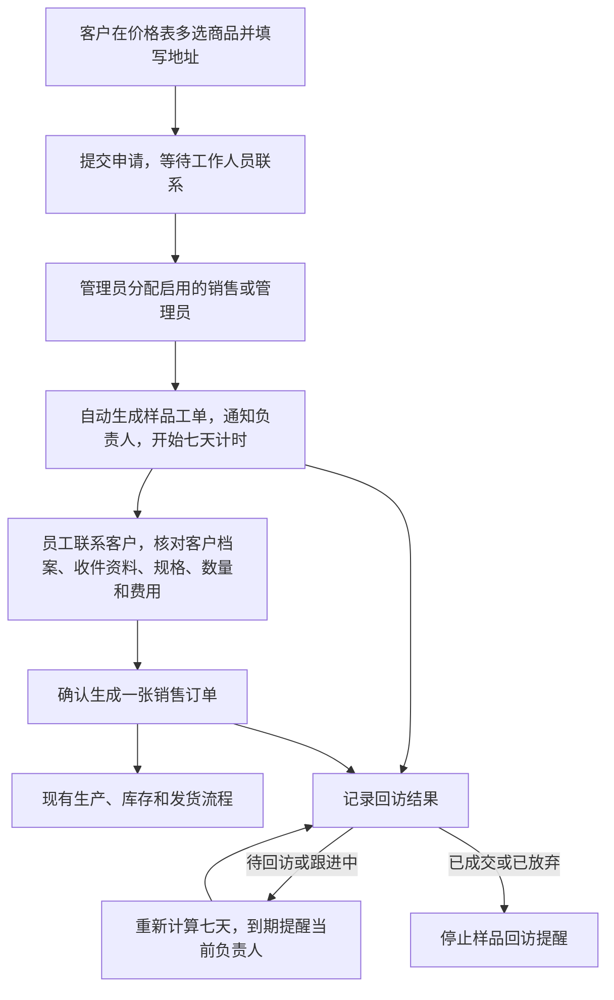

# 样品申请与回访手册

适用需求：PR-692。客户从小程序价格表中心申请；员工在 ERP“订单销售 → 样品申请与回访”或小程序员工首页“样品工单”处理。ERP 页面右上角“操作手册”可随时查阅本手册。

## 流程图

## 权限与前置条件

- 登记客户只可查看本人申请和处理进度，不能分配、确认订单或查看内部回访内容。
- 管理员可查看全部申请，分配或改派给启用的销售或管理员；销售只可处理本人负责的工单。
- 价格表必须是价格表中心中有效、已发布的官方价格表。客户专属报价权限保持原规则。
- 寄样商品须有当前有效、已发布的 BOM 规格。缺规格时先到商品创建器配置并发布；不能手工输入临时克重绕过生产、库存规则。
- 建档前需准备客户类型、来源和默认订单类型。无法选出这些基础资料时，先请管理员维护后刷新。

## 客户申请

1. 在价格表中心打开一张价格表，选择需要的商品，点击申请样品。同一申请只选这张表中的商品。
2. 未登记时，在同一个底部面板填写昵称并授权手机号；已登记会从后台恢复，不重复授权。
3. 填写收件人、收件电话、完整地址，可选填留言。收件电话默认带入已验证手机号；修改收件电话不会改动账号已验证手机号。
4. 提交后显示“申请已提交，工作人员将联系您，对接样品事项。”在“我的样品申请”查看进度。
5. 申请记录保留当时的价格表名称、版本、商品和联系资料。后续价格表发布新版本不会改写已提交的申请。

## 管理员分配与改派

1. 在 ERP“样品申请与回访”选择“待分配”，打开申请；也可从 ERP 或小程序站内通知直接进入。
2. 核对申请商品和收件资料，在“分配负责人”选择启用的销售或管理员，点击“保存负责人”。
3. 系统只生成一张样品工单，通知负责人；首次分配时开始计算七天回访周期。
4. 需要换人时，在同一工单改选负责人并保存。历史操作保留，不重复生成工单、不重置回访时间、不修改已生成订单的责任记录。
5. “客户门户配置 → 登记用户”的“样品申请”可查看该登记用户的全部申请；页面左上角可返回来源操作。

## 员工确认寄样与自动下单

1. 打开工单，先联系客户，再进入“已联系客户，确认寄样”。
2. 核对客户档案。唯一有效客户绑定会优先带入；其他匹配候选需由员工明确选择，不以昵称相似代替确认。
3. 没有匹配客户时，选择新建客户，补齐客户名称、客户类型、来源、默认订单类型。新客户负责人使用本工单负责人；既有客户归属保留。
4. 核对收件人、电话、完整地址；逐项选择同商品已发布规格、数量和单价。商品单价默认零，可按联系结果收费；运费单独确认。
5. 核对商品合计、运费和订单总额，勾选“已联系客户，确认客户档案、收件信息、规格、数量和全部费用”，点击“确认并生成销售订单”。
6. 成功后显示关联销售订单号，通过“查看关联订单”进入现有订单流程。回到样品工单可继续查看履约进度和回访。

建档、订单和样品关联一起保存；任何步骤失败均不产生半完成记录。一份申请最多一张工单、一张销售订单。失败后保留待确认状态并显示原因，可以纠正后重试。新建客户不会自动授予客户门户、其他订单或专属价格访问权限。填写费用不代表已经收款，收款仍按原订单流程登记。

## 回访状态与七天提醒

| 状态 | 操作要求 | 提醒行为 |
|---|---|---|
| 待回访 | 填写简短说明 | 保存后重新计算七天 |
| 跟进中 | 记录联系结果或后续安排 | 保存后重新计算七天 |
| 已成交 | 填写成交说明 | 立即停止，关闭样品跟进 |
| 已放弃 | 填写放弃原因 | 立即停止，关闭样品跟进 |

- 首次提醒从管理员首次分配起算七天；员工确认已联系并寄样，也会重新计算七天。
- 到期仍未更新时，提醒当前负责人；此后每七天继续提醒，直到有效回访重算时间或标记成交／放弃。
- 仅查看页面、阅读消息、改派、发货或签收均不重置回访计时。发货状态和回访状态各自独立。
- 系统每小时检查到期工单，因此提醒会在到期后的扫描中出现。服务恢复时只补发当前到期提醒，不集中补发每一个历史周期。
- 回访必须有说明，保留操作人和时间。已成交／已放弃关闭跟进；已生成销售订单仍按原订单流程处理，不自动取消。

## 通知和结果核对

新申请通知管理员，分配／改派通知当前负责人，回访到期通知当前负责人。ERP 与员工小程序使用同一份站内消息；小程序可查看未读数量、标记已读并跳转工单。此功能不发送微信订阅消息或外部聊天通知。

处理后检查：负责人是否正确、订单是否只生成一次、收件和金额是否一致、回访说明与操作人是否保留、下次提醒时间是否符合本次操作。历史已读消息可能仍显示原通知；改派后的原负责人不能继续查看工单。

## 常见问题

- 看不到入口：确认员工为启用中的销售或管理员，重新登录刷新权限；客户需从“我的样品申请”进入。
- 价格表商品已变化：重新打开当前发布价格表后选择；系统不会把旧商品自动替换为其他商品。
- 缺少规格：在商品创建器补齐并发布该商品的有效 BOM 规格，再刷新工单。只新建草稿不生效。
- 提示客户已存在：查找并确认已有客户；不要重复建档。匹配有歧义时请管理员核对。
- 提示工单已更新：其他人已经处理或改派，点击“重新载入工单”核对最新记录，再重新填写；不强行覆盖。
- 网络中断或下单失败：保留错误提示，重试或刷新检查关联订单。同一申请重复确认不会再创建第二张订单。
- 未收到提醒：核对负责人、回访状态和下次提醒时间；若已成交或已放弃则不再提醒。小程序和 ERP 共用已读状态。
- 已放弃但订单仍存在：这是正常规则；如确需取消订单，请按原销售订单取消流程处理。

## 数据与交付边界

样品申请、分配、改派、确认及回访保留历史和审计记录。本页暂无导入、导出或批量处理入口。资料恢复仅指同一微信身份在同一环境下的登记资料；切换到另一微信或开发／生产环境不会复用另一身份的数据。

开发环境部署、生产发布、小程序上传／审核／正式发布、真人业务验收分别记录；构建和自动化测试通过不代表微信正式版已更新或业务已验收。
