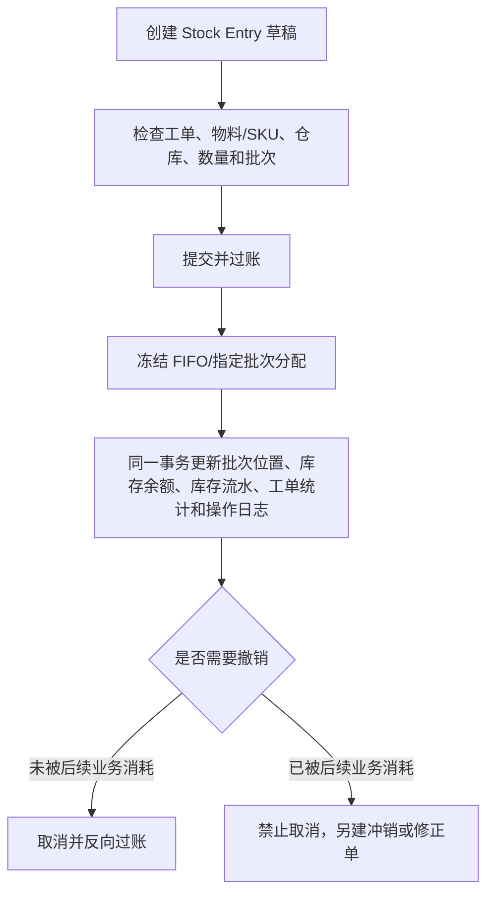

# 操作手册：库存作业与 Stock Entry

## 生产批次位置与分批完工（PR-729）

物料批次所有仓位数量之和必须等于该批次剩余量。启动时只为“完全没有仓位”的历史批次建立期初原料仓位置；已有 WIP 或其他仓位的批次不会再次自动补到原料仓。此修复只阻止重复初始化，不会擅自清除已经存在的重复仓位。发现同批在多个仓位显示、仓位总量与批次余额不一致或预留指向异常仓位时，先核对原始库存流水及现场实物位置，再按有版本和操作日志的批次核对修复；不可用普通报损或手工改数掩盖重复。

工位“完成本批”会按实际产出和本次实际用量同步扣料、记成本，并直接交接或入库。可用预留不足时，表单显示当前可完成数量及缺口；件数（袋、盒、个）必须为整数。完成一部分后保留剩余待办，补料后继续完成；只有明确结束工序才结卡。多工序中的前序产出由系统内部批次余额交接，避免二次领用或重复计成本。

## 工序自动用料与库存位置（PR-728）

工位“完成”自动从配置来源仓扣除本工序实际用料，默认 WIP；指定其他仓时直接扣该仓。前序产出通过内部批次余额交给后序，不重复领用、扣料或计原料成本。末道完成直接形成入库单据，承接已有成本；生产流程不再单独办理入库。

仓库库存中的“工序中的物料与实际位置”显示商品、来源工序、工单、位置和待后序使用数量。这些是生产中的数量，不增加商品可发货库存，不新增半成品档案或 SKU。中间工序指定仓库后，后序从实际位置使用，系统不虚构转回 WIP。

自动完成使用本单预留和同货主、同来源仓的合格空闲库存；冻结批次、其他工单预留不会被挪用。库存不足时整次完成回滚，输入保留。完成产生的库存单据与工序记录关联，不能从库存页单独取消；在工单详情中的“完工入库与历史核对记录”更正，记录差额、成本和原因。旧单补账必须现场核实数量及实际用料，已存在的记录逐项抵扣。

### 核对物料批次库位

入口：仓库库存 → WIP 物料库存 → 批次列表 → “核对库位”。此操作需要库存查看和库存写入权限。先查看批次余额、各仓当前余额及关联工单预留，再向现场确认实物分别在哪个仓；只按真实物理位置调整，不以账面重复显示推断实物位置。

1. 在目标批次打开“核对库位”，检查预览版本、批次剩余量、所有现有库位和关联工单预留。
2. 填写每个实际存放仓的克数及件数；件数为整数。某仓无实物时删除该行或填 0。各仓合计必须等于批次剩余量。
3. 若某库位有工单预留，逐条将预留指向核实后的来源仓；目标仓的余额需覆盖该仓预留量。不要移走其他工单实际需要的预留。
4. 填写原因并提交。系统校验批次版本、仓库货主、预留和余额，保留前后快照及操作日志；重复请求返回原结果。

此功能只修正系统批次库位和关联预留，不会搬动物料，也不会增加、减少批次总量或成本。现场位置未确认、总量不平、仓库货主不符或预留超出目标仓余额时，不提交；先核清原始单据及现场位置。

手工转仓、退料仍用于发生了实际移动的例外场景。正常生产直接在工位完成，无需每道工序重复执行领料和入库。历史手工单据沿用原追溯关系。

## 工位多选与合并领料（PR-724）

入口：生产管理 → 工位视图 → 进入包装台或其他具体工位。查看需要生产、库存查看权限；过账还需生产执行、库存写权限，并已绑定员工。

1. 勾选本次任务，或点击任务表头全选。表头横杆表示部分选择；再次点击全选框取消选择。切换工位后重新选择，不跨工位领料。
2. 点击“合并领料”，在当前工位抽屉核对物料汇总。不同规格、库存单位、货主分开汇总；来源仓不同的物料分组提交，展开可核对原工单、任务、批次与分配数量。
3. 默认勾选可领物料，数量为尚未领用需求中当前可领部分，不重复累加单任务记住的整包量。可取消本次不领的物料，也可修改实际数量；件数必须为整数，重量精确到克。数量减少按任务优先级、计划时间、任务编号依次满足；额外数量只使用未被占用的合格库存，优先记在首个符合条件的任务。
4. “一键领料并过账”直接把合格库存移到 WIP；额外领用量作为额外 WIP 显示，不增加生产消耗。等待前道产出、库存不足、质检冻结的物料继续保留待办。不得用领料代替耗料或完工。
5. 同一物料来源组内所有工单共同成功或共同回退；其他物料来源组可以独立成功。结果显示已领、额外 WIP、仍待领、失败原因及 SE 单据入口。工位任务自动刷新，仍缺半成品时继续显示缺料是正常状态。
6. 若提示库存、预留或任务已变化，点击“刷新领料建议”，重新核对后提交；系统不会悄悄改变确认过的数量。网络中断时点击“重试确认领料结果”，继续同一次请求，不会重复扣库存。
7. 已有未提交领料草稿的任务列入“需单独处理”，点“查看原草稿”继续原流程。合并领料不会覆盖或自动提交旧草稿。

结果校验：检查来源仓减少与 WIP 增加一致，单据按原工单保留；在“操作日志”筛选“工位合并领料”可查看本次批量结果，单张 SE 仍保留创建和提交日志。取消领料继续在原库存单据按既有规则操作。本功能不自动开工、耗料或完工。

## 整袋领料与返回工位（PR-722）

适用：有生产、库存写权限并绑定员工的人员。从“工位视图”具体任务点击“领料”，在库存作业核对冻结的物料、货主、来源仓和批次，填写本次实际数量；单位由系统显示，重量可按 kg/g 等单位等价换算，件数须为整数。

建议量只用于填充，不是领取上限，也不要求 60kg 整倍数。可以把建议 15.57kg 改为 60kg；来源批次须有足够合格库存，其他工单已经预留的数量不可挪用。保存草稿不影响库存；点击“提交并过账”后完整 60kg 转入同货主 WIP，本工单对应的待领预留随之转移，多出的部分成为可用 WIP。实际生产消耗仍另行记录，不扩大 BOM 需求、工单产量或生产消耗。

已有草稿保留手填数量，建议量更新、提交失败均不会自动裁剪 60kg。若提示库存不足、质检冻结、来源或货主不匹配，按明确原因处理后重试。更换冻结来源仍须按生产计划重排流程办理。

库存作业页左上角和领料抽屉内均有“返回工位”。保存或提交成功后留在单据页供核对，再点击返回；返回后保留原“我的／全厂”范围，并刷新、定位原工位任务。若有未保存修改，选择“保存草稿并返回”“放弃修改并返回”或“继续编辑”；保存失败保留输入，不会自动过账。菜单直接进入或刷新页面没有本次返回上下文时，不显示过期入口。

结果核对：来源仓减少实际领取量，WIP 增加同量；本工单仅占用所需预留，余料保留相同货主。库存流水和操作日志可查保存、提交、撤销及实际／预留／余料数量。撤销只反向该单实际转移及预留，不能动用其他工单占用；已耗用或余料已被占用导致不足时，整单撤销失败，不会部分改变库存。历史已提交单保持兼容。

## 客户虚拟仓库管理（PR-710）

适用：有库存读写权限的内部员工。从“客户门户配置 → 一件代发履约设置 → 库存代发”的仓库选择旁点击“打开仓库”，使用右侧抽屉维护客户子仓。

“虚拟仓库”是固定展示分类，父级没有库存余额；下属原料、包材和成品仓继续使用原库存账。历史已绑定客户仓自动归入，仓库编码、库存与单据关系不变；库存列表可在虚拟仓库分类查看子仓，选择具体仓库核对库存。

抽屉默认当前客户，可切换全部并搜索、分页。新增默认当前客户成品仓，也可选择其他客户或暂不绑定。编码自动生成且不可更改，仓库类型在新增时确定；编辑维护名称、说明和绑定客户。有任何业务历史时不能更换绑定客户，避免历史库存归属变化。

删除只停用、不清除历史。有余额、预留、待入库权益或未完结单据时系统拒绝并说明原因，请先处理对应业务。仓库名称编辑、客户绑定和删除均检查修订版本并留操作日志；遇到版本冲突应重新读取后核对，不能覆盖他人变更。未绑定的虚拟子仓不会作为公共仓向客户开放。

仓库操作成功后返回代发配置，核对选中的客户成品仓，再点击“保存履约设置”。抽屉刷新仓库候选时保留尚未保存的代发费用和开关。

## 当前生产库存动作（PR-729）

生产人员在工位一次填写本批实际完成数量和实际用料。提交“完成并入库”或“完成并交接”时，系统同步记录耗料、产出、库存位置、增量成本、库存单据及操作日志；不再从库存页另行办理正常工序的领料、耗料或完工入库。前序批次交接后由后序直接使用，避免重复扣料和重复成本。

料默认从 WIP 扣减；工单冻结配置指定其他来源仓时，系统直接从该仓扣减。质量冻结、货主不一致、预留不足或库存版本变化时，完成整笔回滚，页面保留输入并显示缺口。不会跨仓寻找库存，也不会挪用其他工单预留。

库存单据仍保留给采购收货、实际转仓、退回未用原料、报废和其他明确库存操作。历史生产库存单据只用于追溯；需核对或修正历史生产数量时，从对应生产工单详情进入记录核对。现场需先确认真实数量和仓位，系统只补差额并保留原流水。

## 适用范围

库存单据、采购收货入库、物料发出、普通转仓、生产领料、补料、退回未用原料、生产消耗、完工入库、盘点调整、库存流水和操作日志。

PR-479-MANUFACTURING-PHASE2-EXECUTION-COST-CLOSED-LOOP：生产执行相关库存变更先形成 Stock Entry，再关联库存流水、工单、工序卡、生产日志和操作日志。历史版本把入口称为 `Stock Entry单据`，并把退回未用原料称为 `WIP退料`；PR-552 后统一显示为 `库存单据` 和 `退回未用原料`。

PR-509-E2E-RAW-MATERIAL-ORDER-PRODUCTION-FLOW：库存作业承接订单需求和生产工单，上游可追溯到原料入库，下游可追溯到完工后的成品或半成品批次。

PR-552-STOCK-ENTRY-CONVERGENCE：库存写入统一为 Stock Entry。库存作业只保留 `库存单据` 和 `盘点调整`；原 `WIP领退/转仓`、`原料入库`、`成品转仓` 独立写入入口不再使用。历史 MT、FT、原料入库和旧 Stock Entry 只读展示，不重新过账。

PR-605-MATERIAL-STOCK-COST-CONVERGENCE：采购收货是外购物料新增库存和正式采购成本的唯一入口；库存作业不再允许新建普通原料入库。库存动作实时显示来源仓账面/可用/冻结余额，盘点按所选仓及 FIFO 批次调整，重量和离散物料使用同一仓库库存模型。

PR-559-PRODUCTION-CONFIG-WIP-ISSUE-UX：工单生产领料按冻结物料快照和当前 WIP 覆盖生成。抽屉显示真实工单号，不要求用户填写工序卡或“生产中”ID；每行只填写一个领用数量，库存单位由系统显示，生产领料不填写单位成本。PR-561 后一个单据显示全部冻结物料，缺口作为建议量，零建议行可按需填写标准批量。

PR-560-PRODUCTION-ISSUE-COMPACT-DIAGNOSTICS：工单库存动作的多物料明细按统一列头紧凑排列，桌面端一行一个物料。原料仓库存不足和质检冻结使用中文逐物料说明；恢复旧草稿时重新读取最新 WIP 覆盖。

PR-561-WIP-BULK-MATERIAL-ISSUE：当前 WIP 缺口是建议值，不是生产领料上限。生产领料可以按 60Kg 等实际批量从原料仓转入 WIP；超出工单当前需求的部分继续保留在 WIP，不能自动算作生产消耗。原料仓合格 FIFO/指定批次实存仍是提交硬上限。

PR-482-MANUFACTURING-PHASE3-MRP-SUGGESTIONS：MRP 采购建议和调拨建议仍只做计划提示，不自动改变库存；确认建议后使用本手册的统一库存单据完成实际入库或转移。

## 入口

- 库存管理 / 库存作业 / `库存单据`
- 库存管理 / 库存作业 / `盘点调整`
- 库存管理 / 仓库库存：查看仓库余额；查看 WIP 时筛选 `WIP在制仓`
- 生产管理 / 生产工单 / 执行枢纽：生产领料、补料、退回未用原料、记录生产消耗、完工入库
- 操作日志：按库存单据、工单、工序卡或关键字追溯用户触发写入

## 统一流程

## 库存单据

### 页面打开与商品选择（PR-670）

- 首次进入库存作业先显示单据列表；物料、商品和仓库基础资料在点击 `新建库存单据` 或打开已有单据时加载，不需要等待全量商品档案。
- 商品/SKU 选择框按名称、编号、条码或产品 ID 搜索，每页 20 条；输入停止约 250 毫秒后查询。下拉框底部的 `加载更多` 用于翻页，已经选择的历史商品会继续保留并回显。
- 选择商品后系统再读取该商品的完整 BOM 规格和库存单位。规格读取完成前 `保存草稿`、`提交并过账` 会保持禁用；读取失败时保留当前单据输入，点击重试或重新选择商品。
- 直接打开链接、刷新或返回历史单据时，系统先恢复单据和商品 ID，再补齐商品详情，不会因为选项列表尚未加载而清空明细。
- 页面切换时会先显示当前页面标题和“正在打开页面”；版本文件失效时显示 `重试`，不会自动刷新未保存表单。

1. 点击 `新建库存单据`，先选择单据目的：
   - `物料发出/报废`：`material_issue`
   - `库存转仓`：`material_transfer`
   - `生产领料`：`material_transfer_for_manufacture`
   - `退回未用原料`：`material_transfer_for_manufacture + is_return=true`
   - `生产消耗`：`material_consumption_for_manufacture`
   - `完工入库`：`manufacture`
2. 选择物料或具体商品/SKU，核对库存单位、来源仓、目标仓和数量。选择物料和来源仓后，页面立即显示该仓账面库存、可用库存和冻结库存；切换选项或恢复草稿时重新读取，不使用草稿旧快照。生产用途必须关联生产工单；完工入库必须选择工单产出的具体商品规格。
   - PR-639：物料档案归属、单据明细货主、库存批次货主必须一致；客户绑定仓库还必须与该客户一致。工厂物料只能形成工厂货主批次，客户物料只能形成对应客户货主批次，系统拒绝跨客户或把客户物料记入工厂库存。
3. 普通原料入库已退役。旧入口跳转采购入库；历史已提交/取消单据继续只读，旧草稿提示到采购入库重建。直接提交 `material_receipt` 会被拒绝，采购收货内部仍产生统一 `SE-*`、批次、仓位和流水。
4. 原料未指定批次时，系统按 FIFO 分配并在提交后冻结实际批次；指定批次时只使用该批次。冻结、拒收、停用或余额不足的批次不能提交。
5. 点击 `保存草稿` 只保存单据，不改变库存；点击 `提交并过账` 才改变库存。重复提交同一单据不会重复过账。
6. 已提交单据可以点击 `取消`。系统按原冻结批次反向过账；如果目标库存已经被后续消耗，系统拒绝取消，并提示另建冲销或修正单。
7. 列表中的“历史单据”仅供只读核对，不能从统一页面取消或改写。历史库存不自动重算、不自动补单。

## 采购收货入库

1. 进入采购入库创建采购单，选择供应商、外购物料，按物料库存单位填写预计数量、预计单价和预计仓库。创建采购单不会更新库存或物料最近采购入库价。
2. 对待收货采购单点击“确认收货”，填写实际数量、最终单价和目标仓。包材默认包材仓，其他物料默认原料仓；只能选择有效非成品仓。
3. 确认后，系统在同一事务完成库存单据、物料/库存批次、仓位、库存流水、采购收货记录、采购单状态、最近采购价和操作日志。任一步失败全部回滚。
4. kg、袋、件、盒等单位都按物料主档单位过账；离散数量必须为整数。历史 `qty_g` 采购继续按 kg/原料仓只读兼容。
5. 客户来料必须选择归属于该客户的物料档案并进入绑定该客户的仓库。没有对应档案时，先在物料档案新建或复制基础资料并明确选择该客户；不要使用本公司或其他客户的同名物料代替。

## 生产工单快捷动作

1. 进入生产工单或工单执行枢纽，选择需要的动作：
   - `生产领料`：以当前物料缺口作为默认建议量，从原料仓转到 WIP 仓。
   - `补料`：按仍未领足的缺口生成预填内容。
   - `退回未用原料`：只显示该工单实际领入且尚未消耗/退回的批次余额，方向为 WIP 仓到原料仓。
   - `记录生产消耗`：只消耗该工单当前 WIP 可用量与尚未消耗冻结需求中的较小值。
   - `完工入库`：带入工单产出商品/SKU、规格、计划产出和成品仓。
2. 快捷动作打开同一库存单据抽屉，并显示 `工单号：WO-...`。生产领料会一次带入全部冻结物料；当前无缺口的物料也可填写标准批量，保持为 0 的行在保存时自动忽略。桌面端按统一列头一行显示一个物料，物料、原料仓、WIP 仓和库存单位只读，每行只填写一个“领用数量”。可删除本次暂不处理的行，允许分批领料。
3. 首次领料默认当前剩余缺口；该值只是建议，可以改为 60kg 等实际仓储批量。PR-599 后重量物料主档统一按 kg 显示，因此 60kg 填写 `60`；底层规范克余额和历史单据快照保持不变。同一工单同一物料最近一次已提交的领料量会作为下次标准批量默认值，即使高于当前建议量。已有草稿时恢复草稿原数量并重新读取当前 WIP 覆盖；即使草稿高于建议量或当前建议为 0，也不会裁剪或删除，只显示非阻断说明。已取消单据不作为数量记忆来源。
4. 保存草稿不改变库存。提交时系统重新检查物料属于该工单冻结需求、库存单位一致且原料仓库存充足；不再按当前 WIP 缺口限制数量。多物料任一行真实库存不足时整单不入账。
5. 超出当前工单需求的领料只增加 WIP 库存，不增加工单已消耗量。现场实际投料后，另用 `记录生产消耗` 创建生产消耗单据；系统最多带入并允许消耗“工单冻结需求减去已提交消耗”，超出的标准批量继续留在 WIP，确保领料、消耗和剩余 WIP 分开追溯。
6. 工艺损耗记录在工序卡实际数据、完工单据和工单实际成本中，不使用盘点调整伪造损耗。

## 报废、副产品和盘点

- 实际丢弃原料或商品使用 `物料发出/报废`，填写报废原因；这会真实减少库存。
- 可回收副产品使用普通库存单据进入指定副产品仓或报废仓，不直接抹除库存。
- `盘点调整`只用于实物盘点差异、数量修正和批次成本修正，不作为仓库移动、领料、退料、生产消耗或工艺损耗入口。
- 物料盘点先选仓库和物料，系统显示并带入该仓当前数量。增加库存时在该仓建立调整批次；减少时按该仓 FIFO 扣减批次位置并记录调整批次分配。提交后按所有仓位汇总物料总库存，不覆盖其他仓。
- 批次成本调整同时支持重量和袋/件/盒等离散物料；价值变化分别按剩余重量或剩余件数计算，并记录批次、所在仓库、修改前后成本、原因与操作者。

## 结果校验

- 每次新库存写入只有一个 `SE-*`，不新增 `MT-*` 或独立成品转仓记录。
- 提交后，单据明细的冻结批次、仓库库存余额和库存流水 `before/change/after` 一致。
- 生产工单的已领料、已消耗、已退料和可退料与该工单 Stock Entry 及冻结批次一致。
- 采购单、采购收货、采购价变更、盘点调整、生产领退料、生产消耗和完工入库均可在操作日志查到操作者和时间。
- 完工入库后，具体成品/SKU 批次可以追溯到工单、物料批次和 Stock Entry。

## 常见问题

- 提交失败：检查单据目的、工单、物料或商品/SKU、数量、仓库方向和批次状态。数量必须大于 0，来源仓和目标仓不能相同。
- 提示物料归属与库存货主不一致：返回物料档案核对“物料归属”，再核对当前仓库绑定客户和单据货主。不能靠更换查询参数、同名物料或其他客户批次绕过；归属选错且档案已使用时需新建正确档案并走正式库存处理。
- 退料提示跨工单或可退量不足：只能退回同一工单实际领入且尚未消耗/退回的批次，不能借用其他工单的 WIP。
- 提示库存被质检冻结：先完成质检复核或更换合格批次，系统不会跳过冻结状态。
- 提示“原料仓库存不足”：提示中的“可用”只统计来源仓内可实际分配的合格 FIFO/指定批次，不等于跨仓库的物料档案总库存。按提示逐物料核对需领、可用、缺少和库存单位；库存可能已经在 WIP/其他仓，也可能被质检冻结。
- 取消提示已被后续消耗：不要修改历史流水；使用新的冲销/修正单并在备注中写明原 `SE-*`。
- WIP 数量不一致：到仓库库存筛选 WIP 仓，再按工单查询库存单据及其冻结批次；不要回到旧 WIP 写入页面补数据。
- 执行枢纽显示“WIP资料待完善”：该历史工单既没有冻结物料快照，也没有可兼容的物料占用。不要手工猜物料或单位，先由管理员核对工单来源数据。
- 领料数量高于当前建议量：这是允许的标准批量领料。系统保留填写数量，提交后超出工单需求的部分仍在 WIP；只有真实原料仓合格库存不足、批次冻结、物料不属于工单或库存单位不一致才会阻止提交。
- 全部领用数量为 0：至少填写一个大于 0 的领用数量；不需要本次处理的零数量行会在保存时忽略。
- 完工入库失败：检查必要工序、生产消耗、质检、工单状态和产出 SKU 是否一致。

## 客户成品仓与小程序库存（PR-581）

- “我的库存”和一件代发目录都读取 `finished_inventory`、批次账和未发货预留，不再读取不同步的客户库存快照表。
- 汇总仅包含 `warehouses.customer_id=当前客户` 的启用成品仓。其他客户仓、公共仓、冻结/不合格批次及已有预留不计入可用量。
- 批次详情展示生产日期、所在仓库、入库时间、可用/预留数量和质量状态。旧库存缺少生产日期时显示“历史库存，暂无生产日期”，不得用入库时间或当前时间伪造生产日期。
- 发货提交先预留、发货确认再实际扣减、取消则释放；FIFO 按可用合格批次的生产/入库时间由早到晚分配。并发提交通过行锁和同事务复核避免超卖。
- PR-667：代加工商品的一件代发先预留可用成品批次，不足部分再预订已提交代加工申请的有效在制产出；两者都按先进先出。成品与在制合计不足时整张订单不写入。
- PR-667：完工入库将对应在制预订转为本次成品批次占用，并保存“申请行 → 订单行 → 成品批次”的转换记录。部分入库只转换实际数量；最终少产或质检导致不可用时保留缺口和受影响订单，不借用其他客户或规格库存。
- PR-668：代加工完工入库提交后显示结果面板，核对本次实际数量、质检结果、客户货权、目标仓、来源工单、入库单、成品批次、累计合格入库、订单占用和现货可用。结果面板列出本次转换的关联订单，并可进入客户申请、订单、工单和库存批次。
- PR-668：申请完成数量只累计同一申请行的客户、商品、BOM 规格和目标仓合格成品。部分入库仍为“开始生产（部分入库）”；质量冻结或不合格批次不计入完成量，并继续显示受影响订单与缺口。

## 小程序库存独立详情与多选生产（PR-582）

1. 客户进入“我的库存”，可在顶部输入商品名称；服务器只在当前客户绑定成品仓的中央库存内搜索和分页，并显示总条数、总页数、当前页、跳页和每页条数。
2. 点击库存卡片进入独立详情页，核对商品、SKU、规格、批次、生产日期或历史库存提示、仓库、入库时间、可用/预留和质量状态。使用顶部返回或设备右滑回到库存列表。
3. 单个规格生产：在详情页点击“添加生产工单”。多个规格生产：回到库存列表勾选多个商品后点击“生成生产工单（N）”。
4. 生产工单页面只预填所选目标商品和规格，数量由客户填写；预填上下文只在本次页面跳转的前端内存中存在并消费一次，不改变库存、不建立预留，也不会在提交后重复恢复。
5. 若某个历史库存商品已停用、当前客户不可见或没有可用生产 BOM，页面显示具体未加入项；先在 ERP 恢复商品可用范围或补齐并发布有效 BOM，再重新从库存添加。不要把不可生产商品按 0 数量或默认物料提交。

结果校验：切换搜索词或库存页码不会清除已勾选规格；批量入口只进入一张包含多目标 SKU 的生产申请。真正提交后才按既有生产申请流程试算、锁定物料、建立预留并写操作日志。

## PR-598：物料工单完工入库

1. 物料工单下达时先核对产出对象、计划数量、目标仓库和上游依赖。存在未完成上游工单时不要绕过阻断手工调整库存。
2. 完工时录入实际合格数量；系统按物料库存单位把合格量写入目标仓库。重量与离散单位分别按自己的数量字段处理，不用商品销售规格代替物料单位。
3. 批次管理物料会生成或关联可追溯批次，并记录来源工单、目标仓库和入库时间；后续下游工单按该批次领用。
4. 重复点击完成不得再次入库。取消或失败时以冻结计划和流水为准释放未使用预留，已经发生的领料、退料、报废和合格入库继续可追溯。
5. 目标仓库在生产计划草稿行选择并保存；商品计划行默认成品仓、物料计划行默认 WIP 在制仓。计划提交后不能从页面改仓，完工必须写入工单冻结的目标仓库。

结果校验：物料工单、完工库存流水、批次和目标仓库数量一致，操作日志能定位本次完工动作。

## PR-600：BOM 规格库存身份

- 已切换商品的成品库存、批次、流水和预留使用 `父商品 + BOM 规格 + 仓库`，数量单位就是规格库存单位；不同 BOM 的同名规格不能合并库存。
- 半成品只能通过生产完工进入物料批次；普通物料入库拒绝半成品。库存调整仍可处理盘点差异，但必须填写原因并进入操作日志。
- 默认 BOM 切换前系统检查旧规格组的库存、预留、未完成订单、生产与履约；任何占用不为零都拒绝切换。
## PR-608 价格表与库存规格一致

价格表发布行必须绑定主商品的 BOM 版本、规格和变体身份，库存单位跟随该 BOM 规格。一个商品有多个规格时价格表显示一个商品和多条规格，不得把不同规格合并为一个销售单位。默认 BOM 切换后未发布草稿需要刷新，已发布快照保持不变。

## 客户小程序可见仓库（PR-711）

客户的“我的库存”按当前客户绑定的启用虚拟子仓展示仓名及对应分类，空仓仍可见。库存余额与货主仍读取原账，不因仓库可见性重新归账。其他客户、未绑定虚拟仓、停用仓与公共仓不列入该客户视图；列表、详情和流水使用相同权限。无仓或无库存请核对客户绑定和启用状态，不调整余额来恢复显示。

## 旧完工入库链接（PR-726兼容）

旧“完工入库”链接只为兼容历史地址：有工单号时定位至对应工单记录，没有工单号时返回生产工单列表。新生产不再使用独立完工入库页；正常完成在工位一次完成并自动入库。历史数量更正从工单详情处理，现场核实后提交，保留原值、差额、原因、操作者及库存单据关联。
