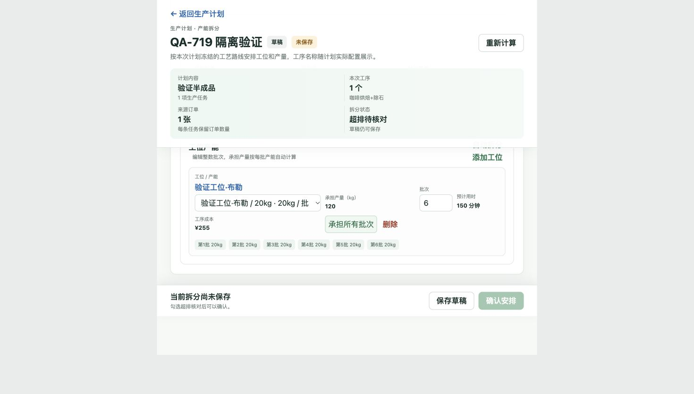
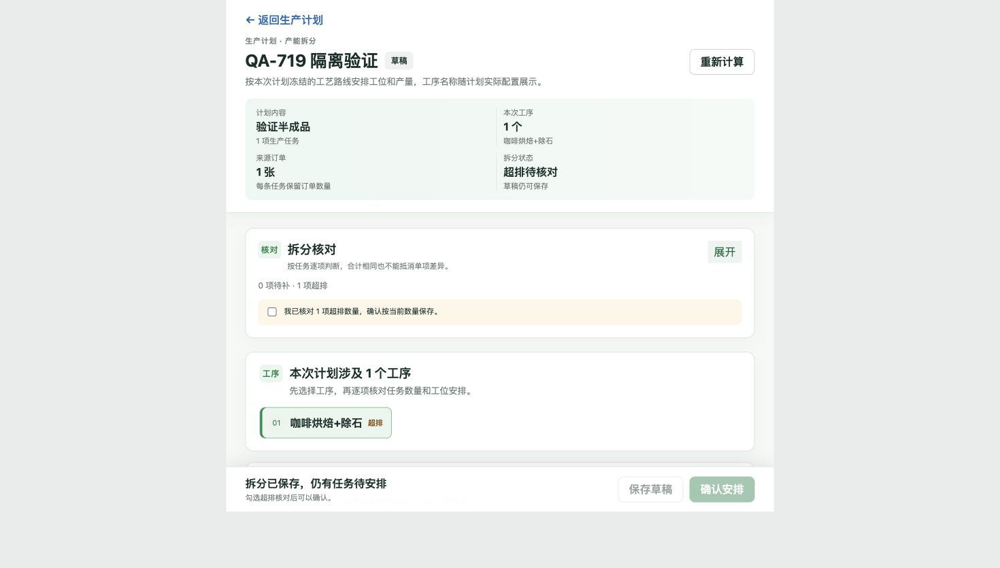
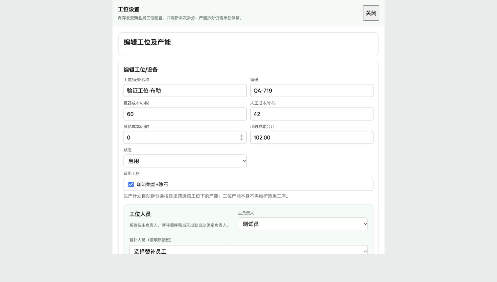
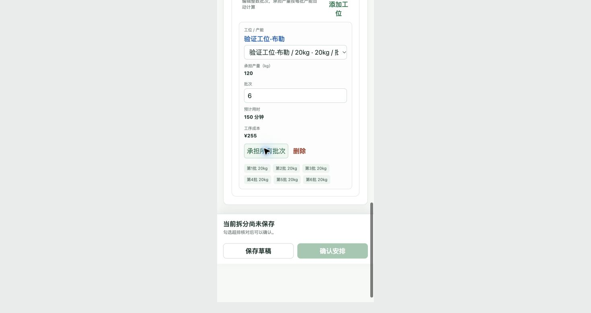

# PR-719 生产计划产能拆分优化

2026-10-23。分支 `codex/production-capacity-batches-20261023`，基线 `470018f9`。原 ccd2 工作区已有改动保持不变。PR 状态 review，Van 业务验收待完成。

## 交付范围

核对面板折叠；可点击工位及完整编辑抽屉；正整数批次和只读产量；承担所有批次；自动拆分整批余量；旧尾批保存兼容。按任务 ID 和冻结工序序号隔离，重复工序 ID 不串行。名称/费率刷新保留旧尾批，批量变化保留批次数重算。服务端读取当前产能，拒绝无效批次，旧数量请求仍兼容。没有新增数据库字段。

权限验证补齐生产计划接口在统一权限映射中的遗漏：读取归 production.read，预览与保存归 production.run；工位/产能编辑仍为 bom.write。已有角色权限未扩张。业务写入沿用操作日志。

## RED → GREEN

- 前端初始 RED：缺少批次驱动、承担全部、整批余量和旧尾批兼容函数。
- 服务层 RED：按批次请求被旧 planned_qty 必填挡住，整张草稿未拒绝无效行。
- PostgreSQL/API RED：count-only 预览返回 400，工位失去适用工序后仍可保存。
- 运行时 RED：缺少可折叠核对和共享工位编辑行为。
- 联调补充 RED：旧草稿携带旧产能时，编辑应使用当前产能；保存重载后缺 operation_id 的行应从冻结工序序号恢复校验身份。
- 权限 RED：缺生产权限的员工可进入计划接口；补齐映射后相关接口 403/200 边界通过。
- GREEN：合入最新 develop 后 1,533 项前端测试、全量 Go 包测试、Vue 生产构建。构建仅有既有 chunk-size 提醒。
- 隔离 PostgreSQL：TestCapacityBatchAPIReadWriteCompatibility、两个旧拆分 API 测试、整张草稿原子保存及版本冲突测试通过。覆盖预览、两种保存入口、重载、旧数量、无效批次、服务端最新产能、停用/工序变更阻断、操作日志和已提交快照保护。
- 计算覆盖 kg/g/件、计时/计件成本、浮点整批边界、整除及余量、同任务工序隔离。

## 验证范围与既有问题

业务写入只使用本机临时 PostgreSQL schema 和本地内存 UI fixture，没有写生产计划 11。全量 Go 默认不配置集成数据库；本次接口的真实数据库验证单独运行。

扩展数据库回归遇到两个旧 fixture 问题，在原始 470018f9 基线同样复现：归档 BOM 测试缺 product_bom_spec_authorities 表、父商品冻结测试缺来源库存。另一个提交/取消并发测试偶发库存不足，基线连续三次通过；该测试不走拆分接口，保留失败记录，不计入本次 GREEN。

## 浏览器验证（隔离 fixture，实际 Vue 组件）

- 宽屏默认展开；805px/390px 默认收起，可切换，收起仍保留超排勾选。
- 103.797kg / 20kg = 6 批、120kg、超排 16.203kg；单行取代原同任务两行，150 分钟、255 元。
- 旧 3.797kg 尾批打开保留；1.5 批显示错误且保存禁用。
- 抽屉含基础资料、人员、工序、成本和产能档。保存 12kg 产能时保留 6 批并变为 72kg，原未保存拆分仍在。关闭已保存表单正常返回。
- 工位和产能表单分别保存，保留另一个表单未保存输入，由运行时测试验证。
- 改回 20kg 后保留 9 批变为 180kg，承担所有批次重算 6 批、120kg。
- 确认安排返回详情且仍为草稿；刷新重开数量、批次一致，无工序身份误报。
- IAB 对原生未保存确认框的自动控制受限，后续交互在独立 Chrome 验证会话完成。

截图均为隔离数据：






## 可重复验证

```sh
bash scripts/verify_kferp.sh changed
bash scripts/verify_kferp.sh frontend
(cd orderapp-remote && go test ./...)
(cd orderapp-remote && ORDERAPP_TEST_DATABASE_URL='postgresql:///postgres?host=/tmp' go test ./internal/interfaces/http/production -run '^Test(CapacityBatchAPIReadWriteCompatibility|ProductionPlanOperationSplitAPIReadsAndSavesDraftCapacitySplits|ProductionPlanOperationSplitPreviewAPIReturnsDemandGapWithoutSaving|ProductionPlanDraftAPISavesTheWorkspaceAtomically|ProductionPlanDraftAPIReportsVersionConflict)$' -count=1)
```

## 发布

已发布生产环境。功能合入 [PR #256](https://github.com/Backstage2539/KFerp/pull/256)，develop 合并版本 `3edf408a9424ad45ab4cf03deb3749a7a2f446ba`；保留 main 上已有修复后，经 [PR #259](https://github.com/Backstage2539/KFerp/pull/259) 合入 main。

- 部署版本：`9b37113659d080c30ce026bf11af694457e54964`。从干净 main 执行 `KFERP_SKIP_MINIAPP_EXPORT=1 bash deploy_orderapp.sh production`，完整六阶段结束，退出码 0。
- 生产服务启动：2026-10-23 12:00:23 Asia/Shanghai。`erp_prod_orderapp` running，检查时重启次数 0；`erp_prod_postgres` healthy，文档转换服务 running。应用镜像 `sha256:f5081dedb9f3c60fa955a5eb08ea889304beaf794d4118bc5728064899fbe6d4`。
- 运行检查：登录页 200，未认证计划 API 401，认证页面/计划/工位/产能 API 200。认证来自运行容器配置，凭据未输出或入库。公网、服务器文件、运行容器的页面入口及两份相关 JS 逐字节一致，包含新交互文案。
- 生产计划 11：仅 GET 只读；部署前后均为 draft、14 项任务、0 条已保存拆分，持久内容完全一致，响应 SHA-256 均为 `36dad440d88185ad14902a56b6d1b034a680370547a16cb66cc9f7c80c8bf5ac`。没有生产保存、确认安排或提交操作。
- 线上生产手册 200，已包含 PR-719；PR UI 为 review，DEV-719-01/02/03 为 done。Vue 手册页读取单一来源 OP_MANUAL_PRODUCTION.md。
- 生产发布同时完成小程序兼容测试/构建、24 页产物检查，RELEASE_INFO 版本一致。没有导出到本地交付目录，也没有微信上传、提审或发布。
- 详细只读证据：[运行与静态文件校验](production-capacity-runtime-proof.json)。

发布前按共享部署锁等待其他任务完成，未覆盖其正在发布的版本。服务器空间不足时仅清理可重建缓存，并将 67 个旧开发源码备份压缩归档；逐个内容比对后移除未压缩副本，压缩包权限 0600。数据库、数据目录、全部生产源码备份及回滚镜像保留。归档校验、SHA-256 和恢复命令记录在服务器 `/opt/stacks/erp/source-backup-archives-20261023.jsonl`；本次部署前可用约 4 GiB，部署后 2.07 GiB。

回滚依据（已核实存在）：

- 上一版源码：`/opt/stacks/erp-production/orderapp.backup.deploy-20261023114958-9b37113659d0`。
- 回滚镜像：`kferp-orderapp-rollback:production-20261023114958-9b37113659d0`。
- 回滚镜像 ID：`sha256:b5e2f7984f267558c778c902a2e09740c95abb845da03152a78c5b1278237dd9`，与切换前运行镜像一致。没有执行回滚。

发布后的回执仅更新文档，不再次部署。线上运行版本仍以上述 9b371136 为准；Van 业务验收待完成。
