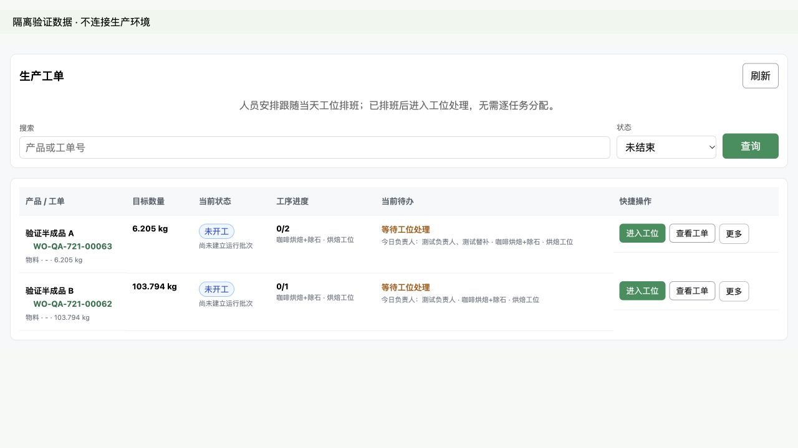

# PR-721 已排班工单误报任务待分配

2026-10-23。基线 origin/develop `17c48f2a`，分支 `codex/work-order-roster-status-20261023`。原 ccd2 工作区的已有改动保留。生产修复沿用本会话生产目标，业务验收由 Van 完成。

## 复现与原因

生产只读核对计划 12 的两个工单：尾号 63 含烘焙、色选两项任务，尾号 62 含一项烘焙任务。当天排班已有有效负责人，工位任务接口正确返回 roster_status=assigned；工单列表却按工序摘要里旧 assigned_to 字段是否为空判断，显示“待分配 2 项任务 / 1 项任务”。排班没有丢失。

## 修复

- 工单列表加载时并行读取 GET /api/production-roster/today?scope=all，按当前工位 ID 匹配；无 ID 的旧记录才按工位名称兼容。
- 有效负责人显示“等待工位处理”、今日负责人和“进入工位”。本周未保存、无人值班、失效人工调整、待交接、读取失败分别展示，不再要求逐任务配人。
- 无人值班按工位去重计数，跳转“查看排班”；网络/权限错误保留工单列表并支持“重试”；过期异步请求不能覆盖较新结果。
- 已完成/取消的任务不会要求重新排班。执行中、暂停与本任务的交接状态保持独立；空工序不误报待入库。
- 跨页操作附带返回生产工单入口。没有新增业务写操作或修改接口、权限、数据库、历史执行人、冻结快照、库存逻辑。

## RED / GREEN 与 API 验证

- 先新增实际 Vue setup 运行测试，RED 复现：没有读取当天排班，当前待办仍为“待分配 2 项任务”；随后修复，8 项针对性测试 GREEN。
- 前端全量 1,545 项测试和 Vite 生产构建通过。构建仅有既有 chunk-size 提示。
- Go 全包测试通过；真实数据库测试在本机临时 schema 中运行。生产数据库无测试写入。
- TestPR657ProductionRosterPostgresLifecycle、TestPR658RosterReliefAndManualReplacementAPI 通过；补充 scope=all 返回合格替补负责人、版本，以及读取后 job_cards.assigned_employee_id 仍为 0 的断言，证明读取不会重新分配任务。
- git diff --check 和 changed 检查通过。

可重复命令：

```sh
(cd orderapp-remote/frontend-vue-shell && node --test src/lib/work-order-roster-runtime.test.js)
bash scripts/verify_kferp.sh frontend
(cd orderapp-remote && go test ./...)
(cd orderapp-remote && ORDERAPP_TEST_DATABASE_URL='postgresql:///postgres?host=/tmp' go test ./internal/interfaces/http/production -run '^Test(PR657ProductionRosterPostgresLifecycle|PR658RosterReliefAndManualReplacementAPI)$' -count=1)
```

## 浏览器与手册

浏览器使用真实 WorkOrdersView.vue 和本地隔离 API。已排班两张工单均显示“等待工位处理”；进入工位、查看排班均带返回入口；无人值班显示具体原因；排班接口 503 保留工单并显示“排班状态待核对 / 重试”。运行测试另覆盖旧姓名、未保存周、已结束、交接隔离、过期响应。



手册：`docs/OP_MANUAL_PRODUCTION.md` 的 PR-721 工单列表人员待办说明；Vue 手册页读取同一份文件。页面同时说明任务跟随当天工位排班。

## 发布记录

- 实现提交 `ac1c6c62f866b48079f91345ad02e5f62d1216ed`；PR #265 合入 develop `8091b2623cd2f0af568f685606699a655c993470`。生产适配 PR #266 合入 main `bedaeeb935a3636b7ac3cb3c64eff531a32bd02c`。
- 生产基线独立验证：前端 1,541 项和构建、两项隔离 PostgreSQL API 测试通过。后续共享生产发布包含已验证的 PR #264 和本修复，预检与正式发布均通过；从干净 main `6b3e67af6bda35572d91f95d4178887eb73be033` 执行 `bash ./deploy_orderapp.sh production`，脚本退出 0。本任务复用该协调发布并独立复核，没有再次重启服务。
- 应用容器于 2026-10-23 13:46:31 CST 启动，镜像 `sha256:f3fe78e2bb3745827e480bbfa35af5fe3adec80872c80d3478dec7e1af8ed4ba`，运行正常、重启计数 0，生产 PostgreSQL healthy。
- 只读 API：工单 18/19 的 3 项任务对应工位 1/4，均匹配当天版本 1 的有效排班；匿名排班 API 为 401。PR-721 为 review，DEV-849/850 为 done；生产手册返回 200。
- 实际生产浏览器刷新后，两个工单都显示“等待工位处理”“今日负责人：刘祎泊”和“进入工位”，不再显示“任务待分配”。下游包装工单仍正确显示“等待上游供给”。窄屏实际页面同时核对通过；未执行开工、领料、重新分配等业务写入。
- 发布前后工单、工序卡和排班的完整只读快照哈希相同：`a5363a720ab681bf7c3a1b97dc514b88274024a135281040391c253b73bb3e39`。
- 公网、宿主机与容器内 shell 和工单资源内容一致：`WorkOrdersView-BuqQrmjn.js`，SHA256 `145a9b3cc1af6425f1baf8e366781bf6dab69038d5713a35a16506b2d2f4e0dd`。包含新的排班请求/负责人/失败提示，移除旧的逐任务指定执行人提示。
- 旧版本 `9b37113659d080c30ce026bf11af694457e54964` 的源码备份：`/opt/stacks/erp-production/orderapp.backup.deploy-20261023133639-6b3e67af6bda`；回滚镜像：`kferp-orderapp-rollback:production-20261023133639-6b3e67af6bda`（`sha256:f5081dedb9f3c60fa955a5eb08ea889304beaf794d4118bc5728064899fbe6d4`），均已核实存在。
- 发布遇到磁盘压力，清理可重建缓存，并将 45 份 2026-10-23 以前的开发源码备份转成压缩归档。每份经 tar 对比校验、SHA256 和恢复命令落盘后才移除未压缩重复副本。清单 `/opt/stacks/erp/source-backup-archives-pr721-20261023.jsonl`；生产源码备份、数据库、数据卷和回滚镜像保留。

技术交付与只读页面核验完成；真实生产操作和 Van 业务验收保持独立。原始核验 JSON 与生产截图保留于本地任务输出（不把生产业务截图提交到代码仓库）。

共享发布的小程序产物证据见同日员工运费验收记录：对应相同 main、24 页 / 96 文件。未进行微信上传、提审或发布。
