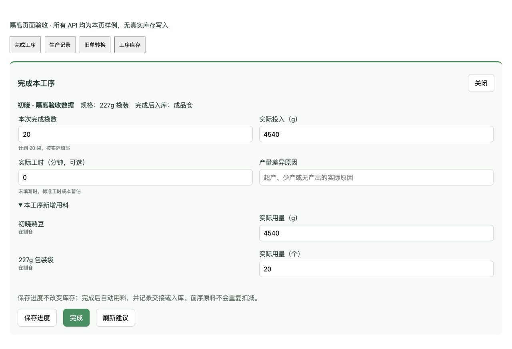
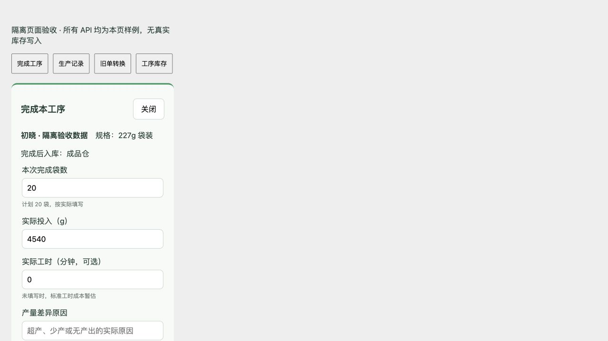
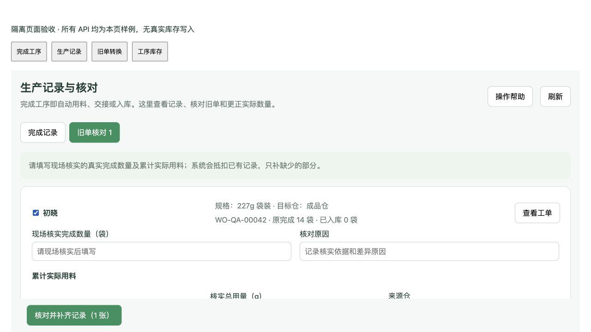

# PR-728 生产简化验收证据

状态：本地实现与验证完成，待合并、部署开发及发布生产；现场真实数量核实与 Van 业务验收未进行。

## 范围

实际数量 → 一次完成 → 自动耗料／交接／入库／成本与日志。冻结路线的入库位置、组件使用工序和来源仓；内部批次余额不属于可发货库存。原入库入口改为记录与核对。执行中旧工单需显式核对后转换。

## TDD 与隔离证据

使用独立本机 PostgreSQL 16（127.0.0.1:55428），每个 API 测试独立 schema，结束清理；从未写生产业务数据。

- RED：规划器／路线配置类型缺失；完成预览 404；生产记录 404；旧单核对预览 404；执行中转换预览 404。
- RED：已完成卡仍允许再次提交建议；更正库存为 98 袋但历史汇总仍 100；商品组件错误依赖当前 BOM 配置。
- GREEN：定向 API 覆盖一次完成及重复请求、早交接与并发重放、超产／少产／零产出、整数拒绝、库存不足回滚、草稿无库存影响、指定仓商品组件、原误填 14 袋现场改为 1 袋、执行中旧单核对后继续完成。
- GREEN：100 → 98 袋更正保留原事件，库存与生产日志汇总均调整 2 袋，原料消耗不重复。指定商品组件使用 22700g 后来源仓余 7 包加 300g，批次和预留一致。
- 前端 RED／GREEN：真实数量不设计划上限、数量整数、稳定工序身份、丢失响应保留原请求、草稿不要求完成原因；旧单真实数量与用料必须填写，不能从误报或计划自动推定。

定向命令：

```
ORDERAPP_TEST_DATABASE_URL=<isolated-dsn> go test ./internal/interfaces/http/production -run '^Test(OperationCompletionAPI|OperationConversionAPI|LegacyReview)' -count=1
node --test src/lib/operation-completion.test.js src/lib/production-records.test.js
```

## 最终本地检查

- 全套 Go：`scripts/verify_kferp.sh backend` 通过。
- Vue：1,587 项测试通过；生产构建通过。构建保留既有分包大小提示。
- 新增 PostgreSQL API：全部通过，包含同单并发重放、不同后序批次争用同一余额、来源仓及货主隔离、质量冻结、失败原请求重试、计时成本、既有加工预留保护、旧耗料抵扣。
- 补充 RED/GREEN：旧耗料流水成本原为 0 而应为 22.7，修复后承接且不重复扣料；已被加工预留的成品更正明确拒绝并显示冲突记录。
- 更正保留原完成时间；多张来源卡按实际投入分配材料成本，不把整笔成本放到第一张卡。
- 扩大数据库回归存在 25 条失败测试/子用例行；在原始 `7459d68d` 与本分支逐项复现一致，无新增失败。主要为旧 BOM authority/货主测试夹具与旧领料、排班契约，不将其宣称为全量数据库通过。
- 本地真实 Vue 组件加隔离样例 API 验证：完成袋数、冻结规格、仓名、草稿、完成反馈、旧单真实数量留空、390px 窄屏。DOM 测试验证响应丢失保留原请求及输入。这些是本地 UI 证据，不代表生产业务验收。





## 发布待办与边界

待完成开发部署和服务器隔离验证、干净 main 集成、生产版本/容器/静态资源/只读列表检查。现场数量核对及 Van 业务验收尚未进行。

已获授权清理服务器可重建 Docker 构建缓存 1.789 GB，根盘可用 4.7 GB。数据库、镜像、源备份、回滚版本未清理。正式构建采用本次发布目录中的 Go 测试缓存，完成测试后清理该缓存再构建镜像，降低磁盘峰值。

手册：`docs/OP_MANUAL_PRODUCTION.md`、`docs/OP_MANUAL_STOCK.md`，页面帮助共用这些源文档。PR 保持 review 待 Van 验收。
