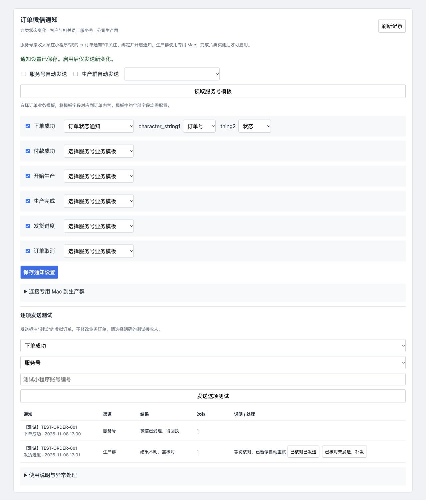

# PR-750 订单微信通知验证记录

## 2026-11-11 四类模板接入跟进

- 生产实测续：账号 285 的扫码已到达生产，但微信已绑定账号 90，系统阻止重复绑定；只读核对确认是同一微信，未变更原绑定。向账号 90 发送了虚拟的货款到账、对账单生成、订单已接单、订单发货（已发货）四条测试，发送列表均显示“已送达 / success”，每条尝试 1 次。尚待 Van 在手机核对实际接收、内容和跳转；这些无测试单据编号的消息只跳通知设置页，不构成具体业务单据详情验收，也不能证明账号 285 已绑定。两条自动发送总开关保持关闭；电脑微信聊天控件仍不可读，群实测未完成。
- Van 确认服务号服务器回调指向生产环境，并要求改用生产小程序实测。生产通知设置已保存四个模板字段与“已接单”“已发货”审核状态，两条自动发送总开关和四类业务事件开关均关闭；生产原有微信绑定未改动。Van 指定测试小程序账号 285，到账虚拟测试入口返回“测试账号尚未绑定、关注并开启通知”，未产生发送记录；需由该账号完成绑定和偏好设置后再测。生产本地测试包显示通知入口，不代表线上发布版本已核验。
- 安全验收缺口：测试内容固定为虚拟单据，详情编号仅控制链接目标，二者可能不一致；不能将消息与详情不一致的测试标记通过或启用渠道。多次发货的测试详情缺少发货记录标识，员工财务测试的详情路径亦需核验。
- 最新现场跟进：Van 确认“已接单”“已发货”状态值审核通过，开发环境已分别保存这两个已审核值；“部分发货”仍待审核及单独实测，不能按“已发货”发送。此前截图中审核中的记录保留为历史证据。
- 开发小程序账号 168 尚待完成服务号绑定；“口加生产”群聊天控件仍不可读，真实服务号和群消息的发送、实际接收、回读及详情跳转验收尚未完成，不以关注成功或模拟测试代替。
- 按 Van 要求，提交下单、生产开始、生产完成、取消四类服务号模板暂缓处理，列为 TODO；这些通知尚未交付。服务号与群通知分别满足原定实际验收条件后才能启用。
- DEV-PR750-05～07：逐笔收款与正式出账、接单及逐次发货、分渠道配置与逐项真实测试。开发及验收进行中，未视为完成。
- Van 提供了四个模板的字段：订单已接单 55828、货款到账 49283、订单发货提醒 46985、电子对账单已生成 75952。
- 接单模板的“已接单、拒绝、等待中”和发货模板的“已发货、已签收”在截图中均显示审核中；部分发货状态尚未提供。审核状态需在实际启用前重新确认。
- 真实服务号及“口加生产”微信群送达均仍待逐项核验；模拟接口、代码通过或微信受理不能代替实际收到。现有个人微信聊天控件不可读取的限制仍需重新验证，禁止盲发。
- 本轮本机小程序测试 454 项通过，类型检查和开发构建通过；通知引擎、服务号适配与通知 HTTP 的隔离 PostgreSQL 定向测试通过。账单/账户/订单处理较广 PostgreSQL 回归出现报损日期与测试数据日期冲突；在未修改 HEAD 的隔离快照中同一测试组复现该日期错误，广度回归仍不计为通过。
- 本轮曾以只读设备清单检查，电脑微信当时未运行；未发送服务号或微信群消息。真实微信、单据详情跳转及逐项启用证据仍待完成。接单/发货枚举截图显示审核中，部分发货尚未获审核结果。
- 实施初期本轮改动尚未合并和部署；不得将上述旧版开发发布回执当作本轮交付，最新交付见下方。
- 本地完成代码后重跑：后端全量检查通过；Vue 前端 1774/1774 及构建通过；通知专项隔离 PostgreSQL 测试通过，账单分次、结清、撤销与订单处理关键集成测试通过。以上为合并前结果，不代表真实微信送达。
- 合入 `origin/develop@d057faecc` 的候选工作区后：后端全量通过，Vue 1892/1892 及构建通过，小程序 507/507、类型检查及开发构建通过；通知及账单部分收款关键 PostgreSQL 测试通过。手机号登录后的通知详情回跳加入专项测试。上述均为本地结果，真实微信仍未验收。
- 2026-11-11 开发环境已发布 `228c6394dd38ae27481e6fd88c5a291f97980f5a`：服务运行、重启 0、数据库 healthy；登录及认证后通知/PR/DEV API 200，匿名通知 API 401。四个模板及字段分别保存，两个自动发送开关关闭，生产群设备 0，发送记录 0；开发环境当前完成关注与通知授权的绑定数为 0。浏览器核对通知设置与到账测试入口；无真实微信消息。
- 开发小程序包 `/Users/yiiiple-work/KFerp-miniapp-mp-weixin-dev`，清单 108 文件，版本与开发运行版本一致；尚未上传、提审或发布。服务器源备份 `/opt/stacks/erp/orderapp.backup.deploy-20261111103018-228c6394dd38`，回滚镜像 `kferp-orderapp-rollback:development-20261111103018-228c6394dd38`。普通 ERP 的“已出库”无法可靠判定全部发货时记录未发送；有业务调整的账单暂不支持分次收款。
- 后续补充首笔预付款记录及安全重试、管理员核对解除。后端全量、前端 1905 项及构建、首款与通知隔离 PostgreSQL 定向检查通过；开发环境 `228c6394dd38` 暂不含这次补充。尚未覆盖无初始款订单在嵌入/复制页面断网后重复创建；开发工具已打开账号 72，关注二维码已失效，绑定和真实发送尚未完成。
- 首款补丁经 `KFERP_ERP_ONLY=1 ./deploy_orderapp.sh development` 发布运行版本 `116d2b80679c059d321e5a11d4e52ed30f709f51`；应用 running/restarts 0，数据库 healthy，登录 200，匿名通知接口 401；四个模板映射均保留，服务号及群自动发送关闭。沿用小程序包版本 `228c6394dd38`，两次发布之间小程序源码无变化。回滚源 `/opt/stacks/erp/orderapp.backup.deploy-20261111115825-116d2b80679c`，回滚镜像 `kferp-orderapp-rollback:development-20261111115825-116d2b80679c`。开发者工具使用开发账号 72 生成的绑定二维码已失效，未完成服务号绑定或真实发送。

日期：2026-11-08。产品验收人：Van。需求状态：doing，真实微信验收未完成，不标记 done。

## 实现边界

- 六个节点：下单、付款、开始生产、生产完成、发货、取消。事务提交时捕获最终状态，多次更新合并、回滚不发、重复状态不发。
- 服务号按当前关注、通知偏好、客户绑定、员工权限与订单当前归属筛选。支持加密回执、有限重试、未知结果暂停，以及发送前再次校验。
- Vue 通知配置提供模板对应、逐项虚拟测试、设备配对、发送记录及人工核对；小程序提供关注确认、通知偏好及准确订单跳转。
- 专用 Mac 发送端包含钥匙串凭据、精确控件检查、当前群核对、发送成功记录读回；没有针对当前微信的已验证控件配置，默认不可发送。更换程序或控件配置会使六类验证失效。
- 操作日志覆盖配置、授权、虚拟测试、配对、撤销、重试和人工确认。旧外部 IM 规则不会被本功能自动激活。

## RED → GREEN

1. 六节点识别和模板接口新增测试先因缺失实现失败，补齐后通过。
2. 同一事务“已付款 → 未付款 → 已付款”最初产生错误付款事件；保留第一份事务前状态并对比最终状态后通过。
3. 回执早于发送响应最初无法确认送达；持久化回执并在响应落库时核对后通过。
4. 通知中具体订单登录回跳最初返回空路径；新增严格数值路径允许列表后通过。虚拟测试不链接到不存在的真实订单。
5. 当前订单已属于其他客户时，旧通知快照最初仍返回授权 true；增加发送前订单当前客户核验后通过。
6. 前端模板辅助模块先出现模块不存在，补齐后通过；小程序新增页的首页顺序、环境标识、分享和底部手势在全量测试中检出并修正。

## 自动验证

仅使用独立本地 PostgreSQL，数据库端口 55483、随机测试 schema；没有写生产业务数据。外部微信 HTTP 在集成测试中由本地测试服务替代。

- `scripts/verify_kferp.sh backend`：全 Go 测试通过；数据库集成另行显式运行。
- `ORDERAPP_TEST_DATABASE_URL=... go test ./internal/appmain ./internal/infrastructure/postgres/messagecenter -run 'TestOrderNotificationsAPI|TestWechatOfficialPostgres|TestLifecycle|TestOrderOutbox' -count=1 -v`：通过。
- `TestOrderNotificationsAPISixDesktopBindingAndGuards`：六节点服务号经真实 handler、PostgreSQL 队列、模拟 HTTP 发送和加密签名回执逐项通过；六节点群任务经领取、完整内容回报、错误设备/内容/重复回报拦截逐项通过；配对撤销、版本变更失效、未知结果核对、审计、当前客户归属以及取消订单查询通过。
- 仓储测试覆盖事务提交与回滚、同事务恢复状态、取消关注/重新关注不恢复旧授权、租约过期未知、早到回执及重复 Tick 不重发。
- `scripts/verify_kferp.sh frontend`：1761 个测试通过，Vue/Vite 构建通过。
- `cd miniapp && npm test`：74 个测试文件、446 个测试通过；类型检查与开发环境小程序构建通过。未上传、提审或发布微信版本。
- `tools/wechat-notifier/build.sh`：Mac 程序编译通过；9 条守卫断言通过。编译工具残留的重复模块声明通过临时编译文件视图处理，没有修改系统文件。
- `scripts/verify_kferp.sh changed`：通过。
- 浏览器隔离预览验证了读取模板、禁用不适用模板、字段对应、保存提示及受理/未知状态区别。页面中的消息均为虚拟数据，不代表外部已送达。

## 真实微信验收矩阵

| 节点 | 业务规则与接口 | 服务号实际收到 | 原微信群实际收到 |
| --- | --- | --- | --- |
| 下单成功 | 通过 | 待验收 | 待验收 |
| 付款成功 | 通过 | 待验收 | 待验收 |
| 开始生产 | 通过 | 待验收 | 待验收 |
| 生产完成 | 通过 | 待验收 | 待验收 |
| 部分/全部发货 | 通过 | 待验收 | 待验收 |
| 订单取消 | 通过 | 待验收 | 待验收 |

现场证据与阻塞：

- 通过服务器读取服务号 API 配置并成功读取私有模板列表；仅返回“订阅模板消息”，内容为 `{{content.DATA}}`，尚无适用的持续订单业务模板。本功能拒绝把该一次性模板当作订单模板。
- 此前桌面微信只暴露窗口/菜单，未暴露可靠的聊天控件。尝试控制时出现重新登录提示；用户后续确认已登录。没有继续盲输、没有绕过安全提示，也没有发送任何真实测试消息。
- 重新登录后的只读检查发现微信停在“Insufficient storage space”弹窗；尝试点击“Do not remind today”返回 `AXError.notImplemented`，弹窗仍在。没有清理聊天记录或继续发送操作，已请求用户手动关闭提示。本机可用空间约 1.6 GiB。
- Van 后续确认测试群为“口加生产”、服务号为“棵凡咖啡-服务号”，并手动关闭空间提示；这两个名称已确认，无需重复索取。仍需适用业务模板、同环境回调、测试账号关注绑定、六类真实送达、内容与具体订单跳转验收。
- 关闭提示后的微信主窗口截图仍为空白，控件树只显示窗口及菜单。执行已暴露的 Raise 动作后截图仍空白，无法读取目标群名、输入框或发送结果，未盲输或发送。已请 Van 手动打开目标聊天后再核对。
- 尝试观察现有公众平台浏览器标签页时，工具明确返回站点安全策略禁止访问 `mp.weixin.qq.com`，且没有发起用户授权或自动审批流程。遵守禁止绕过的要求，没有改用其他浏览器、网络请求或隐藏接口访问该后台；已请 Van 手动添加业务模板并提供模板 ID 与字段列表，不索取 AppSecret 或密码。
- 当前没有微信控件适配配置；原微信群自动发送不可启用。发送端成功编译与模拟回报不构成真实微信群送达证明。
- 真实订单流程、断网/锁屏/退出/恢复等桌面场景、微信真机跳转仍待验收。

## 交付状态

工作分支：`codex/order-wechat-notifications-20261108`。产品/开发追踪：PR-750，DEV-PR750-01～04。手册：`docs/OP_MANUAL_NOTIFICATIONS.md`，前端使用现有通知配置手册入口及页面帮助。

功能提交 `2dee342c1` 已推送，合入已验证的最新 `origin/develop@15eeea3e1` 后，开发运行版本为 `184ae0944e34bf8d33e8726ba2ece0cbbcb4e7f1`。原 develop 工作目录存在其他未提交工作，使用独立干净集成目录 `/private/tmp/kferp-notifications-develop-20261108` 完成快进、推送及 `./deploy_orderapp.sh development`，没有改动原目录。

2026-11-08 开发发布回执：

- 服务器前端 1761 测试、构建，小程序 446 测试、类型检查与构建，以及两轮后端测试/镜像构建均通过。
- 源码备份：`/opt/stacks/erp/orderapp.backup.deploy-20261108173725-184ae0944e34`。
- 回滚镜像：`kferp-orderapp-rollback:development-20261108173725-184ae0944e34`。仅开发 orderapp 重建/重启。
- `erp_orderapp` running、重启次数 0；`erp_postgres` running/healthy。启动日志未发现通知 worker 错误。
- 登录页 200；认证后的通知页面、配置、手册、PR/DEV 查询 200；未认证管理通知、小程序偏好、设备心跳均 401。两个自动发送开关关闭，设备数 0、发送记录数 0。
- 原检查脚本把 `/app/` 预期写为 401，初次因自动跟随重定向得到 200 而失败。核对当前源码与 `TestVueShellCanLoadBeforeBearerAPIAuth` 后确认入口实际为 303 → `/orders` → Vue 壳；改为禁止自动重定向并分别验证入口 303 与受保护 API 401，未改变认证实现。
- 服务器通知页面文件 `NotificationSettingsView-BUybJKk_.js` 包含本功能；服务端与本机小程序 `RELEASE_INFO` 均为上述运行提交、`development`、`https://dev.qacoohee.com/app`。
- 本机开发小程序包：`/Users/yiiiple-work/KFerp-miniapp-mp-weixin-dev`；清单 100 文件、25 页面，包含 `pages/order-notifications/order-notifications`。原包备份：`/Users/yiiiple-work/KFerp-miniapp-mp-weixin-dev.backup-20261108174902-184ae0944e34`。
- 本机证据：`/private/tmp/kferp-notifications-development-deploy.log`、`/private/tmp/kferp-notifications-runtime-result.json`、`/private/tmp/kferp-notifications-integrated-backend.log`、`/private/tmp/kferp-notifications-integrated-db.log`。PR/DEV 保持 doing，开发发布回执与实际微信验收分别记录。
- 开发 PR 与四条 DEV 的证据说明已在同一事务更新，新增 5 条操作审计；通过需求查询与 `/api/audit` 读回确认，状态仍为 doing。未修改订单、库存、款项或通知配置。

## 正式发布回执（2026-11-08）

- Van 明确要求将完整 develop 合入 main 并发布，包括尚待现场验收的微信通知。正式运行版本 `d48ad618d27d69cd099c3df4e921ce24fc19a110`；前端 1765 项、微信小程序 446 项、类型检查、构建及服务器后端检查通过。
- 正式服务运行、数据库健康；通知管理 API 匿名 401、认证 200，订单表单、手册与需求查询 200，订单页面和通知 worker 源码散列与发布版本一致。两个自动发送开关关闭、设备 0、生命周期投递 0；原有投递共 145 条。未发送测试消息，真实微信送达仍待现场验收。
- 正式小程序包已构建并同步至 `/Users/yiiiple-work/KFerp-miniapp-mp-weixin`，版本标识与运行版本一致；未上传、提审或发布微信平台。正式备份 `/opt/stacks/erp-production/orderapp.backup.deploy-20261108221728-d48ad618d27d`，回滚镜像 `kferp-orderapp-rollback:production-20261108221728-d48ad618d27d`。
- 发布后回执仅更新跟踪说明，不改变运行功能；PR/DEV 保持待现场验收，不将真实送达标记为完成。
